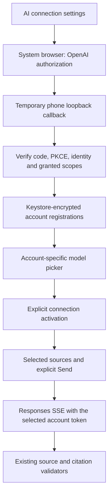

# ChatGPT account connection

UIT Mobile adds **ChatGPT account** alongside Direct OpenAI and Gateway. A new,
unconfigured connection form presents ChatGPT first. Existing saved API/gateway
connections keep their mode. No API key is needed for the ChatGPT option; access
depends on the selected account, workspace and explicitly granted plan permission.

The integration follows OpenAI's open-source Sign in with ChatGPT flow. This is
client-side OAuth, not a reuse of Codex credentials, a ChatGPT website session,
or a shared university account. No Codex runtime, AI gateway or hosted sandbox is
required by this connection mode.

## Student flow

1. Open AI connection settings in UIT Assistant or a course AI tool.
2. Select ChatGPT account and Continue with ChatGPT.
3. Sign in and authorize on OpenAI's page in the system browser. The app never
   receives the password. Return through the callback page's Return to UIT Mobile
   action, or Android Back.
4. Review the connected account, choose an available model and explicitly select
   Use this ChatGPT account. Signing in or choosing a model sends no inference.
5. Select sources and send a question in the existing AI workflow. Using ChatGPT
   plan and Manage ChatGPT usage remain visible at generation controls.

The first authorized connection explains plan use once, with an explicit Got it
action. Settings support additional registrations, switching, reauthorization,
model-list refresh, permission enablement and sign-out. Registrations with the
same email remain distinct. A declined permission does not enable inference.

Usage follows the subscriber's plan/app limits. A quota error does not imply a
known reset time or require silently switching to API billing. Manage usage opens
`https://chatgpt.com/settings/usage`. No ChatGPT conversation history is imported.

## Authorization and storage

Each installation persists a random opaque host ID. Each attempt creates fresh
state, nonce and PKCE material. A short-lived IPv4 loopback listener binds an
ephemeral port on `127.0.0.1`, with the exact `/auth/callback` path. It checks the
request method/host/path, duplicate parameters and state before accepting a code.
Malformed requests do not consume the attempt. Attempts time out after three
minutes; cancellation/disposal closes the listener.

Initial authorization uses dynamic registration; subsequent attempts reuse the
issued client ID. A pending registration ID survives an unsuccessful exchange.
Before replacing an account, the app verifies the ID token with the fixed
official JWKS endpoint, JCA RSA/SHA-256 signature verification, issuer, client
audience, time claims and nonce. Reauthorization also checks the stored subject.
Only RS256 is accepted, matching the public discovery metadata observed during
implementation. Other algorithms fail closed.

Credentials and registration metadata use `StudyPrivateStorage`: app-private
preferences encrypted by Android Keystore AES-GCM. Accounts retain separate client
IDs, subjects, rotating tokens and model catalogs. The active connection stores
an opaque registration reference, model and display label rather than a copy of
its bearer token. No credential enters saveable Compose state, source control,
logs, exported files or a university transport. App backup remains disabled.

A single application repository coordinates course tools and the assistant.
Refresh is serialized and replacements are saved together. Terminal refresh
errors clear unusable credentials; temporary service errors preserve them.
Changing connection or signing out fences old results. Sign-out clears local
tokens, attempts remote refresh-token revocation and reports if that revocation
cannot be confirmed. Registered client metadata and the installation host ID
remain for reauthorization. Uninstall removes this app's local storage.
The optional ID-token login hint is deliberately omitted from browser Intents;
returning sign-in may show OpenAI's account selector. Canceling a sign-in UI does
not discard rotating tokens from an independent refresh. Sign-out immediately
fences new requests, serializes local clearing with refresh, and bounds the remote
revocation attempt to ten seconds.

The return-to-app URI is package-specific, including the separate preview package.
It contains no code or token and only brings the activity forward. The loopback
listener receives the actual OAuth callback. Process death loses an unfinished
attempt; restart sign-in rather than recovering secrets from a browser URL.
Closing or recreating the connection UI cancels an unfinished browser attempt;
start it again if Android recreates that screen. Existing saved registrations
remain separate from that in-memory attempt. At most ten registrations and one
hundred displayed models per registration are retained.

## AI requests and boundaries

ChatGPT requests use the official Responses endpoint with OAuth bearer credentials.
The account's model catalog supplies visible names and model IDs; no particular
model is assumed to be available. `ChatGptPlanProtocol` adapts existing structured
requests to the plan route: required streaming, no provider conversation storage,
an input array with local history and removal of unsupported request fields.
Assistant source tools are grouped in a namespace and retain their read-only
allowlist. No hosted MCP/file-search/code-execution tools are introduced.

Study Q&A, assignment analysis, quiz/flashcard generation, Code Tutor, knowledge
maps and the UIT Assistant share this transport. Existing schemas, source limits,
exact-quote validation, account checks and explicit save/send actions remain.
Only completed responses reach result validators; a broken/refused stream does
not become a successful answer. No alternate billing path is tried automatically.

Embeddings remain available only through Direct API mode. ChatGPT plan access
does not grant the embeddings endpoint. Offline BM25 stays available without an
AI connection; no new document vectors are generated with a ChatGPT token.

Connection diagnostics retain safe status/code/request-ID/body-shape metadata
when provided, without raw error messages, content, identities or credentials.
Copying diagnostics is explicit. Authentication/model/request errors are shown
as account, quota, unsupported-capability or connection recovery states.

## Verification status

Local tests cover protocol adaptation, an actual localhost callback socket with
controlled OAuth HTTP responses, signed fixture ID tokens, consent denial,
registration reuse, token rotation, revocation and source-validated SSE decoding.
These fixtures are not evidence of an actual subscriber login or paid inference.
UI behavior tests cover the production Compose controls. Exported design evidence
contains empty sign-in forms; no synthetic connected account is presented as a
real ChatGPT connection.

Physical Android browser callback, subscriber eligibility, actual model access
and a real plan-backed request require owner acceptance in the preview. No access
or refresh token should be pasted into chat. No university account mutation is
needed for that acceptance. GitHub CI is not dispatched as a development loop.

## Official references

- [Open-source integration overview](https://developers.openai.com/siwc/token-sharing-open-source)
- [Registration, callback and ID-token verification](https://developers.openai.com/siwc/token-sharing-open-source/sign-in)
- [Sessions, refresh, revocation and usage](https://developers.openai.com/siwc/token-sharing-open-source/profiles-and-sessions)
- [Account-specific models and inference](https://developers.openai.com/siwc/token-sharing-open-source/models-and-inference)
- [Preview protocol restrictions](https://developers.openai.com/siwc/token-sharing-open-source/preview-limitations)
- [Errors and recovery](https://developers.openai.com/siwc/token-sharing-open-source/errors-and-recovery)
- [Connection and usage UI](https://developers.openai.com/siwc/ui-ux-guidelines)
