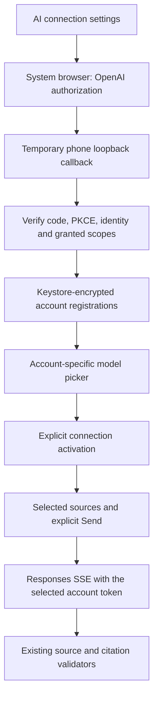

# ChatGPT account connection

UIT Mobile adds **ChatGPT account** alongside Direct OpenAI and Gateway. A new,
unconfigured connection form presents ChatGPT first. Existing saved API/gateway
connections keep their mode. No API key is needed for the ChatGPT option; access
depends on the selected account, workspace and explicitly granted plan permission.

The integration follows OpenAI's open-source Sign in with ChatGPT flow. This is
client-side OAuth, not a reuse of Codex credentials, a ChatGPT website session,
or a shared university account. No Codex runtime, AI gateway or hosted sandbox is
required by this connection mode.

## Student flow

1. Open AI connection settings in UIT Assistant or a course AI tool.
2. Select ChatGPT account and Continue with ChatGPT.
3. Sign in and authorize on OpenAI's page in the system browser. The app never
   receives the password. Return through the callback page's Return to UIT Mobile
   action, or Android Back.
4. Review the connected account, choose an available model and explicitly select
   Use this ChatGPT account. Signing in or choosing a model sends no inference.
5. Select sources and send a question in the existing AI workflow. Using ChatGPT
   plan and Manage ChatGPT usage remain visible at generation controls.

The first authorized connection explains plan use once, with an explicit Got it
action. Settings support additional registrations, switching, reauthorization,
model-list refresh, permission enablement and sign-out. Registrations with the
same email remain distinct. A declined permission does not enable inference.

Usage follows the subscriber's plan/app limits. A quota error does not imply a
known reset time or require silently switching to API billing. Manage usage opens
`https://chatgpt.com/settings/usage`. No ChatGPT conversation history is imported.

## Authorization and storage



Each installation persists a random opaque host ID. Each attempt creates fresh
state, nonce and PKCE material. A short-lived IPv4 loopback listener binds an
ephemeral port on `127.0.0.1`, with the exact `/auth/callback` path. It checks the
request method/host/path, duplicate parameters and state before accepting a code.
Malformed requests do not consume the attempt. Attempts time out after three
minutes; cancellation/disposal closes the listener.

Initial authorization uses dynamic registration; subsequent attempts reuse the
issued client ID. A pending registration ID survives an unsuccessful exchange.
Before replacing an account, the app verifies the ID token with the fixed
official JWKS endpoint, JCA RSA/SHA-256 signature verification, issuer, client
audience, time claims and nonce. Reauthorization also checks the stored subject.
Only RS256 is accepted, matching the public discovery metadata observed during
implementation. Other algorithms fail closed.

Credentials and registration metadata use `StudyPrivateStorage`: app-private
preferences encrypted by Android Keystore AES-GCM. Accounts retain separate client
IDs, subjects, rotating tokens and model catalogs. The active connection stores
an opaque registration reference, model and display label rather than a copy of
its bearer token. No credential enters saveable Compose state, source control,
logs, exported files or a university transport. App backup remains disabled.

A single application repository coordinates course tools and the assistant.
Refresh is serialized and replacements are saved together. Terminal refresh
errors clear unusable credentials; temporary service errors preserve them.
Changing connection or signing out fences old results. Sign-out clears local
tokens, attempts remote refresh-token revocation and reports if that revocation
cannot be confirmed. Registered client metadata and the installation host ID
remain for reauthorization. Uninstall removes this app's local storage.
The optional ID-token login hint is deliberately omitted from browser Intents;
returning sign-in may show OpenAI's account selector. Canceling a sign-in UI does
not discard rotating tokens from an independent refresh. Sign-out immediately
fences new requests, serializes local clearing with refresh, and bounds the remote
revocation attempt to ten seconds.

The return-to-app URI is package-specific, including the separate preview package.
It contains no code or token and only brings the activity forward. The loopback
listener receives the actual OAuth callback. Process death loses an unfinished
attempt; restart sign-in rather than recovering secrets from a browser URL.
Closing or recreating the connection UI cancels an unfinished browser attempt;
start it again if Android recreates that screen. Existing saved registrations
remain separate from that in-memory attempt. At most ten registrations and one
hundred displayed models per registration are retained.

The model catalog has a separate **4 MiB decoded-response limit**. Token and JWKS
documents retain the smaller 256 KiB limit. Catalogs can include lengthy unused
capability descriptions; they must not be rejected merely for exceeding the token
document limit. Only the selected account's visible model IDs and display names
are persisted, capped at one hundred entries. Unknown metadata is discarded.
Malformed entries are skipped when usable visible entries remain. A successful
empty catalog clears cached picker choices; network failures retain the cache.

## AI requests and boundaries

ChatGPT requests use the official Responses endpoint with OAuth bearer credentials.
The account's model catalog supplies visible names and model IDs; no particular
model is assumed to be available. `ChatGptPlanProtocol` adapts existing structured
requests to the plan route: required streaming, no provider conversation storage,
an input array with local history and removal of unsupported request fields.
Assistant source tools are grouped in a namespace and retain their read-only
allowlist. No hosted MCP/file-search/code-execution tools are introduced.

Study Q&A, assignment analysis, quiz/flashcard generation, Code Tutor, knowledge
maps and the UIT Assistant share this transport. Existing schemas, source limits,
exact-quote validation, account checks and explicit save/send actions remain.
Only completed responses reach result validators; a broken/refused stream does
not become a successful answer. No alternate billing path is tried automatically.

Embeddings remain available only through Direct API mode. ChatGPT plan access
does not grant the embeddings endpoint. Offline BM25 stays available without an
AI connection; no new document vectors are generated with a ChatGPT token.

Connection diagnostics retain safe operation/status/code/request-ID/body-shape metadata
when provided, without raw error messages, content, identities or credentials.
Copying diagnostics is explicit. Authentication/model/request errors are shown
as account, quota, unsupported-capability or connection recovery states.
Successful HTTP responses that exceed the bound or contain unreadable JSON report
response errors, rather than network errors. Catalog-schema errors identify the
response shape without exposing the body. DNS, TLS and socket failures use fixed
diagnostic codes; status `0` means no HTTP status was captured. Byte counts measure bytes read,
not the complete remote size when reading was stopped at the limit.

The phone UI distinguishes browser authorization from model loading. A saved plan
grant alone does not enable Send. The pending model step, error and diagnostic-copy
action appear before secondary account controls. Welcome is deferred until models
are available; acknowledging it does not erase an existing diagnostic. Retrying
catalog loading reuses the saved registration and sends no inference.

## Verification status

Local tests cover protocol adaptation, an actual localhost callback socket with
controlled OAuth HTTP responses, signed fixture ID tokens, consent denial,
registration reuse, token rotation, revocation and source-validated SSE decoding.
These fixtures are not evidence of an actual subscriber login or paid inference.
UI behavior tests cover the production Compose controls. Exported design evidence
contains empty sign-in forms; no synthetic connected account is presented as a
real ChatGPT connection.

Physical Android browser callback, subscriber eligibility, actual model access
and a real plan-backed request require owner acceptance in the preview. No access
or refresh token should be pasted into chat. No university account mutation is
needed for that acceptance. GitHub CI is not dispatched as a development loop.

### Owner report and catalog recovery

On 2026-11-06, the owner reported that the first preview retained a signed-in
account and displayed plan permission, but offered no models and kept Send
disabled. The supplied phone images show this failed state. No HTTP trace or
response body from that device was available, so its exact cause is unconfirmed.
Those private account screenshots are not republished in the repository.

An independent regression reproduced a defect in the previous 256 KiB reader:
a controlled 400,000-character capability field prevented an otherwise valid
model catalog from loading. The follow-up separates catalog and token limits,
adds typed response diagnostics and tests retry without another consent flow.
This reproduced defect is a plausible explanation, not proof of the owner's
specific failure. Preview 2 needs an owner retest; if it still fails, its copied
diagnostics can distinguish HTTP access errors, malformed catalogs, size limits
and transport failures without sharing OAuth credentials.

### Browser-probe observation and native regression

On 2026-11-06, the owner completed the separate browser probe's SIWC flow. The
probe verified the signed identity and the two direct-access scopes. Its explicit
read-only request to `https://api.openai.com/v1/models` returned HTTP 200, a
`models` array with 10 entries and a 655,730-byte response. That actual response
exceeds the app's former 262,144-byte limit. This supports the catalog-size
diagnosis, although no response was captured from the failing phone itself.
The device-code attempt expired; it did not establish a device-code grant.

The native integration regression recreates `ConnectedStudyAiRepository` with a
retained login and empty cached models, loads a controlled catalog containing a
700,000-character capability field, explicitly activates a model, observes the
connection update and decodes a source-validated SSE answer. It requires no new
browser consent. A second regression covers credential renewal during catalog
loading: the loading indicator must survive renewal, initialization and welcome
acknowledgment until loading completes.

These are distinct evidence layers. The owner-authorized probe read is a live
service observation; the native tests use controlled endpoints. Neither is a
completed subscriber inference on Android. The [preview acceptance checklist](CHATGPT-PLAN-PREVIEW.md)
remains necessary for the phone's browser callback and actual plan-backed Send.
The [sanitized verification record](research/evidence/chatgpt-native-acceptance.json)
records the checks and APK identity. Probe credentials are not exported, injected into the APK or transferred between
client registrations. The HTML tool is optional development tooling; the Kotlin
app needs neither Node.js, Codex CLI nor a hosted backend. Device code is available
only in that diagnostic tool, not as an Android sign-in option.

### Native transport investigation

The owner subsequently reported `operation=models`, `status=0`,
`code=network_io` and unknown response bytes on the phone. Chrome on the same
phone and network returned "Missing bearer" for the public models endpoint.
This establishes browser reachability, not successful native authentication or
catalog loading. The catalog-size change alone has not resolved phone acceptance.

The older diagnostic caught IO failures outside the whole request/response block.
It therefore lost HTTP status and request ID when a response body was interrupted,
reporting status zero even after HTTP 200. The transport follow-up retains HTTP
status, validated request ID, bytes copied, protocol and response phase. It
classifies nested IO causes and copies only bounded trusted exception type names;
exception messages, URLs, tokens, response content and account identity are not
included. A pre-response failure still has status zero and unknown response size.

Catalog GETs may retry once after 300 ms for a socket interruption, unexpected
EOF, HTTP protocol failure or HTTP/2 stream/connection reset. The application
does not retry DNS/TLS failures, access denials, malformed JSON or cancellation.
This new loop is limited to catalog reads; it does not wrap token exchange,
refresh, revocation or inference. TLS verification and provider endpoints remain
unchanged. No fallback model, invented catalog or alternate billing route is used.

`ChatGptWireTest` uses the same `studyAiHttpClient()` factory as the application,
with localhost test routing rather than MockEngine. A socket server returns a
700,000-character catalog or deliberately truncates its declared body. Tests cover
successful loading, one-read recovery, bounded repeated failure with HTTP metadata
and classification without private exception text. A separate explicit keyless
GET to the public endpoint returned HTTP 401 over HTTP/2 from the Linux JVM.
That is actual host networking, not Android or subscriber inference evidence.
Run the network check deliberately with `UIT_CHATGPT_NETWORK_LIVE=1`; it is skipped
in ordinary checks and never sends an Authorization header or inference request.

Preview 4 includes this transport follow-up. Update in place, keep the retained
registration, retry loading models and copy its expanded diagnostics if it fails.
The cause of the owner's original native IO failure remains unconfirmed until
that device result is available; do not mark this investigation resolved from the
localhost regression or host HTTP 401 alone.

### Inference failures after model loading

The next owner phone report showed the model picker populated with GPT-6.1-Sol,
followed by a failed `hello` turn within a few seconds. The previous generic chat
banner combined provider, transport and citation failures, so those screenshots
do not establish the failing phase or provider code. Model loading is now observed
on the phone; subscriber inference remains unconfirmed.

Preview 5 separates request rejection, transport interruption, timeout, incomplete
stream and answer verification. The chat error exposes a deliberate Copy diagnostics
action. It includes the actual active connection mode/model, operation, captured
HTTP status, request ID, safe error code/parameter, stream phase and protocol.
It excludes credentials, account labels, questions, source text and raw service
messages. Diagnostics are temporary UI/session state, cleared when dismissed or
when a new question is sent; they are not a persistent network log.

Responses errors can arrive after HTTP 200 as `response.failed` or `error` events.
The parser retains their machine-readable code and parameter. It handles an SSE
event name when the JSON lacks a type, distinguishes `response.incomplete` and
refusal, and never accepts `[DONE]` or EOF as a completed response. Stream failures
stop the current turn without an inference retry or an API-key fallback. Citation
verification still runs after a valid completed response; a failed repair remains
a separate validation error, never a saved successful answer.

The chat also shows the connection mode and model actually used for Send. Available
models in the sign-in panel do not activate a connection until Use this ChatGPT
account is selected. This status row uses the active configuration, not the pending
picker choice or a subscriber identity.

Verification includes a controlled native ChatGPT tool loop for `hello`, HTTP-400
parameter retention, quota errors inside HTTP 200 and no automatic inference retry.
Real API-key probes accepted the namespaced request on `gpt-6-luna`; that API
project returned HTTP 403 `model_not_found` for `gpt-6.1-sol`. Project API access is
not evidence about the selected ChatGPT plan's access, and no app model or billing
connection was changed by those experiments.

A separate opt-in Kotlin check completed a real `hello` turn with `gpt-6-luna`:
two provider requests, streaming previews and a validated persisted answer. It
uses the production repository, OkHttp engine, SSE parser and tool loop, with the
production plan-request adapter applied in a **test-only** HTTP-send interceptor.
The credential is the owner's explicitly supplied API key. The cache is controlled
and empty; no university account or network operation is performed. This is actual
provider inference with an API credential, not subscriber admission or Android
device acceptance. See the sanitized evidence for the exact runtime and results.

To run that paid opt-in check after privately loading `OPENAI_API_KEY` into the
process environment (`.env` is not loaded automatically):

```sh
UIT_CHATGPT_RESPONSE_LIVE=1 OPENAI_MODEL=gpt-6-luna \
  ./gradlew :core:data:testDebugUnitTest \
  --tests '*ChatGptAssistantTest.actualGreetingWithPlanRequestShapeAndExplicitApiCredential'
```

Ordinary checks skip this test. It must not be enabled in CI. The phone failure
stays open until its expanded diagnostics or successful subscriber turn is observed.

## Official references

- [Open-source integration overview](https://developers.openai.com/siwc/token-sharing-open-source)
- [Registration, callback and ID-token verification](https://developers.openai.com/siwc/token-sharing-open-source/sign-in)
- [Sessions, refresh, revocation and usage](https://developers.openai.com/siwc/token-sharing-open-source/profiles-and-sessions)
- [Account-specific models and inference](https://developers.openai.com/siwc/token-sharing-open-source/models-and-inference)
- [Preview protocol restrictions](https://developers.openai.com/siwc/token-sharing-open-source/preview-limitations)
- [Errors and recovery](https://developers.openai.com/siwc/token-sharing-open-source/errors-and-recovery)
- [Connection and usage UI](https://developers.openai.com/siwc/ui-ux-guidelines)
