# Course passage search

Enter from workspace search using **Search inside downloaded materials**. Select
one linked Moodle course and open **Files & updates**. A previously prepared scope
is selected when its downloads remain available; a first-time scope starts empty.
Choose up to eight verified downloads from the first 200 cached catalog entries,
check saved files, review the update, then explicitly confirm. Other account/course
content is excluded. Keyword preparation/search needs no AI connection.

Optional **Search by meaning** uses the existing personal Direct OpenAI connection
and a separate embedding model. The review discloses reusable vectors, new unique
text and API usage before the **Update & send new text** action. Typing, changing
modes, selecting files, opening the screen and checking saved files make no paid
call. Semantic/hybrid queries are submitted only when Search is pressed.

See [storage and cleanup](COURSE-SEARCH-STORAGE.md) for private file locations,
file-explorer access, measured disk usage and what uninstall removes.

```mermaid
flowchart TD
    Catalog[Selected account / course / downloaded files] --> Verify[Capture and verify local bytes]
    Verify --> Parts[Notebook cells / source lines / partial PDF text]
    Parts --> Chunks[Bounded overlapping passages and exact locations]
    Chunks --> Lexical[Local BM25 inverted index]
    Chunks --> Consent[Explicit semantic indexing action]
    Consent --> Embed[Fixed Direct embeddings API]
    Embed --> Vectors[Validated normalized vectors]
    Lexical --> Store[Encrypted per-account derived index]
    Vectors --> Store
    Query[Explicit Search] --> Fence[Ownership / catalog / current source guards]
    Fence --> BM25[BM25 ranking]
    Fence --> Dense[Optional query vector / exhaustive cosine]
    BM25 --> Modes[BM25 or dense or RRF hybrid]
    Dense --> Modes
    Modes --> Inspect[Exact source part / cell and lines]
    Inspect --> PDF[Existing native PDF reader when applicable]
```

| Component | Responsibility |
| --- | --- |
| `core:domain/PassageSearch.kt` | Validated budgets/configuration, exact chunk offsets, Unicode/code tokens, BM25, unit vectors and RRF |
| `core:data/PassageDocuments.kt` | Bounded verified local bytes, notebook-source extraction and explicit partial formats; no university client |
| `core:data/PassageSearchRepository.kt` | Scoped catalog, source checks, account lifecycle, atomic rebuild, explicit fallback and inspectable results |
| `core:data/PassageIndexCodec.kt` | Versioned source/configuration identity, bounded decode and Float32 vector persistence |
| `ConnectedStudyAiRepository.embed` | Existing personal credentials, fixed HTTPS embedding request, strict response and ownership/connection fences |
| `feature:courses/PassageSearch*` | Existing phone theme, explicit selection/search, modes, status and source inspection |

The full [research and formulas](research/COURSE-RETRIEVAL.md) explain the choices.
No vector server, ANN engine, model code execution, CLI, MCP process or Room
migration is required for this bounded implementation.

## Ownership, invalidation and failures

The index is derived data stored with the existing Keystore AES-GCM wrapper in a
separate `course_passages` namespace. One active course index is stored per account.
A registry allows removed accounts to be pruned across process restarts. The raw
provider key remains only in the existing encrypted connection store. Owner IDs,
download URLs and notebook outputs are not added to embedding inputs. Selected
source text itself can contain links or personal text; source selection is the
transfer boundary, not a claim that all course material is public.

Rebuilds retain the previous usable index until a verified replacement is saved.
A source/owner change, deletion or cancellation fences late work. Missing or changed
source bytes are removed before search results are returned, and inspected text
must exactly match its retained offset and version. Removed accounts cannot search
or inspect their former index. Clear removes only that owner's derived passage
copies/vectors; original downloads remain. Unreadable storage fails closed and
requires an explicit reset of all local search indexes, with a separate
confirmation, rather than silently overwriting unknown data. Source files and
the independently stored AI connection remain untouched.

A semantic service failure does not erase a successfully built local lexical index.
The UI labels local fallback and never replaces a real provider failure with fake
vectors or generated prose. A partly completed embedding matrix is not persisted.
There is no automatic paid retry. A cancellation cannot save a late replacement.

The catalog is cached authorized state, not a live permission check against every
university service. The feature performs no university request or mutation. It
reuses verified downloads; a missing source must be downloaded through the existing
course/offline workflow deliberately. Source validity checks include disk reads and
hashing, so latency depends on selected file sizes and device storage.

## Coverage and current limits

- One active course per account; up to eight selected files, 400 passages, 120,000
  extracted characters per file and 8 MiB verified source bytes per file.
- Notebook v4 source, ordinary UTF-8/code text, derived HTML and best-effort PDF
  extraction. No notebook execution/outputs, OCR or inferred physical PDF pages.
- Source previews preserve literal Markdown/LaTeX/code; they do not typeset math.
- Source cells and line numbers are exact within the extracted part. HTML/PDF line
  labels describe extracted text; they do not claim original layout/page positions.
- BM25 is lexical. Accent folding can collide distinct terms and does not implement
  Vietnamese word segmentation or translation. Identifiers remain inspectable.
- Dense ranking always has nearest neighbors; they are excerpts, not certified
  relevant answers. RRF can worsen ranking when a component retrieval is weak.
- Direct embeddings only. Gateway mode falls back to BM25. Chat model settings do
  not select an embedding model.
- The first evaluation is one unique actual NT409 notebook with 16 implementer-
  labelled queries. It is not an independent multi-course benchmark or physical-
  phone performance/Keystore/networking test.

See the [evaluation](research/COURSE-RETRIEVAL-EVALUATION.md) and
[phone design gallery](design/COURSE-RETRIEVAL.md).

This is a staged increment of [#52](https://github.com/trungdangtapcode/UIT-Mobile-kt/issues/52).
The [original scope matrix](research/SEMANTIC-COURSE-SEARCH.md#november-5-implementation-increment)
keeps page-aware PDF navigation, a packaged local embedder and independent
multi-course/physical-device gates open. Host evidence and this optional cloud
adapter do not close those remaining requirements.

## Saved-file checks and incremental updates

The Files & updates view now separates local file verification, offline readiness
and optional AI readiness. Check saved files computes a transfer review without an
API call. Updates reuse exact-text vectors from the same account/course and matching
model/dimensions, then send only missing unique text after confirmation. A persisted
receipt exposes reuse, newly embedded rows and request count. Checks describe saved
bytes on this device, not the latest Moodle server version.

See the [student preview guide](COURSE-SEARCH-PREVIEW.md),
[interaction design](design/COURSE-SEARCH-UPDATES.md) and
[algorithm](research/COURSE-SEARCH-UPDATES.md) for recovery, migration and limits.
