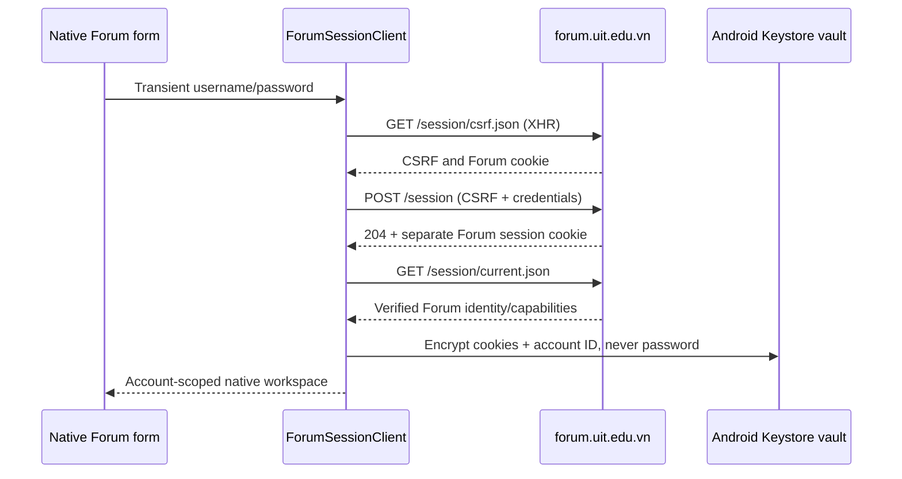

# Native Forum accounts and participation

The Forum account button opens a native phone sign-in form. The existing guest
reader remains available without university login. This increment implements
Forum sessions, personal lists, basic participation and channel/thread chat;
[the full parity matrix](research/UIT-FORUM-PARITY.md) remains open and PR #79
remains draft, stacked on #78.

## Same credentials, separate session

UIT observation on 2026-11-03: public settings report
`enable_discourse_connect=false`, `enable_local_logins=true`, with no advertised
external auth providers. The owner's authorized account successfully used the
same university username/password through this sequence:

1. `GET /session/csrf.json` with `X-Requested-With: XMLHttpRequest`.
2. `POST /session` with form `login`, `password` and the CSRF header.
3. UIT returns **204**, then `GET /session/current.json` confirms the identity.

The production client accepts both UIT's 204 and upstream's JSON success response.
It also supports the upstream TOTP challenge contract; TOTP has not been exercised
on the real account. Passwords stay in transient memory and are cleared from the
form on submission. They never enter saved state, the ViewModel or persistent
storage.

UIT sets Secure `_t` and `_forum_session` cookies scoped to `forum.uit.edu.vn`.
They are different credentials from Portal/Moodle cookies. Sharing a university
password does not make those services' sessions interchangeable. Standard
[DiscourseConnect](https://meta.discourse.org/t/setup-discourseconnect-official-single-sign-on-for-discourse-sso/13045)
requires server configuration; the app cannot enable it from the client.
No parent-domain cookie sharing or browser-cookie extraction is implemented.



## Storage, expiry and disconnect

`ConnectedForumRepository` wraps the existing anonymous repository and owns a
separate `forum_session` / `uit.forum.session.v1` Android Keystore AES-GCM vault.
Forum cookies, account ID and one pending composer draft per Forum account persist.
The draft includes Markdown, title, category, reply target, edit reason, original
edit source and an uncertain-submission marker. Other authenticated content,
temporary saves, reading anchors, notices, bookmarks and chat stay in memory. They
never enter the guest offline cache. **Saved temporarily** and **Forum bookmarks**
are deliberately distinct controls.

Restoring a session verifies the stored account ID against the server. Each
member operation checks the current identity before accessing private content.
An expired or changed identity clears private memory and asks for login. It does
not silently retry as a guest. Operation generations discard responses from an
old account, including late image/history/member responses and cookies arriving
after disconnect.

**Disconnect here** removes this app's cookies, encrypted credential record and
member UI. An encrypted local draft is retained for recovery only after that same
account is verified again; **Discard** removes the current draft with confirmation.
Drafts are not uploaded or synced to other devices. Disconnect does not revoke remote sessions or log other devices out. Server
session revocation is still an open parity item. Android backup is disabled by
the app manifest. Installed-device Keystore/recreation testing remains required.

## Available flows

| Flow | Native behavior | Contract and limits |
| --- | --- | --- |
| Personal feeds | New, unread, unseen, read, posted and bookmarks when advertised to the account | Guest parser rejects member-only filters; inaccessible responses are errors |
| Category permissions | Retain authorized restricted categories; only full-permission categories appear in new-topic selection | Server remains authoritative at submission |
| Reading position | Offer the server's last-read post as a resume target | Reading does not submit timing/read updates; no cross-device write sync yet |
| Notifications | Paged list, read state, date, topic targets and badge titles | Opening the list does not mark read; unsupported notification kinds have an explicit fallback label |
| Forum bookmarks | Read server list/reminder time, native topic/chat/thread bookmark targets, add post bookmark, explicitly confirm removal | Unknown bookmark types remain visible with a safe web link when supplied; no reminder editor yet; temporary device saves are separate |
| New topic/reply | Native raw Markdown editor, title/category and explicit Publish | One encrypted local draft per account; recover/keep/confirmed discard; no server autosave or multiple concurrent drafts |
| Edit | Fetch permitted raw source, edit reason, submit `original_text` with changed raw | A stale edit returns conflict instead of overwriting a newer revision |
| Likes/reactions | Counts, current selection, server-advertised choices and action permissions | Explicit action only; no fabricated emoji/capability list |
| Polls | Semantic choices, own votes, nullable results, open/closed state, regular/multiple voting | Source-position semantic blocks; upstream optional min/max defaults; explicit vote removal; number/ranked-choice and advanced results/voter lists remain unsupported |
| Chat | Existing public channels and DMs, latest messages, bounded bidirectional history, bookmark anchors, semantic rich bodies, explicit send | 500-message directional window with independent older/newer continuation; initial/send scroll to latest; stable paging keys; manual refresh only |
| Chat threads | Open an existing message's thread, isolate history, send explicitly into that thread, return to channel | No new thread/DM creation, thread directory, realtime events, edits/deletes or typing/read receipts yet |

Notification badge fields were checked against actual UIT data after visual
inspection revealed blank rows when the parser assumed every notice had a topic
title. Unknown kinds remain visible instead of becoming fabricated topic links.
No unrelated personal messages or private chat conversations were opened during
UIT verification.

## Submission and failure rules

All write operations are typed `ForumCommand` values. The session client serializes
writes, refreshes CSRF, uses fixed-origin requests with redirects disabled, and
never automatically retries them. The server enforces final permissions and limits.
403, 409, 422, 429, expired sessions and ambiguous network/server failures have
separate UI states. Rate-limit controls wait for the returned retry interval.

A timeout/5xx/malformed successful create response may mean the server committed
the operation. The UI labels this as an unknown outcome and blocks another submit
across editor dismissal and restart. For a post draft, the user must inspect the
server and explicitly confirm that the previous attempt was not published before
retrying, or discard the draft if it was published. Merely refreshing another list
does not unlock that draft. The pending marker is stored before the network write;
a failed local save prevents the write. A confirmed write clears the draft; if
local cleanup fails, recovery remains marked uncertain to prevent a duplicate. There is no
offline write queue. Chat `staged_id` is a correlation ID, **not** a verified
idempotency guarantee. A confirmed write is not reported as failed merely because
persisting a rotated cookie failed afterward.

The client sends no `Discourse-Present`, `track_visit`, timing, notification-read,
chat-read or draft-autosave writes during browsing. XHR read-state behavior was
sampled in the pinned isolated server; this does not prove that all GETs are
side-effect-free on UIT. Necessary login changes session/last-login metadata.

## Verification and evidence

- Production Kotlin session/API acceptance runs against the isolated rootless
  Discourse server, with generated local users. It covers cookie restore,
  create/edit/conflict/reply, bookmarks, likes/reactions, polls and channel/thread
  chat. See [the lab guide](FORUM-LAB.md) and
  [aggregate evidence](research/evidence/uit-forum-native-member-lab.json).
- Mock transport/repository tests cover cookie boundaries, stale sessions,
  redirects, no write replay, account/cache isolation, malformed restore, hidden
  poll results and thread filtering. Compose fixture tests cover explicit login,
  publish, bookmark removal, chat send and disconnect at phone widths; they export
  no screenshots.
- The opt-in live Compose test uses production Kotlin networking against UIT with
  an additional guard: only GET and login `POST /session` are permitted. It verifies
  identity, account feed, permitted composer categories, notifications/bookmarks
  and local disconnect. It does not publish, vote, react, mark read or send chat.
- [Live account aggregate evidence](research/evidence/uit-forum-native-account-readonly.json)
  and [public empty-form provenance](design/previews/forum-account-provenance.json)
  record the inspected run without credentials or account identifiers.
- Live runtime is Robolectric on the SSH host with memory storage, not an installed
  APK, emulator or Android Keystore test. The device's TLS/WebView behavior is not
  established by this result.

Run the live check only for an account whose owner has authorized login and reads:

```sh
# Supply these in the invoking process; never put the password into command text.
# FORUM_TEST_USERNAME and CPASSWORD must already be exported.
./gradlew :app:testDebugUnitTest --tests '*ForumAccountLiveTest' \
  -PforumAccountLive=true
```

Captures stay under ignored `app/build/outputs/forum-account-private/` with private
permissions. Inspect them before selecting any publication evidence. Only the
empty native login and empty composer screens are selected for the public gallery;
account identifiers, notices, private bodies and credentials stay out of the PR.
These empty forms were captured during the actual production flow, not populated
with authored Forum content.

Full parity still needs uploads/preview/server drafts, broader account preferences and
tracking, remote logout, advanced polls, topic voting/solved, private-message
creation, chat management/realtime, further media fidelity and installed Android
acceptance. Implementing this increment does not close those rows.
