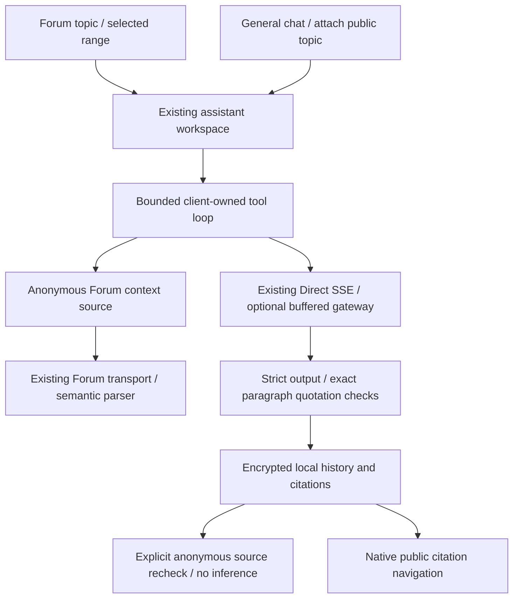

# Public Forum context and AI digest

Issue [#51](https://github.com/trungdangtapcode/UIT-Mobile-kt/issues/51).
Research date: 2026-11-05 (Asia/Tokyo). This increment extends the existing UIT
Assistant rather than creating a second chat history, connection or AI runtime.

## Student flow

Open a Forum topic, choose **Summarize / ask AI**, review the starting post and
maximum number of posts, then open the workspace. Anonymous availability is checked
before creating this workspace; no model request is made. In the assistant, the
summary preset fills the composer. Send remains an explicit separate action.
Follow-up questions use the same immutable selected scope and fresh evidence.

The general workspace dialog can also attach a public Forum URL, independently or
alongside selected announcement sources. Existing notice-only workspaces remain
readable. Personal academic records, course files, private topics and messages are
outside this connector.

Each answer retains exact post IDs, authors, creation/update times, source revision,
reply targets, paragraph copies and quoted references. Staff and accepted-answer
badges require positive server metadata; a username, vote count or later date is
not authority. A matching quote establishes occurrence, not semantic entailment.

Coverage is shown before answer prose. It identifies the selected and loaded post
counts, actual first/last post numbers, the topic's listed stream size, missing
bodies and text/media omissions. A window is not presented as the whole topic.
Rechecking sources performs anonymous reads without inference and reports current,
changed or unavailable. Changed sources invite an explicitly sent replacement
answer; historical evidence is never overwritten or silently regenerated. A
confirmed per-answer deletion removes that local question, answer, evidence and
checklist while retaining other conversation turns. It has no university action.

## Source selection algorithm

1. Validate a positive fixed-origin topic ID, starting post number (1–1,000,000)
   and explicit post limit (1–40; default 20). Limits are execution budgets, not
   assumptions about the university's topic counts.
2. Fetch the anonymous regular topic near the requested post number. Reject private
   messages, hidden/deleted topics, missing access and unsupported responses. There
   is no member-session fallback.
3. Locate the first returned visible post at or after the requested number in the
   server's ordered post-ID stream. Select at most the requested number of IDs
   from that position. Fetch missing bodies in the existing 20-ID batches.
4. Validate topic/ID ownership through the production Forum parser, retain source
   order and report unavailable selected IDs. Numeric post-number gaps do not
   imply that intervening posts exist or are unread.
5. Extract text from the existing semantic Forum blocks. Preserve quotations as
   quoted content, code whitespace and table row/column boundaries. Concealed
   spoilers, images, unsupported blocks and polls are omitted with an explicit
   flag. No linked document, image, script or external embed is fetched by AI.
6. Reserve text for later replies. With remaining text budget `R` and `N` remaining
   posts, a post receives at most `min(4800, floor(R/N))` characters. Paragraphs
   retain the existing 1,800-character cap and at most 64 entries per post. This
   prevents a long first post from consuming the entire selected window.
7. Bound serialized Forum evidence to 70,000 UTF-8 bytes and extracted source text
   to 32,000 characters. The shared facade applies the same text budget across
   announcement and Forum evidence. Clipping is reported. The complete tool-loop
   input remains bounded to 110,000 UTF-8 bytes.

The runtime exposes one additional fixed tool, `read_forum_topic({})`. It reads
only the user-selected scope and accepts no model-supplied URL, topic ID, post
range or account. Existing announcement tools remain unchanged. The client owns
all university reads; the optional gateway executes no UIT tool.

## Freshness, storage and privacy

Per-post source versions hash extractor identity, topic title, author/date/revision
metadata (including unknown versus negative authority status) and raw cooked
source content. The coverage fingerprint includes the
complete ordered public ID stream and selected source versions. Likes and reaction
counts are excluded, so unrelated popularity changes do not invalidate evidence. New replies, removed IDs
and selected post edits invalidate the old fingerprint. Changes outside the
selected text that do not affect the public stream are not monitored.

Persistence format 2 adds optional Forum scope, coverage and post metadata; format
1 notice workspaces still decode. Decode validates scope ownership, canonical post
URLs, source IDs, selected/loaded ID membership, limits and quote integrity. Public
Forum content remains in the existing encrypted device-local public workspace
namespace, shared across sign-ins as disclosed. Credentials, raw provider reasoning
and transcripts are not stored by the production workspace.

Source inspection uses retained exact paragraphs offline. Opening the original
uses an explicit public citation mode in the native Forum reader, including public
image transport, with member controls and local bookmark/position writes excluded.
It cannot inherit a member cookie transport. The ordinary signed-in Forum workflow
remains available separately.

The connector has no SSO credential, posting, editing, reaction, poll-vote, chat,
watch, timing or mark-read API. Necessary anonymous GETs can still affect server
access logs or anonymous view counters; read-only is not zero server-side effect.
The configured AI receives only the selected public text and recent chat when the
student sends. Normal CI has no real university account or model key.

## Observed current UIT contract

Anonymous research observed the HTML generator **Discourse 2026.10.0-latest** at
upstream commit `b81bee142d364526b432788251986871952b5ddb`.

- [Topic 163707](https://forum.uit.edu.vn/t/163707) listed actual posts #1, #16,
  #17 and #19. The evaluated scope deliberately selects only #1 and #16, two public
  staff announcements without student/team support details. Later bodies are not
  supplied to the model or published as review evidence.
- [Topic 139895](https://forum.uit.edu.vn/t/139895) returned only 20 bodies against
  thousands of public stream IDs. This establishes why the visible reader window
  cannot be treated as a complete summary. Its support content was not used for
  AI review captures.
- These are dated observations, not hardcoded topic contents/counts in production.
- Upstream reference: [Discourse API](https://docs.discourse.org/) and
  [topic controller at the observed version](https://github.com/discourse/discourse/blob/b81bee142d364526b432788251986871952b5ddb/app/controllers/topics_controller.rb).
- Provider contract: [Responses function calling](https://developers.openai.com/api/docs/guides/function-calling).

## Verification record

See the [evaluation record](research/FORUM-AI-EVALUATION.md) and
[phone gallery](design/FORUM-AI.md). Deterministic
fixtures are behavior tests only. Published Forum images must render actual UIT
responses, and model-answer images must replay actual successful provider output.
Host Compose renders do not establish physical-phone execution. Broader Discourse
parity remains tracked in #39; this feature does not close that scope.
