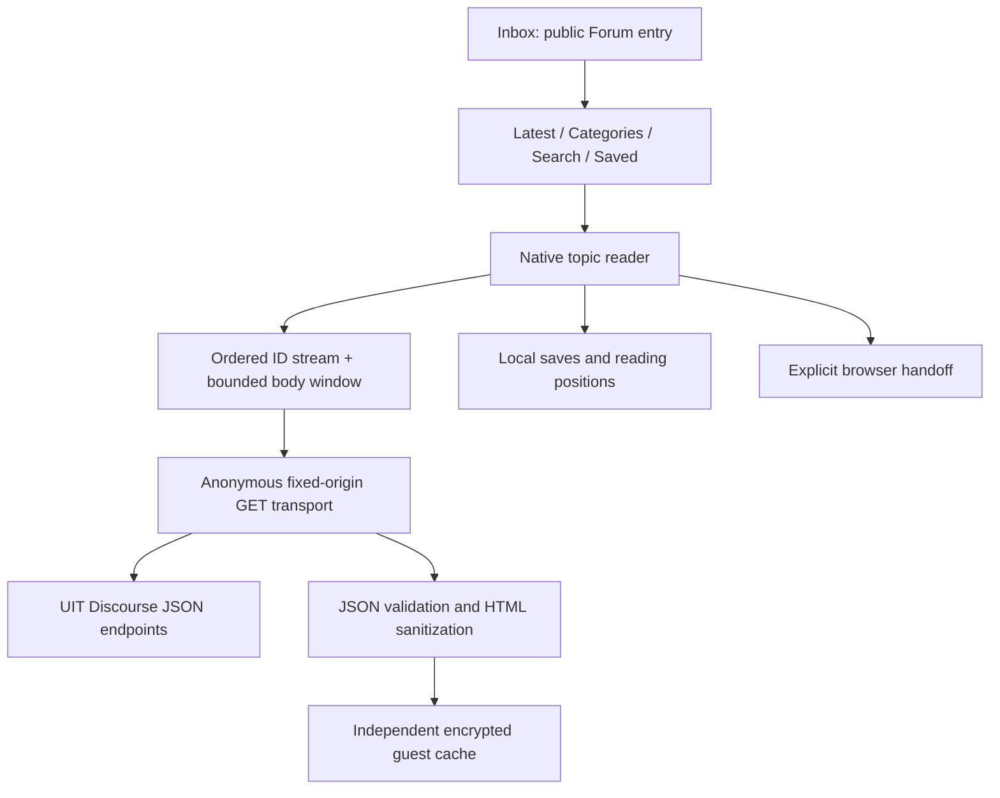

# UIT Forum reader

Open **Inbox → UIT Forum**. University sign-in is not required. Forum is a
dedicated native phone workspace inside the existing five-destination shell;
Moodle course discussions remain separate.

Latest and category feeds support explicit pagination. Search is submitted by
button, accepts Discourse search syntax, and opens the matched post. Topic
navigation supports numbered jumps, a local resume anchor and previous/next
reply windows. **Saved** stores references on this device. It does not change
Discourse bookmarks, notifications, likes or subscriptions.

## Reading algorithm

A topic response supplies an ordered stream of post IDs, `S`, plus a partial set
of bodies. Stream positions and post numbers are different: deleted or hidden
posts can leave gaps in post numbering. Every returned body must belong to the
requested topic and requested ID set.

For a current stream interval `[a, b)`, forward loading requests
`S[b : min(b + 20, |S|)]`; backward loading requests
`S[max(0, a - 20) : a]`. The reader deduplicates by post ID, orders by `S`, then
keeps at most 80 bodies, evicting from the opposite end. Missing bodies still
advance the requested interval and are reported as unavailable entries. They
are not retried indefinitely or renumbered into fake consecutive replies.

A numbered jump uses Discourse's bounded topic response around that post number.
It does not fetch all intervening bodies. A local reading anchor stores topic ID,
post ID, actual post number and a bounded density-independent scroll offset.
Writes are debounced by 500 ms and flushed when leaving the reader. The position
is best-effort during abrupt process termination. Search and topic requests use
operation generations so canceled or late responses cannot replace a newer view. A completed jump is remembered for the current reader session so Activity
state restoration preserves the visible reply instead of repeating the initial
jump. A fresh ViewModel session still applies a new requested jump.



## Local data and failure behavior

The Forum guest namespace uses Android Keystore AES-GCM independently of UIT
sessions and AI configuration. Response snapshots use a shared fetch-recency budget of
1,000,000 serialized JSON characters, at most 32 snapshots. Saved references have
a 100-topic limit and reading anchors have a 120-topic limit. Repeated saves are
idempotent. Failed writes are surfaced rather than shown as successfully saved.

Saving does not download a whole topic. Offline availability depends on retained
snapshots. Offline resume can reassemble retained bodies across topic and batch
responses, even when no exact numbered-jump response was previously cached. It
uses an actual cached stream and reports nearby content when the target body is
missing. Cached views expose retrieval time and incomplete window coverage.
Transient network failures may use cache; explicit access-denied or removed
responses invalidate related topic snapshots. Rate limits show a delay and do
not trigger automatic retries. Clear **Saved → Clear Forum data** to remove local
references, anchors and response snapshots. Clearing also invalidates in-flight
cache writes; it does not contact UIT.

## Content handling

HTML becomes native text, headings, quotes, code, lists, tables, collapsible
details and links. The app never executes forum JavaScript, CSS or forms. Code
keeps whitespace and scrolls horizontally; tables scroll horizontally. Unsupported
interactive content has an explicit source action. Native images require a user
tap, a same-origin upload URL, an allowed image content type, at most 3 MiB, at
most 4096 pixels on either axis and at most 8 million decoded pixels. Large images
are sampled before rendering. External images and other HTTPS links require a
browser handoff. Avatars and remote trackers are not loaded automatically.

Responses are limited to 4 MiB, streams to 20,000 IDs, cooked HTML to 64,000
characters per post and rendered blocks to 200. These are resource limits, not
assumptions about the size of a university topic. Public category metadata can be
incomplete; only IDs found in public content and their parents are resolved,
with at most eight extra metadata requests per load.

## Verification

[Research and endpoint observations](research/UIT-FORUM-READER.md) explain the
upstream contract, category metadata gaps and tracking caveat.
[Aggregate live evidence](research/evidence/uit-forum-public.json) contains counts
and route identifiers only. Raw live bodies and student identities are excluded.
[Design notes](design/UIT-FORUM.md) and the [phone gallery](design/README.md) document
the actual Compose UI. Screenshots use authored synthetic content.

```sh
./gradlew :core:network:forum:test :feature:forum:testDebugUnitTest \
  :core:data:testDebugUnitTest
./gradlew :app:testDebugUnitTest --tests '*ForumDesignTest' -PrecordUi=true
# Explicit manual network verification; not run by normal check/CI:
./gradlew :core:network:forum:researchPublicForum
```

The Android instrumentation test exercises the production Compose reader,
repository, parser and real Keystore with an authored transport fixture. It
checks local save, restore, offline reading and clear without constructing any
university account transport. Its screenshot is a native emulator capture;
host-rendered screenshots are separately labeled in the gallery.
