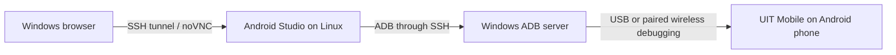

# Remote Android development from Windows and a rootless Linux server

Researched October 27, 2026. The laptop runs Windows without Android Studio;
source and builds stay on the SSH-accessible Linux server. The product remains
a native Android phone app. This research does not add a web or desktop product.

## Findings

Browser access and live code updates are separate capabilities. A browser can
control a real Android process by streaming its display and forwarding input.
That does not, by itself, change the bytecode in the running process. Conversely,
a code-patching tool still needs a connected device and a compatible app runtime.

| Approach | Where the Android app runs | What the browser provides | Code-update behavior | Assessment for this setup |
| --- | --- | --- | --- | --- |
| ADB over SSH or wireless ADB | Physical phone | Nothing by itself; add a viewer if wanted | Build/deploy, logs and debugger transport | Direct, rootless device connectivity; not hot reload |
| Tango/WebADB | Physical phone attached to the laptop | WebUSB ADB control, with suitable browser/device access | Deployment/control; no Compose patching mechanism | Useful browser device access without a local IDE |
| ws-scrcpy | Physical phone or reachable Android device | Display streaming and interactive control over WebSocket | No code patching by itself | A real Android view, not an HTML approximation |
| Android Studio on the server + noVNC + phone ADB | Physical phone | Remote access to the IDE | Official Live Edit for supported changes after the initial Run | Best candidate for retaining the native app and official live UI updates without installing Studio on Windows; setup still needs validation |
| JetStart CLI + Android runtime | Physical phone with additional development runtime/instrumentation | Optional dashboard; its web preview is a separate renderer | Third-party Kotlin-to-DEX patches over WebSocket, plus full-build fallbacks | Experimental integration candidate; not verified with UIT Mobile |
| Android CLI | Physical or remotely connected device | Device hub is a separate window; previews are PNGs | Incremental/delta deployment is documented, not Compose Live Edit | Useful official CLI workflow, not evidence of headless hot reload |
| Appetize | Cloud Android emulator | Interactive app streaming | APK-based deployment | Useful for browser demonstrations; does not establish live source updates |

## Native Live Edit with a browser-accessible IDE

[Android's Live Edit documentation](https://developer.android.com/develop/ui/compose/tooling/iterative-development)
requires Android Studio and Android 11/API 30 or newer on the target. Supported
function-body changes can update the running app after an initial build/deploy;
structural changes require a new Run. The IDE does not have to be installed on the
Windows laptop if it runs on the Linux server instead.

[noVNC](https://novnc.com/info.html) supplies the browser client for a VNC session.
Its [deployment documentation](https://novnc.com/noVNC/docs/EMBEDDING.html) describes
the VNC server and WebSocket proxy required. Combining that with a server-side
Linux Android Studio is an engineering proposal, not a tested installation here.

The phone supplies the Android runtime, so this design does not require a server
emulator or host KVM. Studio and a virtual display/VNC stack would need to be
installed in user-owned locations. Native-library availability and IDE startup
must be checked during setup. No graphical stack has been installed for this
research.

Live Edit is IDE-managed. The official documentation does not establish that
arbitrary files changed by a separate SSH editor will automatically trigger the
same pipeline. That interaction needs an explicit edit-and-observe test. Editing
in the browser-accessible IDE and using its documented Live Edit mode is the
supported starting point.

## Device protocols and browser viewers

[ADB](https://developer.android.com/tools/adb) supports USB device access and paired
wireless debugging on Android 11+. A Windows ADB server can be reached from the
Linux server through SSH remote forwarding. Standalone Platform-Tools are enough
on Windows; Android Studio is not needed for this transport. See the existing
[SSH debugging instructions](DEBUGGING.md) for that connection.

[Tango ADB](https://tangoadb.dev/) implements ADB for browsers and Node.js. Its
WebUSB daemon transport can talk directly to a USB-connected phone. Its browser
TCP/server transports need a native TCP-to-WebSocket bridge; arbitrary TCP sockets
are not available to a normal web page. Browser USB access and server ADB access
must therefore not be assumed to be interchangeable.

[ws-scrcpy](https://github.com/NetrisTV/ws-scrcpy) provides a browser viewer/controller
for a device reached by its ADB backend. This is suitable for seeing the actual
Android UI. Streaming H.264/input over WebSocket or WebRTC does not implement
Compose recompilation or state-preserving code replacement.

## JetStart: promising claim, concrete integration gaps

The [upstream CLI documentation](https://jetstart.site/docs/cli/dev) describes an
HTTP/WebSocket development server, an Android client, Kotlin compilation and DEX
patch delivery. Its [hot-reload guide](https://jetstart.site/docs/guides/hot-reload-explained)
distinguishes that from resource/configuration changes, which fall back to a full
Gradle build and APK installation. These are upstream claims, not results measured
on this project. Published "instant" timing claims are not adopted here.

Selected source files from the public repository's `master` branch were downloaded
for inspection into `/tmp/uit-jetstart-source`; no upstream code was executed:

- [Kotlin compiler](https://github.com/dev-phantom/jetstart/blob/master/packages/core/src/build/kotlin-compiler.ts):
  `getProjectClasspathEntries()` enumerates outputs beneath `app/build`. UIT Mobile
  also requires classes/resources from `core/*` and `feature/*`. The inspected
  implementation scans the older `.gradle/caches/transforms-3` directory; this
  server uses `.gradle/caches/8.11.1/transforms` and has no `transforms-3` directory.
  This is a concrete compatibility concern, not proof that every integration fails.
- [Gradle plugin](https://github.com/dev-phantom/jetstart/blob/master/packages/gradle-plugin/src/main/kotlin/com/jetstart/gradle/JetStartPlugin.kt):
  there are application and library hooks, and debug bytecode instrumentation.
  Integration involves more than opening an ADB tunnel; multi-module behavior
  still needs a working test.
- [Android runtime entry point](https://github.com/dev-phantom/jetstart/blob/master/packages/hot-reload-runtime/src/main/java/com/jetstart/hotreload/ComposeHotReload.kt):
  the app connects a development WebSocket client and observes `reloadVersion`.
  Its example wraps content in `key(reloadVersion)`. That changes composition
  identity, so preservation of remembered UI state must be tested rather than
  inferred from the product description.
- [Browser renderer](https://github.com/dev-phantom/jetstart/blob/master/packages/web/src/services/ComposeRenderer.tsx):
  the web path renders a component tree using React/HTML and its own Material
  styling. It is not an Android emulator. It cannot be treated as proof of UIT's
  native cut-corner shapes, resources, WebView authentication or Keystore behavior.

A credible trial would first use an isolated copy, a connected test phone, and a
small change in a real feature module. Acceptance should include no APK reinstall
for the supported edit, correct visual update, usable navigation/drafts afterward,
and no development runtime in a release artifact. This research did not modify
UIT Mobile's Gradle files or integrate JetStart.

## Other options checked

[Official Android CLI](https://developer.android.com/tools/agents/android-cli) is a
current terminal workflow. [`android run`](https://developer.android.com/tools/agents/android-cli/commands/run)
documents delta installation, while [`android preview`](https://developer.android.com/tools/agents/android-cli/commands/preview)
produces PNG/component-tree artifacts without an IDE or device. Neither cited
command documents Compose hot reload. [`android device`](https://developer.android.com/tools/agents/android-cli/commands/device)
also supports reservations of Google-hosted physical devices, which is a separate
account-backed option rather than access to the user's phone.

[JetBrains Compose Hot Reload](https://github.com/JetBrains/compose-hot-reload)
requires a JVM target. It is not a drop-in hot-reload switch for this Android-only
project. A separate preview target would be an architectural change and would
not, by itself, patch the Android app.

[Appetize](https://appetize.io/) runs mobile builds in a browser-accessible cloud
runtime. Browser streaming alone does not establish source-level hot reload.
No APK was uploaded and no cloud workspace was created.

[Android Studio Cloud](https://developer.android.com/studio/preview/android-studio-cloud)
is an official example of streaming the IDE through a browser. However, the current
[Firebase Studio documentation](https://firebase.google.com/docs/studio) says new
workspace creation and signup are no longer supported. It is not a dependable
new-workspace recommendation for this user.

## Local evidence and conclusion

The current debug manifest declares `android:debuggable="true"`; a debug APK exists.
The server already has a JDK and Android SDK. Its current account cannot read/write
`/dev/kvm`, and Studio, Xvfb, VNC and websockify were not found on PATH. A working
physical-phone connection has not been established in this research.

For an interactive browser view of Android, use a device transport plus a real
viewer such as ws-scrcpy. For supported native UI updates using the official stack,
the strongest candidate is server-side Studio, browser-accessible through noVNC,
with the real phone reached over ADB/SSH. For a strictly CLI-only hot-reload workflow,
JetStart merits an isolated compatibility trial before making any promise for the
existing multi-module app. Viewing, transport, deployment and live patching must
be stated separately.
