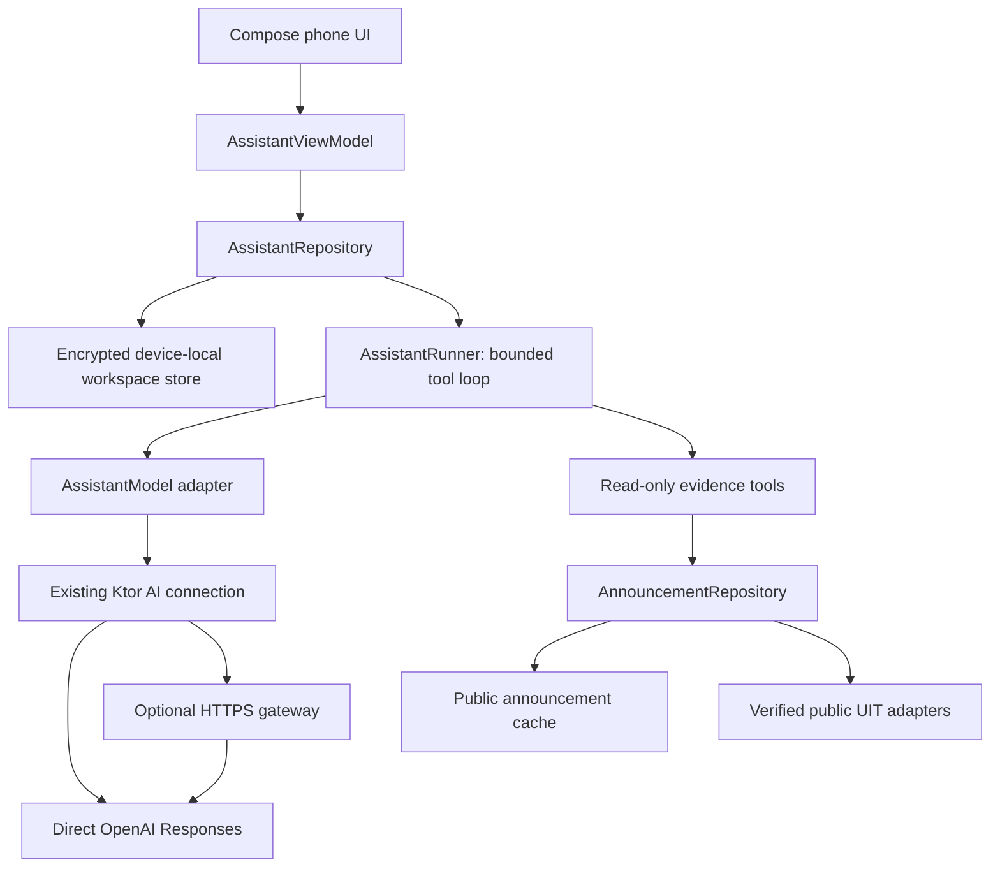

# UIT Assistant: architecture and initial delivery

Date: 2026-11-04. Stacked on #81 (`feat/official-announcements`).
Related work: #46, #47 and #55. The [broader proposal](research/UIT-ASSISTANT.md)
remains a phased design; this delivery implements public-announcement workspaces.

## Delivered scope

Students can create, rename, reopen and delete encrypted device-local workspaces,
choose enabled official announcement sources, or attach a single notice from its
reader. Inside a workspace they can send questions, ask follow-ups, stop a request,
inspect exact source paragraphs and open the native original-announcement screen.
Successful verified responses can become explicitly reviewed, editable local
checklists. Creating a workspace or editing configuration never calls a model.

The first connectors are the existing public announcement adapters: Portal UIT,
CTSV, OEP, Youth, the research office and Information Systems faculty. The assistant
uses sources enabled by the announcement reader and selected for that workspace.
This release does not connect private academic records, course files, Forum posts
or private messages. These remain subsequent phases, not hidden tools in this build.
No code-execution sandbox, Codex process, CLI, MCP server or hosted backend is
required for the delivered runtime. The model itself runs through the configured
API provider. Direct mode uses a personal key entered at runtime; the existing
optional gateway supports the same client-owned tool loop after updating its code.

## Runtime decision: measured Koog compatibility

Koog is a credible Kotlin agent framework and advertises Android targets. Its
current quickstart lists Kotlin 2.2.0+, but the actual 1.3.0 artifacts resolved in
our isolated Android probe contained Kotlin 2.3 metadata. This repo uses Kotlin
2.1.20, AGP 8.9.2, minSdk 26, compileSdk 35 and Java target 17. The probe failed on
incompatible metadata in `agents-core`, `agents-tools`, `prompt-model` and other
transitive artifacts. This establishes incompatibility with the **current repo
configuration**, not that Koog cannot run on Android with a compatible toolchain.

We selected a bounded Kotlin/coroutine runtime over the existing Ktor Responses
transport. It uses the same workspace/tool contracts a later Koog adapter could
consume. We did not bypass metadata validation or upgrade Kotlin, KSP and Compose
as part of a student-facing feature. A coordinated toolchain migration is separate
work and should test all existing features before adopting Koog.

- [Recorded compiler observations](research/evidence/assistant-runtime-spike.json)
- Reproduce with `python3 scripts/research-koog-compatibility.py` after configuring
  JDK 21 and the Android SDK. The probe creates a temporary project and downloads
  public dependencies; it does not change the repository toolchain.
- [Koog overview](https://docs.koog.ai/), [quickstart](https://docs.koog.ai/quickstart/)

## Component boundaries



| Layer | Responsibilities |
| --- | --- |
| `core:domain/Assistant.kt` | Workspace, scope, turn, evidence, references, local checklist and limits; no provider JSON or Android dependency |
| `core:data/AssistantRepository.kt` | Durable lifecycle, interrupted-turn recovery, serialized requests, mutation fences and local deletion |
| `core:data/AssistantRunner.kt` | Multi-turn context, model/tool loop, call/time/context budgets and one evidence-repair opportunity |
| `core:data/AssistantEvidenceTools.kt` | Scope enforcement, local search and text extraction from allowed notices; no generic account or HTTP tool |
| `core:data/AssistantProtocol.kt` | Fixed tool declarations, strict final JSON, Responses continuation and structural validation |
| `ConnectedStudyAiRepository` | Existing encrypted connection and bounded HTTPS transport; connection identity is fenced across the whole run |
| `feature:dashboard/Assistant*` | Phone workspace list, chat, context inspection, source evidence, connection form and checklist review |
| `server/assistant_contract.*` | Optional gateway request validation and identical fixed provider contract; tools execute on the phone |

Feature modules remain independent. No shell executor or general URL fetcher is
registered. The model cannot call methods on the broader academic repository.

## Workspace, storage and lifecycle

A workspace has an ID, editable name, immutable source scope, creation time,
revision and ordered turns. Scope changes require creating a new workspace, so a
past answer cannot silently acquire a different trust boundary. Public workspaces
are device-local across SSO sign-ins, with no university account identifier in the
contract; UI describes this public scope. Future private workspaces need a distinct
account-owned contract, indexes, cleanup and permission checks.

Each turn retains the question, status, verified facts/references, exact source
paragraph snapshots, source versions, source dates, retrieval times, completed tool
names/counts and any explicitly saved checklist. It does not retain API keys,
university cookies, provider reasoning, raw provider transcripts or debug traces.

The dedicated encrypted `assistant_workspaces` store uses existing Keystore AES-GCM
storage. Writes publish new state only after persistence succeeds. Unreadable
storage is protected until a confirmed reset. Deleting a workspace removes its
local source snapshots and checklist without deleting original announcements.

Before networking, a turn is durably saved as RUNNING. Completion stores a verified
answer; failed and cancelled questions remain visible for explicit reuse. On a new
repository/process, any RUNNING record is presented as INTERRUPTED. Generation
never resumes automatically after process death. Leaving the screen or switching
workspace cancels the active request. Deletion/reset and workspace revision checks
prevent late responses from recreating deleted state. A provider configuration
change stops the existing transcript from being sent to the new connection.

## Context and tools

Every send permits relevant public titles and article excerpts from the selected
scope, together with up to three recent completed chat turns. The composer states
this transfer; the context sheet lists allowed sources, cached article count and
source check/failure state. Sending a question does not refresh all feeds silently;
students can explicitly refresh the enabled announcement feeds before sending.

The initial context includes the current Vietnam timestamp and cache coverage.
Historical answers are labelled as conversation context, not current evidence.
Every factual answer must reference evidence read during **this request**.

Only two fixed tools are available:

| Tool | Inputs | Result |
| --- | --- | --- |
| `search_announcements` | A query of at most 200 characters; empty lists recent notices | Up to ten cached metadata matches, opaque source IDs and source coverage/freshness |
| `read_announcement` | An ID discovered by search in this request | Allowed versioned text paragraphs, original URL, publication/retrieval metadata and partial/offline flags |

Search normalizes Vietnamese diacritics, case and punctuation. It counts distinct
query tokens present in the title/excerpt, ranks by descending matches, then by
publication date. Empty queries return recent items. This is local lexical search,
not semantic search or a claim of complete university coverage. Date-range search,
cohort eligibility inference and a full archive crawl are not implemented here.

Reading uses the original announcement repository's safe public client and cache.
The tool does not mark the notice read or change university state. HTML is converted
to ordered visible text; paragraphs and long lines become bounded passages. No
image, PDF attachment, embedded frame or outbound link is fetched for AI context.
Presence of unprocessed media and text truncation is flagged. Missing or disabled
sources return a bounded tool error, allowing an explicit UNKNOWN response.

Evidence identity uses a source-permalink hash. Its version hashes the extractor
version (`assistant-text-v2`), URL, source, title, publication date and article HTML.
Citations include the evidence ID, zero-based paragraph index and short quote.
Stored answers preserve the exact paragraph version. The reader compares available
current cache versions and flags changes; it also warns on answers older than a
day. Opening a source can reveal newer content than the retained snapshot.

## Model protocol and validation

The runtime calls Responses with `store: false`, strict fixed function schemas,
parallel tool calls disabled and a strict final schema. The first step requires a
tool call. Later steps may search/read further or return the final answer. It
replays the complete provider output items, including opaque encrypted reasoning
items, with matching `function_call_output` IDs. No provider-side conversation ID
is used. See [OpenAI's function-calling guide](https://developers.openai.com/api/docs/guides/function-calling).

Unknown tool names, duplicate call IDs, oversized arguments and malformed output
fail closed. Valid tool failures return only a generic bounded error, without
cookies, raw exception details or credentials. Each tool invocation and final
commit rechecks the workspace generation/revision. Permission to read a source is
checked again before fetching and before accepting the final evidence.

The final response separates FACT, SUGGESTION and UNKNOWN. Every FACT requires at
least one reference. References must point to current-request evidence, a valid
paragraph and an exact quote after whitespace normalization. One repair request
is allowed within the same step budget; otherwise the result is not saved as an
answer. Refused/incomplete responses are rejected.

These checks establish reference integrity. They do **not** establish that a
claim follows semantically from the quote, that a student is eligible, or that an
older regulation has been superseded. Human/model quality evaluation remains a
separate release gate. The prompt asks for explicit conflicts, missing evidence
and audience restrictions, but a prompt alone is not a security boundary.

## Resource budgets

These are initial policy constants, not model-dependent magic values. Changing
them requires re-running storage, protocol and phone acceptance tests.

| Budget | Limit |
| --- | --- |
| Workspaces / turns per workspace | 12 / 12 |
| Scope / pinned articles | Selected enabled source set / at most 8 URLs; the article entry attaches one |
| Recent completed history sent | 3 turns, at most 4,000 characters of answer prose each |
| Model steps / tool calls | 6 / 8 per question |
| Evidence / paragraphs per article | 6 articles / 64 paragraphs |
| Passage / all extracted text | 1,800 characters / 32,000 characters |
| Serialized input | 110,000 UTF-8 bytes |
| Request timeout / overall runtime | Existing 60-second transport / 180 seconds |
| Provider output | 5,000 output tokens per call; 256 KiB response bytes |
| Durable workspace JSON | 12 MiB characters, with bounded record fields |
| Checklist | 20 items, at most 1,200 characters each |

A model request can fail on context, time, provider or workspace limits. There is
no hidden unlimited retry. A single question may incur multiple model calls.

## Phone navigation and actions

Enter from Today, the announcement list or **Ask about this article**. Keep the
existing five bottom destinations. A workspace opens into one vertical chat with
a bottom composer and visible context controls. Back returns to the workspace
list; citation inspection opens a scrollable source sheet and the original action
opens the native announcement reader, with a route back to the assistant.

Provider configuration is shared with the existing course AI feature. Credentials
stay only in dialog memory until saved and are never saveable Compose state.
The source context is public-only and explicitly disclosed. Request states expose
searching, reading, preparing, stopping and failure; credential rejection and
quota/busy errors have dedicated messages.

A checklist is initially a draft. Students can edit/remove lines before saving,
then toggle local completion. AI has no save tool and creates no tasks implicitly.
The original announcement reader retains the existing explicit local reminder
flow. No assistant action submits an application, pays tuition or registers courses.

## Validation and remaining gates

The [evaluation record](research/UIT-ASSISTANT-EVALUATION.md) records exact checks,
live-source provenance, Koog probe observations and model-access limitations.
Screenshots distinguish actual public-source context from synthetic behavior tests.
Do not publish a mock answer as a real model result or infer physical-device
execution from Robolectric renders.

Re-run deterministic checks:

```sh
./gradlew :core:data:testDebugUnitTest --tests '*AssistantRepositoryTest' --tests '*AssistantProtocolTest'
./gradlew :app:testDebugUnitTest --tests '*AssistantDesignTest'
python3 -m unittest discover -s server
./gradlew check :app:assembleDebug :app:compileDebugAndroidTestKotlin
```

Opt-in public-source capture and native phone rendering:

```sh
./gradlew :core:data:testDebugUnitTest --tests '*AssistantPublicCaptureTest' -PassistantLive=true
./gradlew :app:testDebugUnitTest --tests '*AssistantLiveDesignTest' -PassistantPreview=true -PrecordUi=true
```

Opt-in actual model evaluation (uses the process's key; never pass a key on the
command line). Preserve the owner's selected `gpt-6-luna` model unless changed by
explicit configuration:

```sh
./gradlew :core:data:testDebugUnitTest --tests '*AssistantLiveTest' -PassistantLive=true
```

Run the commands with JDK 21 and the Android SDK configured. Public captures and
model evaluation stay in ignored build output until reviewed for publication.
