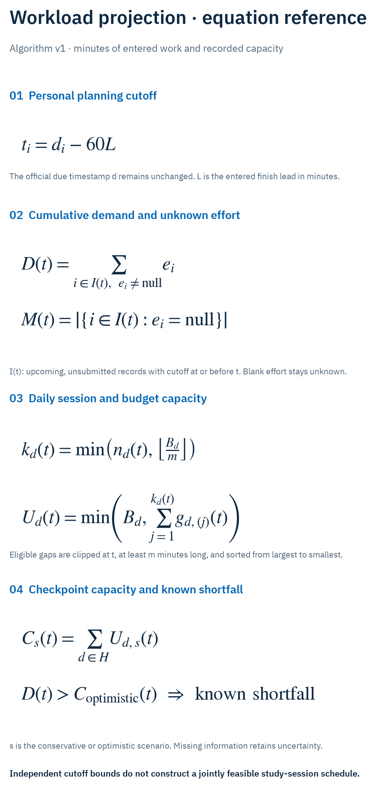
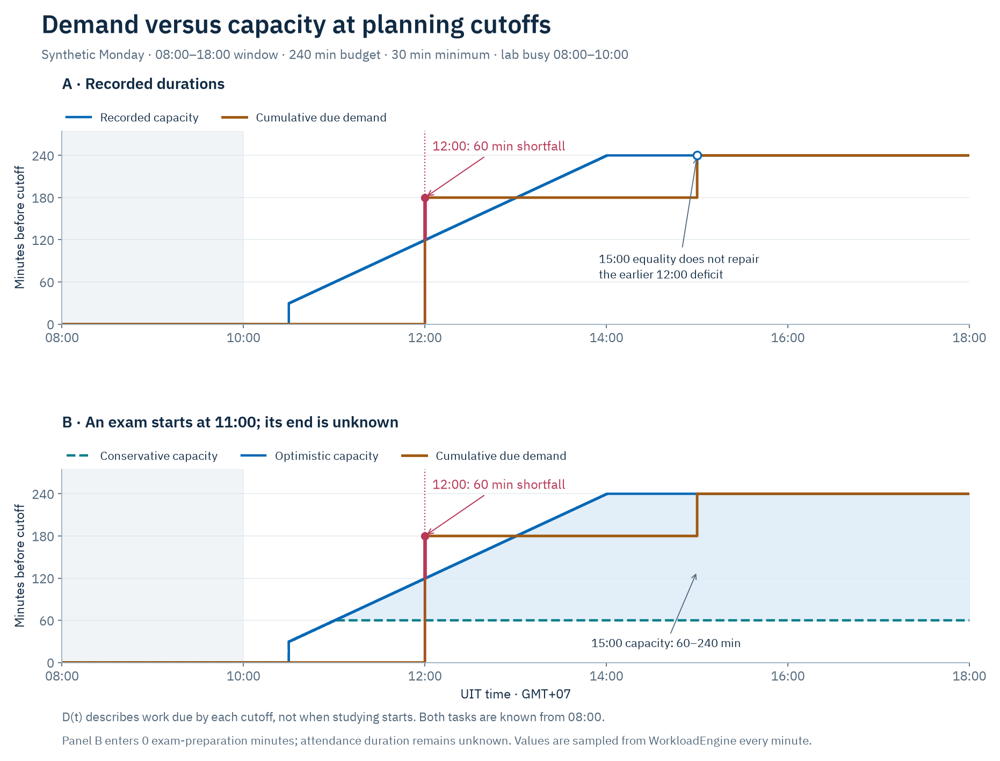
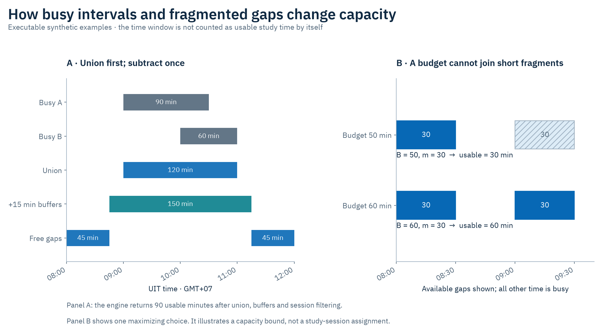
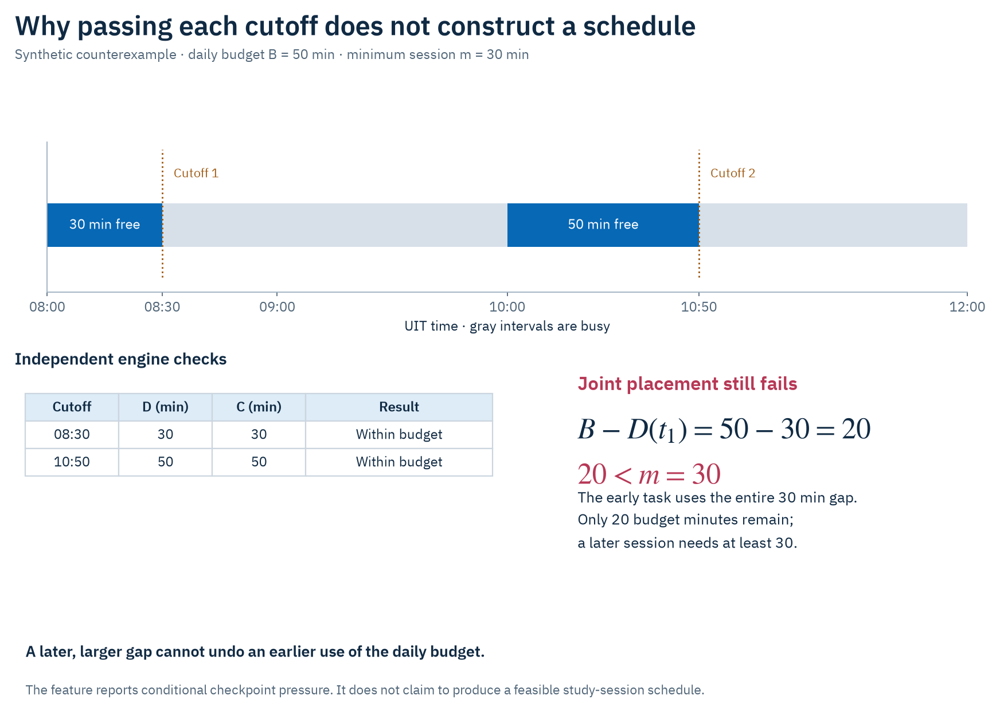
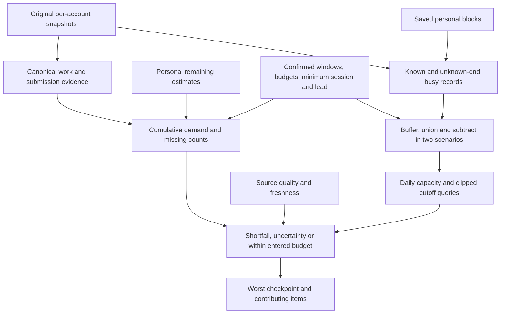

# Configurable workload projection — algorithm v1

This specification describes `WorkloadSourceIndex` and `WorkloadEngine` in
`core/domain`. The engine is deterministic: identical source snapshots, estimates,
policy, personal blocks and `now` produce identical numerical results. It runs on
the client and makes no network requests. Configuration defaults are editable
templates, not measurements of a student's actual free time.

The feature answers: **How does the remaining study time I entered compare with
the recorded capacity before my upcoming planning cutoffs?** It also lists exams
and deadlines without inventing effort estimates. It does not automatically place
study sessions, predict grades, change official deadlines or submit coursework.

## Visual walkthrough

These figures use executable synthetic fixtures, with numerical results exported
from the production Kotlin engine. The [figure guide](figures/workload/README.md)
records inputs, TSV data, PNG/SVG copies and reproduction commands. No real
student data is published.

### Equation reference



`d_i` and `t_i` are Unix timestamps in seconds; `L`, `e_i`, `B_d`, `m`, gap lengths,
`D` and `C` use minutes. `I(t)` contains upcoming items not unambiguously submitted
whose personal cutoff is at or before `t`. `H` is the configured set of UIT dates;
`s` selects a capacity scenario. Sections 3–6 define clipping and classification.

### A later free afternoon cannot repair a noon deadline



At noon, 180 entered minutes are due but only 120 recorded minutes are usable:
the shortfall is 60. At 15:00 the known-duration scenario reaches `D=C=240`, but
the overview retains the earlier shortfall. An unknown exam end gives a 60–240
minute capacity range at 15:00; it does not justify inventing an exam duration.

### Busy records are subtracted once; separate sessions respect their minimum



Two overlapping busy records with 15-minute buffers leave two 45-minute gaps in
the first example, giving 90 usable minutes. In the second, two 30-minute gaps
yield only 30 usable minutes under a 50-minute budget and 30-minute minimum.
Increasing the budget to 60 permits both gaps.

### Independent checkpoint checks are not a constructive scheduler



The early check has `D=C=30`; the later check has `D=C=50`. Spending 30 early leaves
only 20 budget minutes, below the 30-minute minimum for a later session. The UI's
“within entered budget” statement is conditional on an independent cutoff check;
it is not a claim that a complete session schedule exists.



## 1. Inputs and ownership

Inputs are per-account snapshots from `SnapshotStore`, connected-account metadata,
saved estimates, a `WorkloadPolicy`, saved personal blocks, and an explicit Unix
timestamp `now`. Times are interpreted in `Asia/Ho_Chi_Minh` (GMT+07).
The last workspace-refresh failure is also an explicit uncertainty input. It does
not discard cached records; its global scope is disclosed because section-specific
sync status is not available yet.

The primary planning account owns the policy. For a Moodle account, the student
can explicitly choose one DAA/Portal account as the teaching-calendar source.
There is no automatic association by name, student number or similar titles.
Without that selection, missing-calendar uncertainty is displayed. A primary
DAA/Portal account uses its own teaching calendar. Only one official calendar is
selected, avoiding duplicate exam lists from two UIT services.

Moodle deadlines come from the primary Moodle account; exams come from the
selected teaching source. Estimates belong to the resource's owning account,
including exam estimates. Capacity combines the selected sources and the existing
saved personal-block workspace. It is one time budget, never a separate budget
added once per connected service.

The flattened workspace cannot establish ownership for all exam/timetable rows.
This feature therefore reads the original per-account snapshots instead.

## 2. Stable resource identities and deduplication

`WorkloadRef` contains account ID, kind and target. Its memoized SHA-256 ID hashes
those components with NUL separators. Titles and estimates do not define identity.

| Kind | Target |
| --- | --- |
| Assignment | `assignment:<Moodle assignment ID>` |
| Unlinked calendar deadline | `event:<source calendar key>` |
| Exam | `exam:<normalized class code>:<ISO date>:<shift>:<resolved start time>` |

An assignment and calendar record merge only when the record supplies a positive
assignment ID or its same-origin HTTPS `/mod/assign/view.php?id=<cmid>` resolves to
exactly one owned assignment. Query IDs must match exactly; `id=1011` cannot match
`id=101`. Default HTTPS ports are normalized. Titles are never used to merge work,
and records from different account IDs never merge.

If an explicit assignment ID disagrees with the URL reference, the event remains
separate and carries a conflict. For a canonical assignment, a positive assignment
due date takes precedence over calendar dates. Multiple assignment dates use the
earliest one for display. Different linked dates or contradictory submission flags
raise a conflict; they are not silently treated as consistent authoritative data.
With no assignment due date, the earliest linked calendar date is used.

Only an unambiguous saved `submitted=true` flag excludes an item as officially
submitted. A personal remaining estimate of zero does not exclude it, mark it
submitted, or change the university record. Conflicting true/false flags become
unknown. A missing status is not inferred from time, title or a personal checklist.

Exam dates/shifts have no upstream immutable ID in the current model. A date,
shift or start-time change creates a new reference; its old estimate is retained as unavailable,
not automatically transferred to a possibly different examination. Renamed
assignments and changed assignment due dates retain their ID and estimate.
The resolved time prevents two explicit-time exams with an unreported shift from
being merged merely because both use shift zero. Different titles within an
otherwise identical exam key remain a source conflict.

## 3. Horizon, demand and cutoffs

Let `H` be the configured 7, 14 or 28 dates starting today in UIT time. The final
boundary is midnight immediately after the last date. Upcoming items satisfy:

```text
now <= official_due < horizon_end
```

Overdue items remain in a separate list. They are not rescheduled or silently
carried into future demand. The UI explicitly states this exclusion. Submitted
records are counted separately. Missing sources never imply submission or deletion.

Each upcoming item has an optional remaining-study estimate `e_i` in whole minutes.
`null` means unknown; `0` is an explicit personal estimate. Total time already spent
is not subtracted or inferred. For configured finish lead `L`:

```text
cutoff_i = official_due_i - 60 * L
D(t) = sum(e_i for upcoming items with cutoff_i <= t and e_i is known)
M(t) = count(upcoming items with cutoff_i <= t and e_i is unknown)
```

The engine groups identical cutoffs, sorts them, and accumulates demand and unknown
counts. It does not spread effort uniformly across dates or assign arbitrary hours
based on event type. The same prefix includes all known work due by that cutoff,
not just the work due that day. A cutoff before `now` has zero future capacity;
this does not change the official deadline or claim it is already overdue.

## 4. Busy intervals and uncertainty scenarios

Known classes, make-up lessons, selected non-deadline calendar events and saved
personal blocks supply busy intervals. The shared lesson-time and recurrence rules
are reused. Partial cancellations recover the remaining teaching periods through
the same helper used by Find free time. Fully canceled periods consume no time.
Long calendar events are considered even when they start before the visible range.

Each busy interval is expanded by the configured travel/break buffer on both ends,
then clipped to the analysis horizon. Intervals are sorted and unioned; overlapping
classes, duplicate source rows and personal blocks are not subtracted twice.

The current exam model has a start but no official end. The student may enter a
personal exam duration solely for planning; that assumption is counted and labeled
in the UI. It never becomes an official end time. Otherwise the engine evaluates:

- **Optimistic scenario:** an unknown-end busy item consumes no inferred duration.
- **Conservative scenario:** it blocks from its start through the horizon end.

Only exams dated today or later enter busy-time analysis; past exam dates remain
past workload records, not invented ongoing exam sessions. A non-deadline calendar
event with an unknown end can be ongoing even when it started earlier, so it uses
the conservative horizon-end rule. Students can explicitly exclude non-deadline
calendar events through policy; classes and exams are unaffected by that switch.

Missing teaching data or unreadable personal blocks set conservative capacity to
zero, retaining the optimistic scenario and explicit uncertainty. Source failures,
unreadable estimate buckets, stale/future timestamps, conflicting records and an
unconfirmed default budget prevent a positive complete-data interpretation.

These are **scenarios within recorded inputs**, not bounds on every unrecorded
real-world commitment. Per-section freshness is not available in the current store;
the account snapshot timestamp cannot prove a complete refresh. The UI always
states that this projection uses cached data.

## 5. Capacity: windows, sessions and budgets

Each ISO weekday has one same-day study window `[start, end)` and a minute budget
`B_d`. Zero budget is a day off. Today's window is clipped at `now`; earlier study
time is not inferred, so today's budget is a budget for the remaining window.

For each scenario, subtract the union of busy intervals from the study window.
Round starts inward/up and ends inward/down to whole minutes. At checkpoint `t`,
clip free intervals at `t` before applying minimum-session rules.

Let eligible gap lengths be `g_1 >= g_2 >= ... >= g_n`, each at least the configured
minimum session `m`. Maximum individually usable capacity in that day's prefix is:

```text
k = min(n, floor(B_d / m))
U_d(t) = min(B_d, sum(the largest k eligible gap lengths before t))
C(t) = sum(U_d(t) over dates up to the cutoff)
```

Why `k` matters: every separate used gap requires at least `m` minutes, so no more
than `floor(B_d/m)` gaps fit the budget. Choosing the largest permitted gaps
maximizes usable time. If their total exceeds `B_d`, their durations can be reduced
to the budget while respecting the minimum, since `k*m <= B_d`.

For example, two 30-minute gaps, a 50-minute budget and a 30-minute minimum permit
only **30 minutes**, not 50. A 60-minute budget permits both gaps. A short unusable
fragment never becomes capacity merely because another fragment exists elsewhere.

Full-day capacities and prefix sums are precomputed. Each cutoff queries the
preceding full days plus the final clipped day. Conservative capacity never exceeds
optimistic capacity. Capacity is computed from actual intervals and configuration;
there are no fixed event weights or fabricated risk scores.

## 6. Classification and worked examples

For each checkpoint:

1. `D(t) > C_optimistic(t)` → **known demand exceeds recorded capacity**.
2. Otherwise, missing estimates, recorded limitations or `D(t) > C_conservative(t)`
   → **more information is needed**.
3. Otherwise → **within the entered budget at this cutoff**.

No division by zero is needed. The overview shows the worst checkpoint, so a later
checkpoint with enough capacity cannot erase an earlier shortfall.

### Morning cutoff and overlapping busy records

At Monday 08:00, the entered window is 08:00–18:00 with a 240-minute budget,
30-minute minimum, zero travel buffer and zero finish lead. Recorded classes and
an overlapping event occupy 08:00–10:00 after union. A project due at 12:00 has a
180-minute remaining estimate:

```text
Eligible gap before cutoff: 10:00–12:00 = 120 minutes
Capacity: min(240, 120) = 120
Known demand: 180
Shortfall in this projection: 60 entered minutes
```

If another task has no estimate, it contributes to `M(t)`, not a fabricated zero-hour
estimate. With a 60-minute finish lead, the project's planning cutoff becomes 11:00
and capacity before it is only 60 minutes; the official due date stays 12:00.

### Why this is not a feasible-session guarantee

Consider a day with 30 free minutes before an early cutoff, 50 later free minutes,
a 50-minute daily budget and a 30-minute minimum. Demand of 30 at the first cutoff
passes its independent capacity check. Cumulative demand of 50 at the second also
passes by considering the later gap. But using 30 early leaves only 20 budget
minutes, too little for a later minimum-sized session. Independent prefix checks
are not sufficient to construct a jointly feasible schedule under fragmentation.
The UI and PR explicitly retain this limitation; actual session placement belongs
to a separate revision-planning feature.

## 7. Persistence and engineering bounds

Policies and estimates use separate hashed per-account buckets in the existing
Android Keystore AES-GCM private store (`workload`, alias `uit.workload.v1`). A
versioned JSON schema validates all seven day rules and all stored estimates.
Malformed buckets remain intact with an error; they are not replaced by defaults.
Saving an estimate alone does not confirm the default budget. Only an explicit
policy save sets `configured=true`.

Removing an account clears its bucket. Writes recheck account ownership and clean
late writes even under cancellation. UI drafts reset on account/profile changes;
results are recalculated from selected, connected sources. An unavailable resource
keeps its estimate until deliberate removal, subject to the account's storage limit.

Bounds: 30 connected accounts, 2,000 indexed items in the selected sources, 500
estimates per account, 10 saved personal blocks, 1,000,000 local JSON characters, and 28 analysis
dates. Remaining estimates are 0–60,000 minutes; personal exam durations are 1–720.
Session minimum is 10–240, travel buffer 0–120, finish lead 0–1440 minutes, freshness
threshold 1–168 hours. Each nonzero daily budget is between the session minimum
and 720 minutes. Windows must be same-day minute-precision HH:mm, ending no later
than 23:59. These are validated device/input bounds, not recommended study loads.

Identity and estimate lookups are indexed; digests are memoized. Busy intervals
are sorted/merged per day, full-day capacities use prefix sums, and cutoffs use a
sorted demand sweep. With `N` items, `E` estimates, `B` busy intervals, `D` dates,
`K` distinct cutoffs and `G` gaps per date, the main costs are approximately
`O(N + E + N log N + D*B log B + K*G log G)`. Calculation runs off the UI thread;
source/policy changes cancel obsolete calculations and session guards reject stale
results. `now` refreshes each minute while the screen is open.

## 8. Validation contract

Tests must cover exact-ID/URL deduplication, account separation, changed and missing
sources, officially submitted versus personally zero effort, deadline-second
boundaries, lead time, UIT dates, overlapping busy intervals, partial cancellations,
unknown exam ends, user-duration assumptions, zero budgets and fragmented gaps.
Deterministic randomized cases check input-order invariance, interval-union safety,
capacity monotonicity under added busy time/larger budgets/minimum sessions, and
conservative-versus-optimistic ordering.

Repository/ViewModel tests cover schema failures, persistence, disconnected owners,
late canceled writes, failed-save draft retention, profile switches, source updates
and strict reads of shared personal blocks. Native Compose phone renders cover
360/390/412dp and Vietnamese with larger text; synthetic Android instrumentation
verifies the Keystore path. Real-account research, when performed, is read-only
and remains separate from synthetic CI/device evidence.
