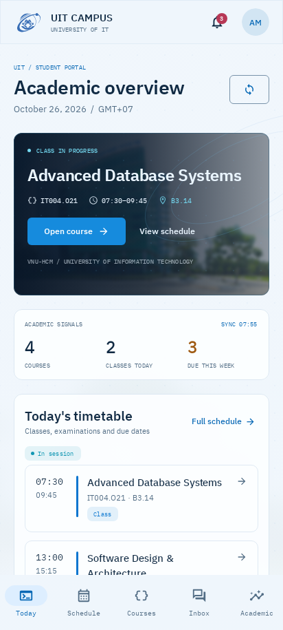

# Agenda revision

Historical review. The current product scope is the [Android phone experience](MOBILE.md).

The subsequent [cut-corner revision](CUT-CORNERS.md) updates the container geometry.
The main preview paths show the latest app.

The earlier UI gave a campus hero and summary counters priority over the timetable.
This revision changes the reading order and component structure. It keeps UIT blue,
the transparent original emblem, local IBM Plex fonts, IT-related icons, and a
subtle campus photograph. It is an implemented candidate, not a claim of visual
approval.

## Compare the actual app

The same synthetic records are used before and after. These are native Compose
renders, not generated mockups. No credentials were used.

| Previous phone, light theme | Current phone, light theme |
| --- | --- |
|  |  |

[Previous desktop](previews/before-agenda-revision/dashboard-light-desktop.png) ·
[Archived desktop](previews/history/desktop/dashboard-desktop.png) ·
[Current dark phone](previews/dashboard-dark.png) ·
[Archived dark desktop](previews/history/desktop/dashboard-dark-desktop.png)

## What changed

- Today opens with a date index and an interactive teaching week. Selecting a day
  shows its real schedule, including cancellations and days without classes.
- Time, course and room share aligned rows. The active class is identified within
  the timetable, with a course action; it is not repeated in a separate hero.
- Due dates use a chronological submission list, including actionable overdue work.
  Exact timestamps and status replace the arbitrary seven-day progress bars.
  Assignment dates without calendar submission status remain visible in the agenda.
- GPA and credit summaries stay in Academic, where a compact record header
  replaces separate statistic cards. The dashboard's count strip and
  student-record card were removed. Course materials remain directly accessible.
- The course library is a searchable directory. The deadline screen also uses rows.
  Shared panels have quieter boundaries; generic uppercase metadata was removed.
- The background photo is confined to the masthead. Circuit dots, decorative
  orbital fields and the second campus image were removed. The logo stays intact
  and transparent.
- Light mode is the initial preference for a fresh installation. Existing saved
  preferences remain effective, and dark mode is still supported.

## Review and validation

Validation: the debug APK builds and the full `check` task passes. Recorded test
results contain 70 distinct passing cases, including 22 Compose UI cases. The
gallery contains 21 current renders plus the preserved baseline images.

The Compose suite covers course/schedule navigation, sign-in, selecting a canceled
class and its details, an empty teaching day, overdue visibility, course search,
materials, calendar selection, transcript/planner behavior and message drafts.
It records phone, desktop, dark and 1.3× font-scale previews. These checks establish
specific behavior; they do not measure whether the user likes the design.

Visual review caught wrapping clock times at 1.3× font scale. Time gutters now scale
with the font setting, with single-line clock strings. Desktop columns were also
rearranged so course materials follow the agenda without a gap determined by the
height of the deadline column.

The [baseline audit](AI-SLOP-AUDIT.md) remains a historical critique. The current
[design system](../../.interface-design/system.md) describes the implemented rules;
other routes still need subjective review with realistic content.
