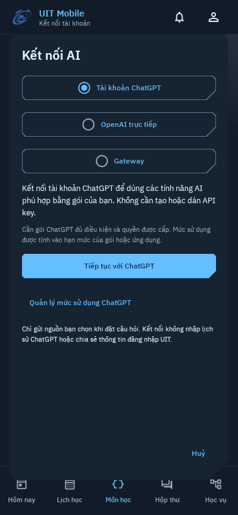

# ChatGPT connection: phone design and evidence

The student wants to use an existing ChatGPT plan without learning API setup.
The connection choice and Continue with ChatGPT lead. Account-specific models
are choices from the service; API key and gateway remain separate alternatives.
Keep UIT blue, Plex type, the transparent emblem, existing five destinations and
TechnicalShapes. Native controls retain 48dp touch targets and the 4dp spacing grid.
The settings dialog scrolls inside its frame with Cancel retained below it.

The domain is account permission, chosen sources, plan usage, model selection,
reconnection and explicit Send. The design avoids a developer credential form
for the ChatGPT path, hidden billing fallback and invented usage meters. Only
verified account state may enable activation; entering settings is not sign-in.

## Inspected phone captures

These are production Compose views rendered with Robolectric API 35 native
graphics. The connector is an isolated no-network UI fixture with **no connected
account**. They establish empty-form layout, not a real subscriber login or
installed Android execution. No student records, tokens or synthetic connected
account are shown.

| State | Capture |
| --- | --- |
| Compact dark phone, 360dp | [View](chatgpt-sign-in/chatgpt-sign-in-360.png) |
| Default dark phone, 390dp | [View](chatgpt-sign-in/chatgpt-sign-in-390.png) |
| Larger text, 412dp / 130% | [View](chatgpt-sign-in/chatgpt-sign-in-412-large.png) |
| Light appearance, 390dp | [View](chatgpt-sign-in/chatgpt-sign-in-390-light.png) |
| Vietnamese, 390dp | [View](chatgpt-sign-in/chatgpt-sign-in-390-vi.png) |

Review found no overlapping controls or hidden Continue action at these sizes.
Body copy explains permission and usage limits. Other credential fields appear
only after selecting their mode. Tests also exercise explicit model activation,
the permission-disabled path and deferring first-use confirmation until connection
work ends; those connected states are fixtures and do not export screenshots.

The system browser handles passwords and consent. The callback page returns to
the package-specific activity without a credential in the return URI. Actual
browser switching, callback behavior, account eligibility and a plan-backed
request remain physical-device acceptance items.

[Image hashes and runtime provenance](chatgpt-sign-in/provenance.json) ·
[Architecture and official research sources](../CHATGPT-PLAN.md) ·
[Preview and device acceptance](../CHATGPT-PLAN-PREVIEW.md)
