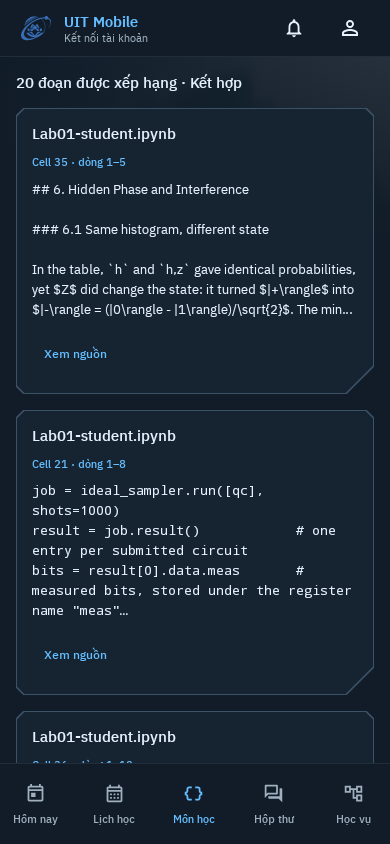

# Course retrieval: phone design and actual-source gallery

The student is trying to find the right explanation or function inside downloaded
material, then inspect the source. The question and source location lead; model
configuration is secondary.

- Domain: courses, verified downloads, source versions, notebook cells, code
  identifiers, line ranges, ranked excerpts and explicitly selected text.
- Color world: existing UIT blue, navy reading canvas, pale source text and muted
  context. Amber is reserved for partial coverage/fallback, not decorative accents.
- Signature: the app's authentic UIT identity and asymmetric technical cuts,
  together with precise cell/line references and literal source excerpts.
- Hierarchy: course choice → file selection/index → explicit query → ranked
  excerpts → verified source context. Retain the five existing bottom destinations.
- Density: 16dp phone gutters, 16dp source panels and existing 4dp rhythm. Use
  standard Material touch targets and the existing IBM Plex typography. Code
  excerpts use a monospace face. No confidence percentages or invented telemetry.
- Depth: existing cut-corner panels and quiet surfaces. Advanced scoring/model
  settings live behind the document selector rather than crowding result rows.
- Dialogs: bounded native surfaces with scrolling content and persistent build/
  close actions. Source context is shown once with the selected span emphasized.
- Flow: do not send while typing; mode changes do not execute a query. Show local
  fallback and invalidated-source counts. Source lookup verifies current bytes.

## Actual-source evidence

The following images replay the production NT409 retrieval evaluation: **103
passages from one actual `Lab01-student.ipynb`** and real `text-embedding-3-large`
results. File/course text is actual captured material, not authored success content.
The local owner is anonymized; the replay contains no API key or university session.
The selector's capture-context label is not a claim of a live Moodle session.

The course source was acquired in an earlier owner-authorized read-only capture on
2026-11-02; model evaluation was captured on 2026-11-04 UTC. Source bodies, index,
vectors and raw notebook remain ignored local artifacts. Inspect source uses the
production local-file loader and exact part offsets. These are Robolectric native
Compose host renders, not physical-phone networking/Keystore verification.



| State | Reviewed phone images |
| --- | --- |
| Scope, separate modes and explicit submitted query | [360dp](course-retrieval/retrieval-scope-360.png) · [390dp](course-retrieval/retrieval-scope-390.png) · [412dp / 130%](course-retrieval/retrieval-scope-412-large-text.png) · [Light](course-retrieval/retrieval-scope-390-light.png) |
| Actual ranked source excerpts | [360dp](course-retrieval/retrieval-results-360.png) · [390dp](course-retrieval/retrieval-results-390.png) · [412dp / 130%](course-retrieval/retrieval-results-412-large-text.png) · [Light](course-retrieval/retrieval-results-390-light.png) |
| Explicit document selection | [Selector](course-retrieval/retrieval-selection-390.png) |
| Verified source cell, lines, version and context | [Source](course-retrieval/retrieval-source-390.png) |
| Actual code-identifier query result | [Code](course-retrieval/retrieval-code-390.png) |

[Provenance and hashes](course-retrieval/provenance.json) ·
[research](../research/COURSE-RETRIEVAL.md) ·
[measured relevance and limitations](../research/COURSE-RETRIEVAL-EVALUATION.md).

The inspected states have no overlapping controls. Long pages scroll within the
phone column; dialogs retain reachable actions. The source view preserves literal
Markdown/LaTeX and code rather than claiming mathematical typesetting or notebook
execution. A matching source excerpt is not a verified answer. The narrow diagnostic
includes genuine ranking failures, documented with the results.

## Reproduce

After an actual model/source capture exists in ignored build output:

```sh
./gradlew :app:testDebugUnitTest --tests '*PassageRetrievalLiveDesignTest' \
  -PretrievalPreview=true -PrecordUi=true
```

This renderer performs no provider or university request. It skips without actual
capture files; synthetic behavior tests do not export review screenshots.
