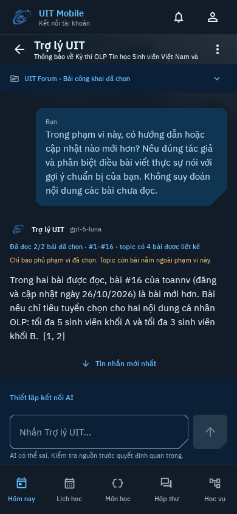

# Forum digest: phone design

The student wants to understand a discussion and inspect what each author actually
said. The selected source window and conversation are the focal content.

Current entry: open a loaded topic's overflow menu, then choose Summarize / ask AI.
The older entry screenshot below predates the [November 5 reader changes](FORUM-READING-UX.md);
the chat and source-selection behavior remain applicable. Empty failed topics do
not expose an AI action.

- Domain: topics, reply targets, author identity, post numbers, edits, chronology,
  unanswered questions, disagreement and retained source versions.
- Color world: existing UIT blue, navy canvas, white source text, muted source dates
  and amber for incomplete/unverified coverage. Use the established Material tokens.
- Signature: existing asymmetric technical cuts, the authentic UIT emblem in chat,
  and numbered post references whose usernames and versions remain inspectable.
- Hierarchy: a compact selection dialog before opening chat; coverage under the
  assistant identity before prose; source details behind the existing Sources
  control. Preserve the fixed Send/Stop composer and five bottom destinations.
- Density: existing 16dp phone gutters and dialog spacing on the 4dp grid; native
  fields/buttons retain touch targets. Dialogs scroll and keep explicit confirmation.
- Depth: existing cut-corner surfaces and quiet outlines, with no decorative image,
  new chat theme or desktop panel.
- Avoid: a second disconnected chatbot, an article-like digest dashboard, repeated
  source cards between every paragraph, automatic paid summaries and claims that
  unselected post numbers were read or even exist.

Review portrait 360/390/412dp, dark/light, 1.3 text scale, range validation, source
inspection, stale/unavailable rechecks and Back from the original public post.

## Reviewed actual-data phone gallery

The source is [public UIT topic 163707](https://forum.uit.edu.vn/t/163707).
Chat replays the three real `gpt-6-luna` answers captured on 2026-11-04 UTC through
production workspace persistence and Compose. The Forum entry uses the captured
UIT JSON through the production Forum parser and screen. No authored Forum posts
or substituted model answers are used. Later student/team-support bodies are not
shown. The isolated replay has no API key, so it truthfully displays AI setup while
historical answers remain readable. No live device execution is implied.



| Review state | Phone captures |
| --- | --- |
| Initial chat and explicit partial coverage | [360dp](forum-ai/forum-digest-chat-360.png) · [390dp](forum-ai/forum-digest-chat-390.png) · [412dp / 130% text](forum-ai/forum-digest-chat-412-large-text.png) · [Light](forum-ai/forum-digest-chat-390-light.png) |
| Actual follow-up with authorship and citations | [360dp](forum-ai/forum-digest-followup-360.png) · [390dp](forum-ai/forum-digest-followup-390.png) · [412dp / 130% text](forum-ai/forum-digest-followup-412-large-text.png) · [Light](forum-ai/forum-digest-followup-390-light.png) |
| Exact retained source identity and paragraph | [Sources](forum-ai/forum-digest-sources-390.png) · [Evidence](forum-ai/forum-digest-evidence-390.png) |
| Actual Forum entry and bounded selection | [Topic](forum-ai/forum-digest-entry-390.png) · [Selection dialog](forum-ai/forum-digest-range-390.png) |

[Provenance and SHA-256 hashes](forum-ai/provenance.json) ·
[Live evaluation and limitations](../research/FORUM-AI-EVALUATION.md).

Review found no overlapping controls at these widths. Long questions and replies
scroll inside chat; the composer and existing bottom navigation remain reachable.
Source timestamps use explicit GMT+07 rather than raw ISO strings. Dialog content
scrolls independently. This is a scoped visual review, not an accessibility or
physical-device certification.

Reproduce after an actual public/model capture exists in ignored build output:

```sh
./gradlew :core:data:testDebugUnitTest --tests '*AssistantForumLiveTest' -PassistantLive=true
./gradlew :app:testDebugUnitTest --tests '*ForumDigestLiveDesignTest' -PassistantPreview=true -PrecordUi=true
```

The live command requires `OPENAI_API_KEY` and `OPENAI_MODEL` in its process and
incurs real provider calls. The renderer uses those captured results without
networking or credentials; it skips if actual evidence is absent.

