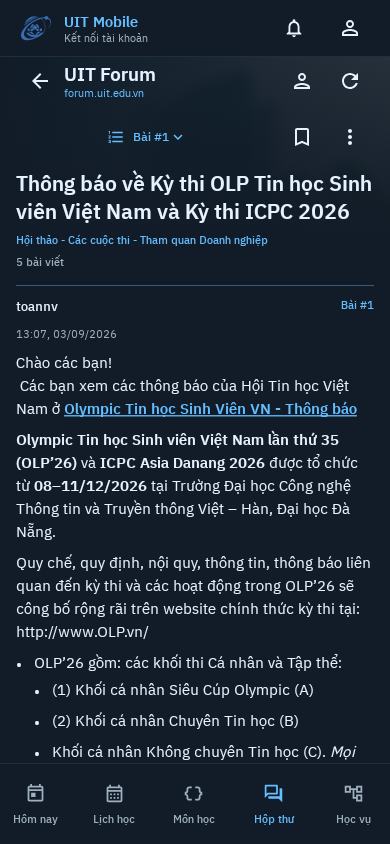
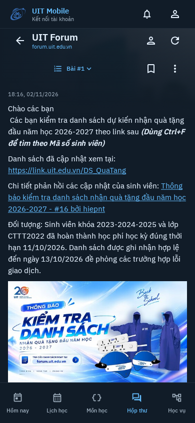

# Forum mobile reading: actual UIT data

The topic body leads. Safe upload images appear as the reader reaches them;
post actions stay below the post. A compact position button replaces the permanent
jump form. Topic overflow contains source, copy-link, resume and AI actions.
The existing UIT palette, Plex type, asymmetric corners and five tabs remain.

These are actual production Compose components with live anonymous UIT responses,
rendered on Robolectric API 35 on November 5, 2026. They are **host renders**, not
screenshots from an installed phone. No Forum posts were authored for this gallery.
Private authenticated captures and later student support bodies are excluded.

## ICPC announcement

Source: [topic 163707](https://forum.uit.edu.vn/t/163707), first post. Source post
numbers are sparse; the reader retains their identity rather than renumbering them.

| State | 360dp | 390dp | 412dp / 130% text |
| --- | --- | --- | --- |
| Title and original body | [Compact](forum-reading-ux/reading-icpc-360.png) | [Default](forum-reading-ux/reading-icpc-390.png) | [Larger text](forum-reading-ux/reading-icpc-412-large-text.png) |
| Guest post controls | [Compact](forum-reading-ux/reading-icpc-actions-360.png) | [Default](forum-reading-ux/reading-icpc-actions-390.png) | [Larger text](forum-reading-ux/reading-icpc-actions-412-large-text.png) |
| Light appearance | — | [Body](forum-reading-ux/reading-icpc-390-light.png) · [Controls](forum-reading-ux/reading-icpc-actions-390-light.png) | — |

Guest controls provide source copying and explicit login for account interactions.
Successful login returns to the selected post; it never automatically replays a
like, bookmark or submission. Member controls honor live permissions.

## Inline image and original viewer

Source: [official gift announcement, topic 164929](https://forum.uit.edu.vn/t/164929).
The same public university poster is visible in the app and mobile website.

| Native reader | Actual mobile website |
| --- | --- |
| [Announcement](forum-reading-ux/reading-announcement-390.png) · [Automatic inline preview](forum-reading-ux/reading-inline-image-390.png) · [Tap-to-open viewer](forum-reading-ux/reading-image-viewer-390.png) | [Same announcement and poster](forum-reading-ux/web-image-inline-390.png) · [Guest controls, element-only crop](forum-reading-ux/web-post-controls-only.png) |

The viewport placeholder reserves bounded space using source dimensions. Concealed
images wait for expansion. External delivery and failures retain explicit fallback
and retry controls. Gallery swiping, secure uploads/CDNs, animated media and full
web interaction parity remain open; this increment does not close issue #39.

## Review and evidence limits

### ICPC post #17 table follow-up

At the owner's request, the public [team announcement table](https://forum.uit.edu.vn/t/163707/17)
was read again and rendered through the same production path. All **44 normalized
plain-text cells match the live mobile website**: 22 rows including the header,
two columns. This includes 20 named teams and the source's final placeholder row.
The actual names/team identifiers are from this public official announcement;
no private session, student ID list, credentials or account capture is included.

| Capture | 360dp | 390dp |
| --- | --- | --- |
| Table at its left edge | [Start](forum-reading-ux/reading-icpc-table-360.png) | [Start](forum-reading-ux/reading-icpc-table-390.png) |
| Horizontally scrolled | [Full team column](forum-reading-ux/reading-icpc-table-right-360.png) | [Full team column](forum-reading-ux/reading-icpc-table-right-390.png) |
| Vertically scrolled to the last team | [Bottom](forum-reading-ux/reading-icpc-table-bottom-360.png) | [Bottom](forum-reading-ux/reading-icpc-table-bottom-390.png) |
| Actual mobile website | — | [Same source table](forum-reading-ux/web-icpc-table-390.png) |

Data is present and both scroll directions work in these two focused live host
tests, but **table presentation is not web-equivalent**. Native cells use fixed
200dp widths, so the team column is partly outside the initial viewport and needs
a horizontal swipe. Web widths follow content. Native column headings also lack
the website's bold distinction and visible row rules. F11 remains partial.
These captures document the existing preview behavior; no production UI or APK
was changed for this follow-up. The first attempt to reveal the bottom cell used
the nearest horizontal scroll parent and failed; targeting the reader's vertical
scroll explicitly passed. The final two tests verified horizontal scrolling and
reaching the last named team, without university write requests.

[Table-specific provenance, UTC times and hashes](forum-reading-ux/table-provenance.json)
records all seven inspected captures, public routes and the matching cell hash.

### Initial reading review

All 11 native captures and both web comparisons were inspected before publication.
The title wraps, the five destinations remain reachable, and the post toolbar fits
at 360dp and with larger text. Long URLs wrap; source code/tables retain horizontal
scrolling. This review does not establish TalkBack, rotation or OEM acceptance.

The owner's older installed build failed to open ICPC while Chrome could open it.
Public and authenticated Kotlin reads succeeded on the host. The physical-phone
failure's cause remains unknown. The new build preserves typed error details and
clears stale reading counters after a failed topic switch.

An isolated API 30 software emulator reported boot completion but lacked a working
package service during installation. It supplied no installed-app acceptance or
native screenshots. The opt-in installed test compiled only.

- [Capture provenance, GET routes, UTC times and image hashes](forum-reading-ux/provenance.json)
- [Research, server revision and verification](../research/UIT-FORUM-MOBILE-UX-2026-11-05.md)
- [Installable preview and device checks](../FORUM-MOBILE-PREVIEW.md)
- [Remaining parity scope](../research/UIT-FORUM-PARITY.md)
