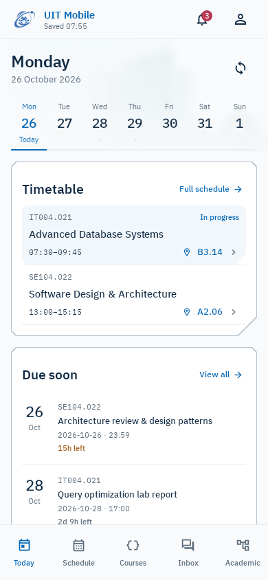

# UIT Mobile phone previews

UIT Mobile is a native Android phone app. Current design and validation target
portrait phones at **360dp, 390dp and 412dp**, with dark mode and larger text.
See [the phone scope](MOBILE.md) and [the current design rules](../../.interface-design/system.md).

The interface keeps UIT blue, the original transparent emblem, IBM Plex fonts,
a subtle campus photograph and the requested asymmetric cut-corner frames.
Main panels have three 8dp cuts and a larger 28dp physical bottom-right cut.
[Asset provenance](ASSETS.md) and [frame geometry](CUT-CORNERS.md) are documented separately.

## Phone sizes

| Compact phone · 360 × 800dp | Main phone · 390 × 844dp | Larger phone · 412 × 915dp |
| --- | --- | --- |
| [Today](previews/dashboard-360-phone.png) | [Today](previews/dashboard-phone.png) | [Today](previews/dashboard-412-phone.png) |



## Phone screens

| Screen | Preview |
| --- | --- |
| Class schedule | [Day](previews/schedule-phone.png) · [Week agenda](previews/schedule-week-phone.png) · [Month](previews/schedule-month-phone.png) |
| Courses | [Course list](previews/courses-phone.png) · [Materials](previews/course-materials-phone.png) |
| Academic record | [Overview](previews/academic-phone.png) · [Semester selection](previews/academic-semester-phone.png) · [GPA planner](previews/academic-planner-phone.png) |
| Tuition | [390dp](previews/tuition-390-phone.png) · [360dp](previews/tuition-360-phone.png) · [Charge details](previews/tuition-details-phone.png) · [Offline](previews/tuition-offline-phone.png) · [Larger text](previews/tuition-360-large-text.png) |
| Student procedures | [Request history](previews/procedures-390-phone.png) |
| Graduation | [412dp dark](previews/graduation-412-dark-phone.png) · [Assessment conditions](previews/graduation-conditions-phone.png) |
| Inbox | [Deadlines](previews/focus-phone.png) · [Conversation list](previews/inbox-phone.png) · [Chat](previews/inbox-conversation-phone.png) |
| Appearance | [Dark phone](previews/dashboard-dark.png) · [Compact dark phone](previews/dashboard-dark-360-phone.png) · [Larger text](previews/dashboard-compact-large-text.png) |
| Data states | [Sign-in](previews/dashboard-connect-phone.png) · [Canceled class](previews/dashboard-canceled-phone.png) · [Empty day](previews/dashboard-empty-day-phone.png) · [Overdue work](previews/dashboard-overdue-phone.png) |

These are the actual Compose components rendered with Robolectric native graphics
and Roborazzi. Names, grades, courses and messages are synthetic test fixtures;
production screens read repository data. No credentials are needed to render them.
Screenshots and passing tests do not constitute visual approval.

## Render on a rootless server

An Android SDK and JDK are required; an emulator, KVM and root are not:

```bash
cd /home/nguyentnt/PDWAIA/kl/uit-mobile
JAVA_HOME=/tmp/uit-jdk ./gradlew :app:testDebugUnitTest \
  --tests '*WorkspaceDesignTest*' -PrecordUi=true
```

Current PNGs are written directly to `docs/design/previews/`. The JDK path reflects
the current temporary installation; use your persistent JDK when needed.

```bash
./gradlew :app:assembleDebug check
```

The suite checks phone navigation, date selection, course search, materials,
calendar selection, transcript/planner interactions, submission filters and
conversation navigation/drafts. Screenshots are review artifacts, not pixel-diff
assertions. The rendering suite uses the debug-only test host Activity.

This is static host rendering, not hot reload or a live device session. See
[Debugging over SSH](../DEBUGGING.md) for device debugging and Live Edit distinctions.

Earlier dashboard and agenda notes are historical. They do not define the current
product scope or preview targets.
