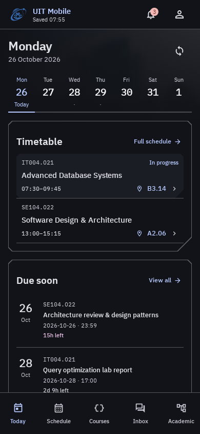

# UIT Mobile phone previews

UIT Mobile is a native Android phone app. Current design and validation target
portrait phones at **360dp, 390dp and 412dp**, with dark mode and larger text.
See [the phone scope](MOBILE.md) and [the current design rules](../../.interface-design/system.md).

The interface keeps UIT blue, the original transparent emblem, IBM Plex fonts,
a subtle campus photograph and the requested asymmetric cut-corner frames.
Main panels have three 8dp cuts and a larger 28dp physical bottom-right cut.
[Asset provenance](ASSETS.md) and [frame geometry](CUT-CORNERS.md) are documented separately.

## Phone sizes

| Compact phone · 360 × 800dp | Main phone · 390 × 844dp | Larger phone · 412 × 915dp |
| --- | --- | --- |
| [Today](previews/dashboard-360-phone.png) | [Today](previews/dashboard-phone.png) | [Today](previews/dashboard-412-phone.png) |

Fresh installations enable dark appearance and device colors. The device-color
preview below uses the test device's palette; actual colors depend on the user's
wallpaper on Android 12+. Older Android versions use the UIT dark palette. Saved
appearance choices remain unchanged.



## Phone screens

| Screen | Preview |
| --- | --- |
| Class schedule | [Day](previews/schedule-phone.png) · [Week agenda](previews/schedule-week-phone.png) · [Month](previews/schedule-month-phone.png) |
| Offline downloads | [390dp](previews/downloads-390-phone.png) · [Section pack](previews/downloads-pack-390-phone.png) · [360dp queue](previews/downloads-queue-360-phone.png) · [412dp larger text](previews/downloads-412-large-text-phone.png) |
| Local bookmarks | [390dp collection](previews/bookmarks-390-phone.png) · [360dp unavailable source](previews/bookmarks-unavailable-360-phone.png) · [412dp Vietnamese/larger text](previews/bookmarks-412-vietnamese-large-text-phone.png) · [Search pin actions](previews/bookmarks-search-390-phone.png) · [Restored filters after navigation](previews/bookmarks-return-390-phone.png) |
| Timetable image sharing | [390dp preview](previews/timetable-image-preview-390-phone.png) · [360dp empty date](previews/timetable-image-empty-360-phone.png) · [412dp Vietnamese/larger text](previews/timetable-image-privacy-412-vietnamese-phone.png) · [Actual shared PNG, synthetic data](previews/timetable-shared-image.png) |
| Configurable workload | [390dp overview](previews/workload-overview-390-phone.png) · [Cutoff explanation](previews/workload-explanation-390-phone.png) · [360dp settings](previews/workload-settings-360-phone.png) · [412dp Vietnamese/larger text](previews/workload-tasks-412-vietnamese-phone.png) |
| Exam revision planner | [390dp overview](previews/revision-overview-390-phone.png) · [360dp draft sessions](previews/revision-draft-sessions-360-phone.png) · [412dp Vietnamese/larger text rules](previews/revision-rules-412-vietnamese-phone.png) · [390dp failed-edit retention](previews/revision-topic-editor-390-phone.png) |
| Course knowledge maps | [Full flow and evidence](../KNOWLEDGE-MAPS.md) · [390dp map](previews/knowledge-bfs-neighborhood-390-phone.png) · [360dp failed save](previews/knowledge-failed-save-360-phone.png) · [412dp Vietnamese/larger text](previews/knowledge-map-412-vietnamese-phone.png) |
| AI quiz & flashcards | [Full flow and 19 captures](../AI-PRACTICE-EVALUATION.md#full-phone-flow) · [390dp draft](previews/practice-draft-390-phone.png) · [Source evidence](previews/practice-evidence-390-phone.png) · [360dp failed save](previews/practice-failed-save-360-phone.png) · [412dp Vietnamese/larger text](previews/practice-options-412-vietnamese-phone.png) |
| Course PDF reading | [Full flow and 25 captures](../COURSE-READING-EVIDENCE.md#full-phone-gallery) · [390dp page](previews/reading-page-390-phone.png) · [Fit width](previews/reading-fit-width-390-phone.png) · [Pinned note](previews/reading-pinned-page-390-phone.png) · [412dp Vietnamese editor](previews/reading-note-editor-412-vietnamese-phone.png) |
| AI Code Tutor | [Full flow and 21 captures](../CODE-TUTOR-EVALUATION.md#full-phone-flow) · [390dp analysis](previews/code-tutor-analysis-390-phone.png) · [Exact lines](previews/code-tutor-line-evidence-390-phone.png) · [Progressive hints](previews/code-tutor-hint-one-390-phone.png) · [412dp Vietnamese proposal](previews/code-tutor-proposal-412-vietnamese-phone.png) |
| Workspace search | [390dp](previews/search-390-phone.png) · [Saved detail](previews/search-assignment-390-phone.png) · [360dp unavailable](previews/search-unavailable-360-phone.png) · [412dp larger text](previews/search-412-large-text-phone.png) |
| Free-time finder | [360dp](previews/free-time-360-phone.png) · [390dp](previews/free-time-390-phone.png) · [Intervals](previews/free-time-results-390-phone.png) · [Unverified coverage](previews/free-time-unverified-390-phone.png) · [Personal-block validation](previews/free-time-personal-block-360-phone.png) · [412dp larger text](previews/free-time-412-large-text-phone.png) |
| Calendar export | [360dp](previews/calendar-export-360-phone.png) · [390dp](previews/calendar-export-390-phone.png) · [Preview](previews/calendar-export-preview-390-phone.png) · [412dp larger text](previews/calendar-export-412-large-text-phone.png) |
| Courses | [Course list](previews/courses-phone.png) · [Materials](previews/course-materials-phone.png) |
| Study AI (synthetic results) | [Assignment sources · 390dp](previews/ai-assignment-390-phone.png) · [Evidence · 390dp](previews/ai-evidence-390-phone.png) · [Question setup · 360dp](previews/ai-question-360-phone.png) · [Direct connection · 360dp](previews/ai-connection-direct-360-phone.png) · [Direct connection · 412dp larger text](previews/ai-connection-direct-412-large-text-phone.png) · [Optional gateway · 390dp](previews/ai-connection-gateway-390-phone.png) · [Checklist · 412dp larger text](previews/ai-checklist-412-large-text-phone.png) |
| Academic record | [Overview](previews/academic-phone.png) · [Semester selection](previews/academic-semester-phone.png) · [GPA planner](previews/academic-planner-phone.png) |
| Tuition | [390dp](previews/tuition-390-phone.png) · [360dp](previews/tuition-360-phone.png) · [Charge details](previews/tuition-details-phone.png) · [Offline](previews/tuition-offline-phone.png) · [Larger text](previews/tuition-360-large-text.png) |
| Student procedures | [Request history](previews/procedures-390-phone.png) |
| Student profile | [390dp](previews/profile-390-phone.png) · [Academic](previews/profile-academic-phone.png) · [Insurance](previews/profile-insurance-phone.png) · [360dp larger text](previews/profile-360-large-text.png) · [412dp dark family view](previews/profile-family-412-dark-phone.png) |
| Profile scans | [Documents](previews/profile-documents-390-phone.png) · [Image viewer](previews/profile-scan-390-phone.png) · [412dp dark](previews/profile-scan-412-dark-phone.png) · [360dp larger-text error](previews/profile-scan-360-error-phone.png) |
| Home screen widgets | [Next class · 360dp phone](previews/widget-next-360-phone.png) · [Today · 390dp phone](previews/widget-today-390-phone.png) · [412dp device colors](previews/widget-today-412-device-colors-phone.png) · [360dp larger text](previews/widget-today-360-large-text-phone.png) · [Disconnected](previews/widget-disconnected-360-phone.png) · [Pin chooser](previews/widget-picker-phone.png) |
| Graduation | [412dp dark](previews/graduation-412-dark-phone.png) · [Assessment conditions](previews/graduation-conditions-phone.png) |
| Inbox | [Deadlines](previews/focus-phone.png) · [Conversation list](previews/inbox-phone.png) · [Chat](previews/inbox-conversation-phone.png) |
| Appearance | [Dark phone](previews/dashboard-dark.png) · [Compact dark phone](previews/dashboard-dark-360-phone.png) · [Larger text](previews/dashboard-compact-large-text.png) |
| Data states | [Sign-in](previews/dashboard-connect-phone.png) · [Canceled class](previews/dashboard-canceled-phone.png) · [Empty day](previews/dashboard-empty-day-phone.png) · [Overdue work](previews/dashboard-overdue-phone.png) |

These are the actual Compose components rendered with Robolectric native graphics
and Roborazzi. Unless a section identifies live sources (as the Forum gallery
does), names, grades, courses and messages are synthetic test fixtures;
production screens read repository data. Each section states its evidence scope.
Screenshots and passing tests do not constitute visual approval.

Widget images inflate and draw the actual Android RemoteViews, with a 16dp outer
gutter representing their placement on a phone. They are host-side renders, not
screenshots of an installed launcher. The widget pin chooser uses actual Compose.

## UIT Forum

The gallery below uses **real responses from https://forum.uit.edu.vn**, loaded
by the production anonymous client, parser, repository, ViewModel and Compose UI.
Native captures are 390 × 844 dp Vietnamese phone renders on Robolectric, not
screenshots from an installed APK. The explicitly marked mobile-web comparison
is an anonymous Chromium capture at 390 × 844 CSS pixels. No authored topic or
response is substituted.

| Actual UIT content | Phone render |
| --- | --- |
| Current public topics | [Latest](previews/forum-real-latest.png) |
| Monthly Top, compared with mobile web | [Native](previews/forum-real-top-monthly.png) · [Actual web](previews/forum-web-top-monthly.png) |
| Server tag search and selection | [Tags](previews/forum-real-tags.png) · [Tagged topics](previews/forum-real-tag-topics.png) |
| Public category hierarchy | [Categories](previews/forum-real-categories.png) |
| Official 2026–2027 gift announcement | [Topic](previews/forum-real-announcement.png) · [Body](previews/forum-real-announcement-body.png) |
| Actual uploaded image | [Fullscreen](previews/forum-real-image-fullscreen.png) · [Zoom](previews/forum-real-image-zoom.png) |
| Official announcement revision | [Changes](previews/forum-real-history.png) · [Before](previews/forum-real-history-before.png) · [After](previews/forum-real-history-after.png) |

[Capture provenance and SHA-256 hashes](previews/forum-real-provenance.json)
identify the sources and capture time. The announcement is available at
[UIT Forum topic 164929](https://forum.uit.edu.vn/t/164929).
The former fixture screenshots have been removed; behavior tests no longer
export Forum screenshots. Missing/error/local states have automated coverage,
not fabricated screenshots in this gallery.

See [Forum behavior and reproduction](../FORUM.md),
[research](../research/UIT-FORUM-READER.md) and [design](UIT-FORUM.md).
The app's Forum client is anonymous; these images do not establish app SSO,
Android Keystore behavior or device networking.

## Render on a rootless server

An Android SDK and JDK are required; an emulator, KVM and root are not:

```bash
cd /home/nguyentnt/PDWAIA/kl/uit-mobile
JAVA_HOME=/tmp/uit-jdk ./gradlew :app:testDebugUnitTest \
  --tests '*WorkspaceDesignTest*' -PrecordUi=true
```

Current PNGs are written directly to `docs/design/previews/`. The JDK path reflects
the current temporary installation; use your persistent JDK when needed.

```bash
./gradlew :app:assembleDebug check
```

The suite checks phone navigation, date selection, course search, materials,
calendar selection, transcript/planner interactions, submission filters and
conversation navigation/drafts. Screenshots are review artifacts, not pixel-diff
assertions. The rendering suite uses the debug-only test host Activity.

This is static host rendering, not hot reload or a live device session. See
[Debugging over SSH](../DEBUGGING.md) for device debugging and Live Edit distinctions.

Earlier dashboard and agenda notes are historical. They do not define the current
product scope or preview targets.
