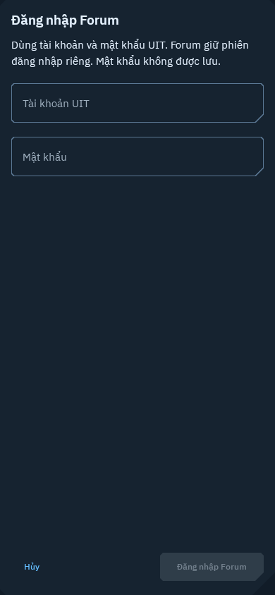
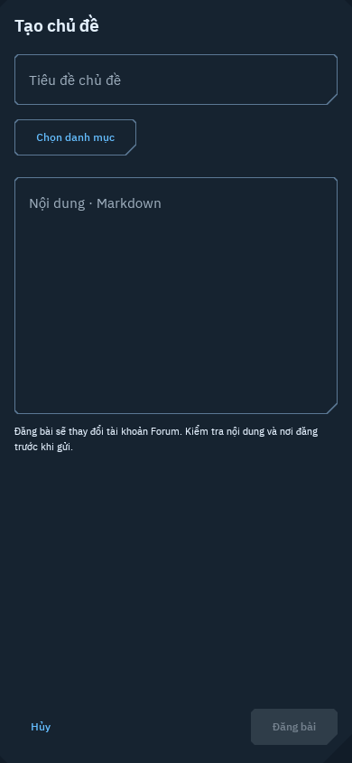

# UIT Forum: native phone workspace

This direction covers the reader and its native account increment. Full student-facing web
parity remains the target; use the [parity matrix](../research/UIT-FORUM-PARITY.md)
to design the missing workflows and verify actual UIT behavior before expanding
the interface. A browser handoff does not complete a native parity requirement.

The reader serves a student looking for a campus answer, following a long support
thread, or returning to a saved post. It is a dedicated workspace reached from
Inbox, including when signed out. The five existing bottom destinations remain.
Moodle course discussions retain their separate course context.

The opening hierarchy is source identity, Latest / Categories / Search / Saved,
then a single editorial list. Topic rows emphasize title, category, activity and
post count. Pinned and closed states use text, never color alone. Categories show
parent relationships. Search opens the matched reply rather than the first post.
Saved topics are explicitly local; they do not subscribe or bookmark on Discourse.

The reader emphasizes the topic title, original author, date and post number.
A compact navigation strip exposes jump, resume, previous and next windows.
Reading position belongs to the device. Missing replies do not collapse the
stream into a fictional continuous post-number sequence. Cached content shows
its retrieval time and offline state. A saved reference does not promise a full
offline copy of a multi-thousand-post topic.

Use the existing navy surfaces, UIT blue, Plex typography and TechnicalShapes
8dp/28dp frames. Body text has the strongest reading priority. Separate posts
with quiet rules and spacing, rather than nested dashboard panels. Controls use
native Material 3. Keep 16dp phone gutters and 4dp spacing increments; long code
and tables scroll horizontally. Quotes, fenced code, tables, collapsed details,
links and explicitly loaded images have distinct native treatments. Unsupported
interactive embeds offer the source page. External links require an explicit
browser handoff showing the destination. No WebView executes forum content.

Validate 360dp, 390dp and 412dp portraits, Vietnamese with larger text, search
matches, long-topic navigation, local saved state, offline and unavailable states.
Published Forum screenshots must come from live UIT Forum responses through the
production client, parser, repository and Compose reader. Behavior tests may use
fixtures but must not export screenshots. Inspect public captures before
publishing; account screenshots and student support replies remain local.
See the gallery provenance manifest for source routes, capture time and hashes.

## Native account workspace

The toolbar account action opens a full-height phone login form, then an account
workspace with Notifications / Forum bookmarks / Chat. Keep account identity
visible and clearly distinguish local disconnect, temporary saves and server
bookmarks. Native personal lists follow account capabilities; no counters or
sample notices are invented.

Login and composer use the same TechnicalShapes, 16dp gutters and keyboard-aware
scrolling content with bottom actions. Their full-height layout avoids an unstable
intrinsic-height alert dialog on the host renderer and gives the keyboard enough
space on narrow phones. Password state is transient. Publishing requires an
explicit button; errors and uncertain submission outcomes retain entered text.

Chat separates channel history from an opened thread. The selected thread is
visible above its messages and the send action retains that thread ID. Every
message uses the semantic Forum renderer, including nested content and explicit
media loading. No background typing/read events are emitted. Realtime updates,
new conversations/threads and message management remain open parity work.

[Account behavior and evidence](../FORUM-ACCOUNTS.md) documents the actual UIT
login/read-only capture and local mutation acceptance. Public images include only
inspected empty forms from that live flow. Private account lists stay local;
fixture interaction tests do not export screenshots.

| Native login | Native composer after actual login |
| --- | --- |
|  |  |

[Capture provenance and hashes](previews/forum-account-provenance.json). These are
390dp Vietnamese Robolectric screens. No draft text or synthetic Forum content is
inserted, and no post is submitted. Authenticated account-list captures remain
private. Passing host rendering does not establish installed-device acceptance.
