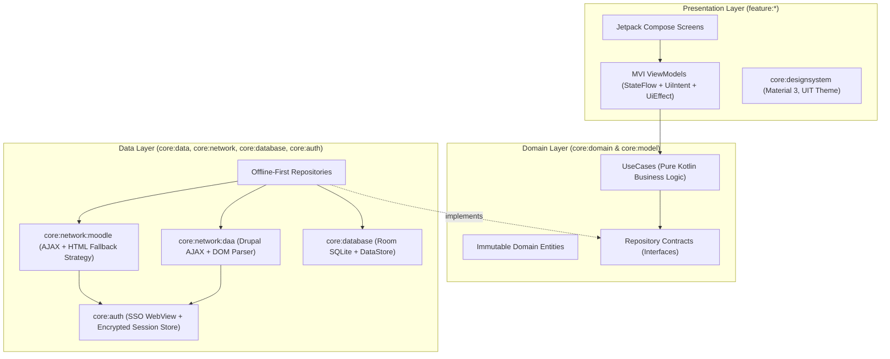

# 01. Architecture, Design Patterns & Clean Code Principles

## 1. Guiding Philosophy: "Stand on the Shoulders of Giants"

Rather than inventing ad-hoc patterns or brittle network calls, **UIT Mobile** stands on two proven foundations:
1. **[`RyanNg1403/uit-cli`](https://github.com/RyanNg1403/uit-cli)** for domain-specific UIT Moodle protocols, session-AJAX serialization, capability discovery, HTML fallback scraping, security hardening, and H5P/file handling.
2. **Google's *Now in Android (NiA)*** for modern Kotlin Multi-Module Clean Architecture, Offline-First Single Source of Truth (SSOT), Unidirectional Data Flow (MVI), and Material 3 Adaptive UI.

---

## 2. Multi-Module Clean Architecture



### Dependency Rules (Strict Clean Architecture)
- **`core:model`**: Pure Kotlin data classes/value classes. Zero external library dependencies.
- **`core:domain`**: Depends only on `core:model` and `core:common` (Coroutines/Flow). Defines **Repository Interfaces** (Dependency Inversion Principle) and **UseCases** that combine Moodle and DAA data.
- **`core:data`**: Implements `core:domain` repository interfaces by coordinating `core:network` and `core:database`.
- **`feature:*`**: Depends only on `core:domain`, `core:model`, `core:designsystem`, and `core:common`. Features **never** depend on `core:data`, `core:network`, or `core:database` directly, nor on other `feature:*` modules.

---

## 3. GoF & Enterprise Design Patterns Applied

### A. Strategy + Decorator Pattern (`FallbackMoodleApiClient`)
In `uit-cli` (`src/api.ts` & `src/moodle-session-client.ts`), Moodle endpoints are first queried via `/lib/ajax/service.php`. If the UIT Moodle server rejects the method as unavailable for student sessions (`servicenotavailable`, `wsfunctionnotavailable`, `cannotfindfunction`), it transparently falls back to parsing the authenticated HTML page.
- **Interface**: `MoodleApiClient`
- **Primary Strategy**: `AjaxMoodleApiClient` (Fast JSON RPC over `/lib/ajax/service.php?sesskey=...`)
- **Fallback Strategy**: `HtmlScrapingMoodleApiClient` (Ksoup CSS-selector DOM extraction)
- **Composite Decorator**: `ResilientMoodleApiClient(primary, fallback, errorClassifier)` intercepts `MoodleException`, checks `ErrorClassifier.isUnavailableSessionMethod(e)`, and delegates to `fallback` without the caller knowing!

### B. Repository + Offline-First Single Source of Truth (SSOT)
- The UI **never** awaits raw HTTP calls to render screens.
- Every Repository exposes `Flow<T>` backed by **Room Database** queries.
- Synchronization uses a `networkBoundResource` / `Syncable` pattern:
  1. Emit cached database rows immediately (`UiState.Success(data, isSyncing = true)`).
  2. Fetch fresh data from Moodle / DAA in background `Dispatchers.IO`.
  3. Sanitize via Anti-Corruption Layer (ACL) mappers and upsert into Room within a transaction.
  4. Room automatically emits the updated state to the UI.

### C. Chain of Responsibility (Ktor HttpClient Interceptors)
All HTTP traffic passes through a strict pipeline of Ktor plugins ported from `uit-cli`:
1. **`OriginGuardPlugin`**: Rejects any non-HTTPS URL or credential-bearing URL, and prevents cookies (`MoodleSession`, `SSESS...`) from ever being sent to an external origin during 301/302/303/307/308 redirects.
2. **`SessionCookieInjectorPlugin`**: Reads the active account's encrypted cookies from `SessionVault` and attaches the `Cookie` header.
3. **`LoginPageSnifferPlugin`**: Inspects the first 8,192 bytes of any HTML or binary file response (`api.ts:195-208`). If Moodle/DAA returns HTTP 200 with a `<form ... login>` or `input[name="password"]`, it aborts the stream and throws `SessionExpiredException`, triggering an app-wide re-auth banner.

### D. Unidirectional Data Flow (MVI) in Presentation
Every screen follows a strict contract:
```kotlin
interface MviViewModel<State, Intent, Effect> {
    val uiState: StateFlow<State>
    val uiEffect: Flow<Effect>
    fun onIntent(intent: Intent)
}
```
- **State**: Immutable `@Immutable data class` representing the exact screen state.
- **Intent**: Sealed interface of user actions (`Refresh`, `SelectSemester`, `SubmitFile`).
- **Effect**: One-time side effects (`NavigateTo`, `ShowSnackbar`, `OpenExternalUrl`).

### E. Typed Error Handling (`AppResult<D, E>`)
No raw exceptions cross the Data -> Domain -> UI boundary.
```kotlin
sealed interface AppResult<out D, out E : AppError> {
    data class Success<out D>(val data: D) : AppResult<D, Nothing>
    data class Failure<out E : AppError>(val error: E) : AppResult<Nothing, E>
}

sealed interface AppError {
    data object SessionExpired : AppError
    data object NetworkOffline : AppError
    data class PortalUnavailable(val portal: PortalType, val code: String?) : AppError
    data class ValidationError(val message: String) : AppError
}
```

---

## 4. SOLID & Clean Code Principles Checklist

- **Single Responsibility (SRP)**: HTML parsers (`DaaTimetableParser`, `MoodleForumHtmlParser`), network transports, Room DAOs, and UseCases each have a single, well-defined reason to change.
- **Open/Closed (OCP)**: Adding a new UIT portal (e.g., `drl.uit.edu.vn` or `oep.uit.edu.vn`) or a new Moodle module type (`quiz`, `lesson`, `h5pactivity`, `book`) requires adding a new parser/handler without modifying existing core network logic.
- **Liskov Substitution (LSP)**: `AjaxMoodleApiClient`, `HtmlScrapingMoodleApiClient`, and `MockMoodleApiClient` (in tests) are 100% substitutable implementations of `MoodleApiClient`.
- **Interface Segregation (ISP)**: Instead of one monolithic 50-method interface, Moodle and DAA capabilities are segregated into focused interfaces (`CourseCatalogDataSource`, `AssignmentDataSource`, `ForumDataSource`, `DaaScheduleDataSource`, `DaaAcademicDataSource`).
- **Dependency Inversion (DIP)**: High-level UseCases depend on pure Kotlin interfaces in `core:domain`; low-level Ktor/Ksoup/Room implementations live in `core:network` and `core:database` and are wired via Hilt/Koin.
