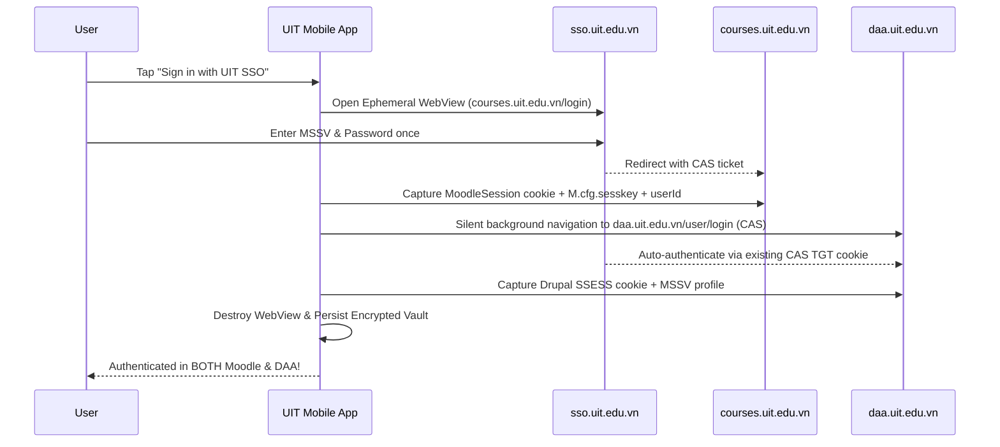

# 04. Unified Features, Cross-Portal Synergy & UX Design

The primary value of **UIT Mobile** is unifying **Moodle (`courses.uit.edu.vn`)** and **DAA (`daa.uit.edu.vn`)** into a single cohesive experience where data from both portals enriches each other.

---

## 1. Cross-Portal Synergy Features

### Feature 1: 1-Tap Unified CAS Sign-In
- Students never have to log in twice. Because `sso.uit.edu.vn` holds the Central Authentication Service (CAS) Ticket-Granting Cookie, as soon as Moodle authentication succeeds in the WebView, the controller silently visits `daa.uit.edu.vn` to mint the DAA Drupal session cookie before closing the WebView.
- Also supports **Multi-Account Management** (just like `uit-studio` in `src/studio-core.ts`): users can additionally link `coursesold.uit.edu.vn` (Legacy Undergraduate) or `coursesold.uit.edu.vn/sdh` (Graduate Moodle).

### Feature 2: Smart Overlay Timetable (`GetUnifiedScheduleUseCase`)
Standard timetable apps only show static weekly classes from the start of the semester. **UIT Mobile** dynamically overlays 4 layers onto your daily/weekly calendar:
1. **Base Layer (DAA TKB)**: Weekly recurring lecture & lab slots (`IT004.O21`, Room `B3.14`, Tiết 1–3).
2. **Override Layer (DAA Nghỉ/Bù)**: Matches `ClassScheduleChangeNotice` by `classCode` (`IT004.O21`) and `targetDate`:
   - If a class has a **Nghỉ học** notice for this week's date, the slot is visually badged `NGHỈ HỌC` (strikethrough/muted) so the student doesn't travel to campus unnecessarily!
   - If a class has a **Học bù** notice, an extra make-up card (`HỌC BÙ - Phòng ...`) is injected into that specific date.
3. **Exam Layer (DAA Lịch thi)**: Injects midterm/final exam shifts (`Ca 1..4`, Room, Date) directly into the calendar.
4. **Deadline Layer (Moodle Calendar & Assignments)**: Overlays Moodle assignment due dates (`duedate`), quiz close times (`timeclose`), and submission status badges (`Submitted` in green vs `Needs Action` in red/amber).

### Feature 3: Automatic Course Cross-Linking (`CourseCrossLinker`)
- Matches DAA `classCode` (e.g., `IT004.O21` or `SE104.O22`) against Moodle `shortname` / `fullname` via normalized regex token matching.
- **In Timetable View**: Tapping a class slot (`SE104.O22 - Nhập môn CNPM`) shows a bottom sheet with:
  - Room, Lecturer, Tiết/Time, Nghỉ/Bù history.
  - Direct quick-links to **Moodle Course Materials**, **Latest Course Announcements**, and **Pending Assignments** for that exact class!
- **In Moodle Course View**: Shows the class's weekly room, lecturer, and DAA final exam date right inside the course header.

### Feature 4: Built-in Course Material Manager & H5P Reader
- **Offline File Vault**: Downloads slides (`.pdf`, `.pptx`, `.docx`) with SHA-256 integrity verification (`core:data`), organized by Course -> Section.
- **Native H5P Interactive Summary**: Uses our Kotlin port of `uit-cli`'s `h5p.ts` to inspect `.h5p` packages without needing a desktop browser, listing all interactive slides, embedded YouTube/Drive links, and text summaries.
- **Safe Assignment Submission**: Allows picking a file from Android's Document Picker (`ActivityResultContracts.OpenDocument`), uploading it to Moodle's draft repository (`repository_ajax.php?action=upload`), and submitting it with an explicit confirmation dialog (honoring `uit-studio`'s safety principle that assignment submissions always require explicit user confirmation).

### Feature 5: Proactive Background Worker (`UitSyncWorker`)
- Runs periodically via Android `WorkManager` (respecting battery & network constraints):
  1. **Deadline Reminders**: Ported from `calendarReminders()` in `uit-cli/src/calendar.ts:150-161` — fires high-priority notifications at **24 hours** and **1 hour** before any unsubmitted (`needsAction == true`) deadline.
  2. **Nghỉ/Bù Alerts**: Alerts the student immediately when a lecturer posts a new canceled or make-up class notice for any of their enrolled `classCode`s on DAA.
  3. **Grade Published Alerts**: Alerts the student when a new Moodle grade item or DAA semester grade (`KQHT`) is posted or updated.

---

## 2. Navigation & Screen Architecture (Material 3 Adaptive)

Bottom Navigation Bar (on phones) / Navigation Rail (on tablets/foldables) with 5 top-level destinations:

1. **Today (Dashboard)**
   - Greeting + Student ID card + Session Health status indicator (`Connected` / `Re-login needed`).
   - **"Happening Today" Timeline**: Today's classes (with real-time Nghỉ/Bù status) + Today's Exams.
   - **"Urgent Deadlines" Carousel**: Next 7 days of unsubmitted Moodle assignments/quizzes with countdown timers (`2d 4h left`).
   - **Recent Announcements Feed**: Combined Moodle Course News (`Các thông báo`) + DAA Nghỉ/Bù & General notices.
2. **Schedule (TKB & Calendar)**
   - Toggle between **Weekly Timetable Grid** (Tiết 1–10 visual blocks) and **Monthly Agenda** (Moodle Calendar + Exams + Deadlines).
   - Semester selector & Week scrubber.
3. **Courses (Moodle Workspace)**
   - Filterable list of enrolled courses (`Current Semester`, `All`, `Past`, `Hidden`) across connected accounts.
   - **Course Detail Tabs**:
     - *Materials*: Sections, modules, downloadable files, H5P reader.
     - *Assignments*: Deadlines, submission status, native file upload & submit.
     - *Announcements & Forums*: Read discussion threads, view inline attachments, post replies (`mod_forum_add_discussion_post`).
     - *Grades & Participants*: Course gradebook report and classmate/lecturer directory.
4. **Deadlines & Inbox**
   - Unified actionable checklist of all Moodle assignments & quizzes across courses (`Upcoming`, `Submitted`, `Overdue`).
   - Moodle Popup Notifications & Private Messaging Inbox (`uit notifications` & `uit inbox` port).
5. **Academic Hub (DAA)**
   - **Transcript & GPA Calculator**: Semester-by-semester grades (`QT`, `GK`, `TH`, `CK`, `TK`), cumulative GPA, and interactive "What-If Grade Calculator" to project future GPA.
   - **Exam Schedule**: Midterm & Final exam cards with countdowns.
   - **Student Profile & Accounts**: MSSV profile details, connected Moodle/DAA session health, and dark/dynamic theme settings.
