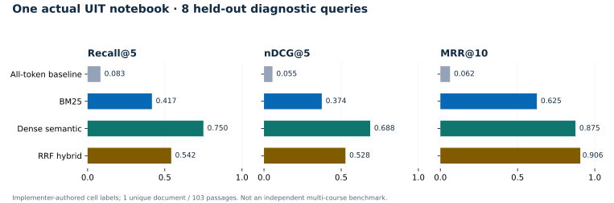

# Course retrieval evaluation

Date: 2026-11-05. This is a small diagnostic, not a general UIT relevance benchmark.

## Actual source and real provider

The source is the owner-authorized read-only Moodle capture of **NT409.R11,
Lab01-student.ipynb**, acquired on 2026-11-02. Two captured files were byte-identical;
one was excluded. Notebook source contains assignment instructions and placeholder
answer cells; outputs/metadata/attachments were not indexed or sent. Raw notebook,
account identity, raw vectors, full index and provider credentials remain outside
the public repository.

The production extraction, verified local-file storage, account-scoped repository,
BM25 and Direct embedding transport processed **one unique notebook / 103 passages**.
The test uses an explicitly anonymized local capture owner and cached source
catalog, not a university login or live university permission check. There were no
new UIT requests, university session access or account mutations.

The project denied `text-embedding-3-small`; three actual rejected embedding
requests (two indexing attempts and a diagnostic) returned HTTP 403. A read-only
model listing exposed `text-embedding-3-large`. The successful run used that model
at **512 dimensions**, with **23 successful real embedding requests**: seven index
batches and sixteen individually submitted query embeddings. It used **18,180
indexing tokens plus 219 query tokens = 18,399 total reported tokens**. Indexing
took 3,473 ms on the host JVM. No vector or successful provider result was replaced
by an authored fixture. Mock transport tests are separate from this live record.

[Sanitized request IDs, token counts, timing, judgments and per-query rankings](evidence/course-retrieval-live.json).
The record includes the denied model, without publishing the project identifier.

## Judgments and methodology

Sixteen queries were written and cell-level relevance grades fixed before real
embedding results were obtained. Eight are labelled development and eight test.
They include code identifiers, English paraphrases, Vietnamese conceptual queries
and mixed-language terms. Labels were authored by the implementer after reading
the actual source; they are not independently judged ground truth. No parameters
were fitted on the test results. This small split does not eliminate author bias
or substitute for a multi-course, independently labelled benchmark.

The comparison uses an all-query-token passage baseline, BM25, dense cosine and
RRF hybrid. The existing metadata search is retained in the app but is not a
passage-ranking system, so its file hits are not assigned artificial passage
recall. All four evaluated methods share the actual extracted corpus. The all-token
baseline is not timed; its stored zero is a sentinel, not a latency measurement.

Metrics deduplicate source cells before scoring, so several chunks of one cell
cannot earn repeated relevance credit. Recall@5 counts labelled relevant cells;
nDCG@5 uses grades 1–3 with gain `2^grade-1`, normalized against ideal graded order.
MRR@10 uses the first cell with a positive relevance grade. The inspected result
window is capped at twenty passages, which can itself limit distinct-cell recall.

## Held-out diagnostic results

| Method | Recall@5 | nDCG@5 | MRR@10 |
| --- | ---: | ---: | ---: |
| All-token baseline | 0.083 | 0.055 | 0.062 |
| BM25 | 0.417 | 0.374 | 0.625 |
| Dense semantic | 0.750 | 0.688 | 0.875 |
| RRF hybrid | 0.542 | 0.528 | 0.906 |

These results support keeping separate modes: dense retrieval improved conceptual
ranking here, while equal-weight RRF lost some top-five relevance compared with
dense alone, despite a higher first-relevant reciprocal rank. It is incorrect to
call hybrid universally superior. BM25 stays the no-transfer/offline default.

BM25 also sometimes ranks a test/call site above a function definition for an exact
identifier. Dense retrieval can rank a nearby exercise question above its
explanation. These are recorded relevance failures, not corrected answers or hidden
fixture substitutions. A search result is an inspectable excerpt, not proof that
it answers the student’s question.

## Local sensitivity and baseline audit

A separate replay made **zero provider requests** and swept 12 BM25 settings:
800/1400/2000-character passages with corresponding 100/180/250 overlap, `k1`
0.8/1.2 and `b` 0.25/0.75. Held-out nDCG@5 ranges were 0.292–0.372, 0.304–0.392
and 0.297–0.392 respectively. These are descriptive sensitivity measurements,
not parameters selected on the test set. The shipped 1400/180, 1.2/0.75 defaults
were fixed before the real embedding run and remain unchanged.

The live all-token baseline matched body-only tokens, while BM25 also indexed the
course/file labels. The replay explicitly checked that adding those labels to the
baseline returned identical matching sets for all sixteen queries, so this metadata
difference did not change the recorded baseline results. The comparison is with
an all-token passage baseline, not an assertion that existing metadata search had
these passage metrics.

[Configuration results and baseline parity audit](evidence/course-retrieval-ablation.json).



## Latency and usage limits

Each semantic query includes one fresh real query embedding. Hybrid then reuses
that exact vector in the evaluation harness to avoid duplicate paid calls; its
recorded latency excludes the provider round trip and must not be presented as
faster end-to-end semantic search. BM25 includes source verification and hashing;
the first lexical query also builds the in-memory inverted index. All timings use
host CPU/SSD/network, not a physical phone. Report mean/individual timings with
these caveats rather than extrapolating device latency or costs from them.

Indexing/query usage comes from actual responses. The bounded app does not estimate
usage by pretending characters are exact token counts. Cancellation or failures
can still incur provider usage; no automatic paid retry occurs.

## Mechanical and visual verification

Deterministic tests cover independently calculated BM25 scores, Unicode/identifier
terms, exact chunk offsets, cell boundaries, overlap, vector validity and rank
fusion. Repository/transport cases cover account ownership and removal, restarts,
source replacement/deletion, unavailable providers, source reservation, strict model/
dimension/index validation, fixed endpoint, connection changes and explicit reset.

The [phone gallery](../design/COURSE-RETRIEVAL.md) uses actual captured source and
production retrieval output. Synthetic behavior fixtures never export review
images. Host Compose rendering is not device TLS, Keystore or physical-phone
performance evidence. Broader relevance tests, PDF text fidelity/OCR and multiple
independent courses remain explicit follow-up evaluation needs.

## Recorded checks

- `./gradlew check :app:assembleDebug :app:compileDebugAndroidTestKotlin`
  passed: app debug 328 cases (25 opt-in skipped), release 121 cases; no failures.
- Final review then tightened source-inspection document membership and the UI
  explanation when all source files are invalidated. The final focused pass
  passed **39 active cases**, with the two paid/replay cases skipped by default:
  7 scoring/chunking cases, 16 data/transport cases, 3 ViewModel cases, 7 UI
  interaction cases and 6 actual-data rendering cases. Kotlin formatting/lint,
  debug APK, release Kotlin and Android-test compilation passed in that pass.
- A forged inspection reference to another account's identical-content file was
  rejected before its loader was called. Clearing an index during an in-flight
  embedding request did not recreate it. These are deterministic regression cases,
  separate from the real provider measurements.
- The real benchmark separately passed with 23 successful provider calls. The
  12-case local ablation passed with no provider or university request.

Reproduce deterministic checks:

```sh
./gradlew :core:domain:test --tests '*PassageSearchTest'
./gradlew :core:data:testDebugUnitTest --tests '*Passage*Test'
./gradlew :app:testDebugUnitTest --tests '*PassageSearchDesignTest' --tests '*PassageSearchViewModelTest'
./gradlew check :app:assembleDebug :app:compileDebugAndroidTestKotlin
```

The real benchmark is opt-in and requires the owner's previously authorized
capture directory (containing `document-2.ipynb`, catalog and source provenance),
plus the personal key in the process. It does not load `.env` itself or accept
secrets on the command line:

```sh
./gradlew :core:data:testDebugUnitTest --tests '*PassageRetrievalLiveTest' -PretrievalLive=true
./gradlew :core:data:testDebugUnitTest --tests '*PassageRetrievalReplayTest' -PretrievalReplay=true
```

Set `UIT_RETRIEVAL_CAPTURE` to the private source directory and `OPENAI_API_KEY`
in the live process before running. The real-model command incurs API usage.
A fresh live run clears only its own report/index/replay files, so stale success
artifacts cannot masquerade as new results. Actual-source outputs stay under
ignored `core/data/build/outputs/retrieval-live`; review before publishing excerpts.

The subsequent PDF navigation pass propagated the expected source hash into the
native reader, preserved it on retry and rejected a changed file before rendering.
Its targeted run passed all 16 reading ViewModel cases, 8 passage UI cases, 3
passage ViewModel cases and the actual selection/source render case. Debug APK,
release Kotlin, Android-test compilation and Kotlin lint passed again. No Android
device was attached when checked with `adb devices -l`. #52 remains open for its
page-aware PDF and broader evaluation scope; these host results do not satisfy
those original gates.
