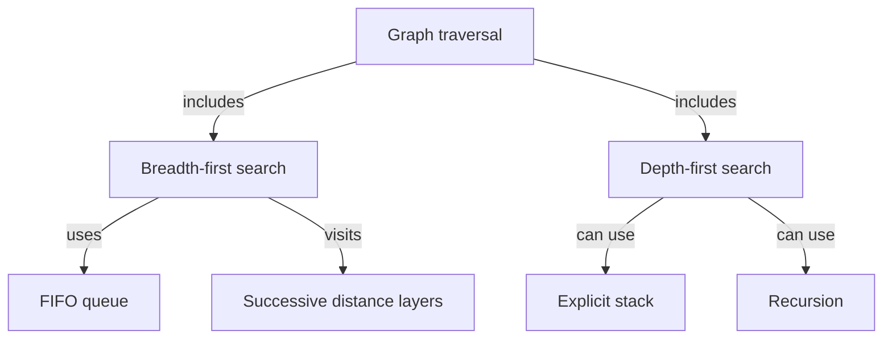

# Source-backed knowledge visualization

Research date: November 2, 2026. This extends the discussion of
[semantic course search](SEMANTIC-COURSE-SEARCH.md). The concept-map milestone is
now implemented on `feat/knowledge-maps`; see the [implementation guide](../KNOWLEDGE-MAPS.md).
Algorithm simulations remain a follow-up. The text below records the original proposal.
No university access, model call, private source upload or UI change was performed.

## Product recommendation

Add a **Course Knowledge Map** that turns explicitly selected teaching passages
into a small, inspectable concept map. Students should see what a concept means,
how it relates to another concept and where that relationship appears in the
course material. Each map answers a focus question, such as how breadth-first
and depth-first graph traversal differ.

Concept maps express propositions using concepts joined by labeled relationships;
an unlabeled connection does not explain the relationship. This follows
[IHMC's explanation of propositions](https://cmap.ihmc.us/docs/proposition.php).
A [focus question](https://cmap.ihmc.us/docs/focusquestion.php) also gives the map
a specific learning purpose rather than accumulating every nearby topic.

The [Nesbit and Adesope meta-analysis](https://www.sfu.ca/~jcnesbit/research/NesbitAdesope2006.pdf)
found positive retention associations across concept-mapping studies, with effects
varying by activity and comparison. This motivates testing the design; it does not
establish a learning improvement for an AI-generated map in this app.

## Illustrative learning experience

This is an authored example, not generated from a student's course or a screen
capture of an implemented feature:



Tapping a concept would open its short definition, an example, neighboring
relationships and original source excerpts. Tapping a relationship would show
the complete proposition and its evidence, not just a similarity score. A source
action opens the verified PDF page or notebook cell through the existing reader
or source viewer. Missing or replaced sources get an explicit stale state.

Search and mapping answer different questions. #52 finds relevant passages; a map
explains proposed relationships among concepts in those passages. Reuse ingestion,
versioned locations and retrieval, but give map generation and review separate
acceptance criteria. Embedding proximity is not evidence of causality, equivalence
or prerequisite order.

## Two delivery levels

| Level | Student action | Engineering boundary |
| --- | --- | --- |
| First: concept map | Select a topic and passages, inspect a draft, expand a concept, read an explanation and open evidence | Bounded structured concepts/relationships, deterministic layout, explicit local saving and offline review |
| Later: interactive walkthrough | Step through BFS with the queue, visited nodes and traversal order changing together | A separately implemented and tested teaching simulator with known transition rules; no execution of AI-generated code |

A BFS walkthrough should let students choose a start vertex, advance/rewind steps
and compare queue state with the graph. Neighbor ordering must be explicit since
more than one traversal order can be valid. Other subjects need their own suitable
visualization, such as a SQL join comparison or a probability tree; do not promise
that a generic concept-map generator can simulate arbitrary topics.

## Draft and evidence contract

Proposed records:

```text
ConceptMapDraft: focusQuestion, sourceVersions, nodes, edges, model, generatedAt
ConceptNode: stableId, label, sourceLanguageAliases, shortDefinition, citations
ConceptEdge: fromId, relationKind, label, toId, citations, provenance
Citation: documentVersion, passageId, originalQuote, originalLocation
```

- Keep source selection explicit. Source text is untrusted teaching data, not
  executable code or instructions for tools. Do not include private annotations,
  submissions or profile scans automatically.
- Start with bounded drafts, for example 8–12 concepts and a validated edge limit.
  These are prototype settings, not measured optimal teaching sizes.
- Require known node IDs, supported relationship kinds, bounded text, no duplicate
  edges and resolvable quotations for definitions and relationships. Preserve
  original source wording even when display labels are translated.
- Check source versions on generation acceptance, saving and navigation. Removing
  an account purges its maps and cancels late results. A saved map keeps explicit
  historical provenance and cannot silently attach to a new file version.
- Separate relationships stated by the source from model suggestions or student
  edits. Two concepts sharing a passage does not prove the proposed relationship.
  Quote matching validates occurrence, not semantic support; relationship quality
  needs human evaluation and an inspectable draft.
- Do not merge similarly named concepts across courses without disambiguation.
  Alias equivalence also needs evidence; a queue and FIFO are related terms, not
  automatically interchangeable concept identities.
- General concept graphs can contain cycles. Only a separately declared
  prerequisite subgraph should have an acyclicity rule, and contradictory source
  claims should be exposed rather than silently removed to make a tidy diagram.

The existing configurable AI connection could generate drafts after a deliberate
send. Map layout, expansion and saved-map reading run locally and need no model
request. A fully offline generation model would require its own quality and device
feasibility work; local visualization does not establish offline AI generation.

## Phone presentation

Use the existing single-column phone shell, five bottom destinations, UIT palette
and cut-corner controls. Start with a focus concept and a few readable neighbors;
expand one cluster at a time rather than shrinking an entire course onto the
screen. Keep positions stable during expansion and provide Back, reset and a list
view of the same propositions. Nodes need native touch targets and accessibility
semantics; an unlabeled Canvas alone is insufficient for TalkBack.

Render typed graph data with application-owned drawing/layout code. Do not execute
model-provided JavaScript, HTML, arbitrary SVG or Mermaid directives in a WebView.
The Mermaid above is only a repository/chat illustration.

Learning actions can include **Explain**, **Open source**, **Compare concepts**
and a later **Practice this concept** link to #50. Matching saved quiz questions to
a concept needs explicit provenance or review. Color must not claim mastery from
graph centrality, viewing time or a single correct answer. A student's self-marked
understanding remains labeled self-report.

## Evaluation and next scope

Before implementation, agree on a small set of maps with human-reviewed concepts,
relationship meanings and source locations. Include Vietnamese/English aliases,
ambiguous terms, contradictory material, unsupported prerequisite claims and
documents with missing text. Measure source-navigation correctness and supported
relationship precision separately from visual layout quality.

Then test whether students can explain the relationships or solve transfer
questions using the map compared with the same passages in a text/list view.
A visually attractive map and passing JSON validation do not establish learning
benefit. Any retention study needs its own stated method; the cited meta-analysis
is not a substitute for evaluating this implementation.

The first implementation proposal should cover concept maps, evidence inspection,
editing/explicit saving and offline viewing. Keep algorithm walkthroughs as a
separate follow-up. Create a dedicated feature issue when implementation is chosen,
linked to #52, ingestion #46, PDF reading #32 and practice #50; do not silently
expand #52's retrieval scope into an entire visual learning platform.
