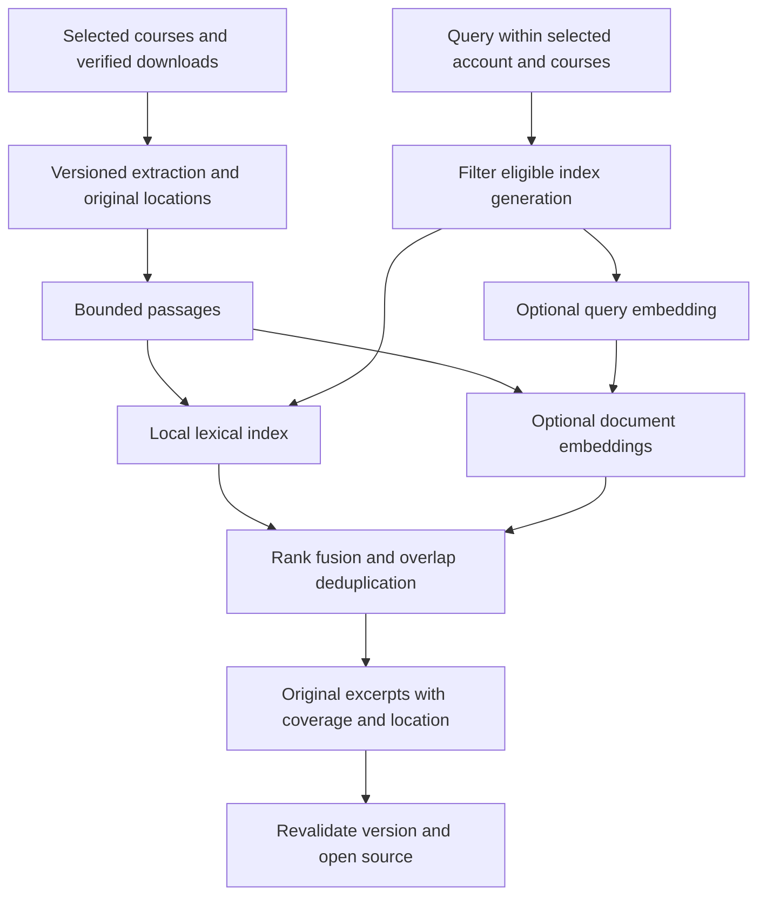

# Semantic course search: implementation research

Research date: November 2, 2026. Target: [issue #52](https://github.com/trungdangtapcode/UIT-Mobile-kt/issues/52).
Repository audit: `5e9afc6da70d4807afb0ed712cedd3556c73ebc8`, the head of
[PDF reader PR #75](https://github.com/trungdangtapcode/UIT-Mobile-kt/pull/75).
This is a researched proposal, not an implemented feature or measured benchmark.
No university account, private document, API key, paid inference or model download
was used. No corresponding semantic-search PR was found in the repository's PR
listing during this audit; #52 was unassigned. Recheck ownership before implementation.

## November 5 implementation increment

This document retains the November 2 proposal and its original audit claims below.
The subsequent [measured research](COURSE-RETRIEVAL.md),
[implementation](../COURSE-RETRIEVAL.md) and
[evaluation](COURSE-RETRIEVAL-EVALUATION.md) add bounded local BM25 and an experimental
opt-in Direct cloud adapter, with actual source/model results. This supersedes the
statement that no corresponding app feature exists; it does not retroactively
change the original research's no-account/no-provider methodology.

| Original scope | Current evidence / remaining work |
| --- | --- |
| Versioned text/notebook passages and lexical baseline | Implemented with exact source offsets/cell/lines, account isolation, current-byte validation and local fallback |
| Optional Direct cloud embedding adapter | Implemented and measured on one actual NT409 notebook; semantic mode remains explicit and experimental |
| Source-version navigation | Text/cell inspection verifies the expected bytes. Native PDF opening carries the expected hash and rejects replacement before rendering, including retry |
| PDF page-aware source navigation | **Open**: only partial extracted-text/document location is available; no physical page is invented |
| Packaged local embedder / Android model parity | **Open**: no model artifact is downloaded or shipped |
| Independent multi-course, unanswerable-query and physical-phone evaluation | **Open**: current judgments are implementer-authored; host renders and timings are not device gates |

Keep #52 open for its remaining source-navigation and evaluation scope. This is a
reviewable increment of stages 1/2 and the optional cloud portion of stage 4, not
completion of every original release gate or a sign-off on production semantic
quality. BM25 stays the no-provider default. Cloud experimental parameters and
limits are documented explicitly rather than presented as fitted UIT constants.

## Recommendation

Build passage search over explicitly selected, verified offline course documents.
Combine local lexical retrieval with optional multilingual embeddings and open
the original version/location from each result. Keep search on the phone; a hosted
backend is not necessary. Cloud embedding can be a separate, explicit option.

A student should be able to describe a concept in Vietnamese and find its English
course passage, even when its filename is unhelpful. For example, a question about
visiting graph nodes level by level should be evaluated against the actual BFS
passage, rather than answered from general model knowledge. Such examples are
target behavior, not evidence that an untested model already retrieves them.

The first engineering milestone should be **versioned passages and reliable source
locations**, followed by a lexical baseline and an Android embedding spike. Merely
adding an embedding API to the current source loader would index incomplete text
and lose the location needed to inspect a result.

This extends shared ingestion work in #46 and evaluation work in #47. It also
provides a stronger retrieval basis for #49 without adding another chat interface.

The companion [knowledge visualization proposal](KNOWLEDGE-VISUALIZATION.md)
describes inspectable concept maps and a later interactive algorithm walkthrough.
It reuses passage evidence while keeping relationship generation and teaching
visualizations separate from search ranking.

## What exists, and what is missing

| Existing component | Verified behavior at the audited revision | Consequence |
| --- | --- | --- |
| [Workspace search](../../core/domain/src/main/kotlin/vn/edu/uit/mobile/domain/WorkspaceSearch.kt) | Accent-folded substring matching over titles, course codes and metadata context; all query terms must match; sorting by kind/title | Body text is not searched. Preserve this useful entry search rather than replacing it with dense results |
| [Offline source loader](../../core/data/src/main/kotlin/vn/edu/uit/mobile/data/OfflineDownloadStorage.kt) | Verified cached files, an 8 MiB input limit and a 12,000-character text prefix per source; PDF streams are flattened | Suitable for explicitly previewed excerpts, not a complete passage index or page mapping |
| [Study source contract](../../core/domain/src/main/kotlin/vn/edu/uit/mobile/domain/StudyAi.kt) | `StudySource(id, title, text)` has no file version, page or cell locator | Introduce a location-aware ingestion contract; do not reinterpret source IDs as page numbers |
| [Study AI](../STUDY-AI.md) | Selected-text Q&A already exists, with direct OpenAI or an optional gateway | #49 is partly implemented. #52 adds retrieval rather than duplicating this flow |
| [Notebook text](../../core/data/src/main/kotlin/vn/edu/uit/mobile/data/NotebookText.kt) and [code imports](../CODE-TUTOR.md) | Notebook sources can be read without executing cells; code imports already retain cell/line provenance | Reuse parsing and safety boundaries; expose structured cell locations to search |
| [PDF reader](../COURSE-READING.md) | Versioned file identity, page navigation and account removal; `open(course, file)` resumes its saved position | Add a verified target-location route. Do not open and immediately race an asynchronous `page()` call |
| [Database](../../core/database/src/main/kotlin/vn/edu/uit/mobile/database/UitDatabase.kt) | Snapshot entities; no passage/vector tables or database encryption configuration in this factory | Existing Room presence does not establish private index storage or semantic search support |

The app supports API 26 and currently pins Room 2.7.1. Its cached Room annotations
contain `Fts3` and `Fts4`, not `Fts5`. Current Android documentation describes newer
FTS choices, but that does not upgrade this repository's dependency or guarantee
device SQLite capabilities. An FTS5 design requires a deliberate compatibility
and storage decision. See [Room full-text search](https://developer.android.com/training/data-storage/room/defining-data#search).

## Extraction is a delivery gate

| Source | Proposed location and boundary |
| --- | --- |
| TXT / Markdown | Original text offsets and line ranges; preserve headings and source text |
| Notebook v4 | Original cell number plus source line range; include selected Markdown/code cells, exclude execution output, metadata and attachments |
| Text PDF | Verified file version and one-based page, optionally text-block bounds; preserve page boundaries and inspect column order |
| Scanned / locked / corrupt PDF | Explicit unsupported/unavailable extraction state; keep normal PDF reading available |

Android's [`PdfRenderer.Page.getTextContents()`](https://developer.android.com/reference/android/graphics/pdf/PdfRenderer.Page#getTextContents())
was added at API 35. Rendering a PDF on the existing API 30 test device does not
establish text extraction there. Its documented reading order also needs testing
on multi-column academic pages. A compatible extractor for API 26–34 is an open
dependency spike, not something the current regex reader already guarantees.

Start with complete text/notebook ingestion. For PDFs, either prove page-aware
extraction on each supported path, or expose a document-only location and disable
the page-specific action. A document-level fallback is partial delivery of #52;
do not close its full source-navigation acceptance criterion on that basis. OCR,
equation interpretation and diagram understanding should remain separate work.

Use bounded streams, cancellation and total corpus limits. Do not remove the old
excerpt limit globally: introduce an independently bounded indexing contract, and
report partial coverage instead of silently dropping the tail of a document.

## Proposed data and lifecycle contract

These are proposed types, not existing repository APIs:

```text
DocumentVersion = accountId + courseId + documentId + capturedBytesSha256
SourceLocation  = PdfPage(page, optionalBounds)
                | NotebookCell(cell, firstLine, lastLine)
                | TextRange(startUtf16, endUtf16, firstLine, lastLine)
                | DocumentOnly(reason)
Passage         = documentVersion + passageId + originalText + location
IndexSpec       = extractorVersion + chunkerVersion + normalizationVersion
                + modelArtifactHash/modelId + tokenizerVersion + promptVersion
                + dimensions + pooling + normalization + quantization
SearchHit       = passageIdentity + originalExcerpt + location + retrievalMode
IndexCoverage   = ready/pending/unsupported/failed documents + truncation details
```

Preserve an offset map whenever normalization changes text. Whitespace/accent
normalization used for retrieval must not become a fabricated source quotation.
Repeated paragraphs need distinct locations even if their text hashes match.

Capture and hash the bytes being extracted, following the reader/code-import
pattern; a successful earlier cache lookup does not protect against replacement
between verification and reading. Publish a completed index generation atomically.
Check ownership and generation before publication, querying and opening a hit.

Replaced/deleted/unselected files invalidate eligible passages and derived vectors.
Account removal cancels work, clears in-memory results and purges private index
buckets; late jobs must not recreate them. Switching accounts cannot reuse a
previous account's query results. A changed embedding model or dimension creates
a different vector space and requires compatible reindexing, not mixed scoring.

Search navigation must carry the expected file hash and target locator through
asynchronous opening. Recheck that hash before navigating; show a stale-source
state rather than silently jumping into a replacement PDF. A temporary search
highlight must not create a persistent annotation or bookmark.

## Retrieval algorithm



1. **Chunk by structure, then token budget.** Preserve paragraphs/headings, page
   boundaries and notebook cell/line locations. Split an oversized block using the
   actual selected tokenizer, accounting for its required prefixes. A candidate
   tuning range is 192–320 body tokens with 24–48 tokens of overlap; these are
   experiment settings, not validated defaults. Never equate characters with tokens.
2. **Create a strong lexical baseline.** Use BM25 with configurable `k1` and `b`,
   original and accent-folded Vietnamese channels, and explicit code/course-token
   matching. Preserve identifiers and meaningful operators in a code-aware channel.
   Avoid blindly applying English stemming or discarding negation. See
   [Lucene's BM25 implementation](https://github.com/apache/lucene/blob/main/lucene/core/src/java/org/apache/lucene/search/similarities/BM25Similarity.java).
3. **Retrieve dense candidates independently.** Embed query and passages with the
   same model, dimensions and correct query/document templates. Normalize as
   required, reject non-finite/zero vectors and compute cosine similarity. Filter
   account/course/version eligibility before top-K selection. Do not reduce dense
   retrieval to reranking lexical hits: that would miss zero-keyword-overlap cases.
4. **Fuse ranks.** For eligible passage `p`, use weighted reciprocal rank fusion:
   `score(p) = sum(weight_j / (rrfK + rank_j(p)))`. Missing passages contribute zero;
   ranks start at one. Rank fusion avoids treating BM25 and cosine as comparable
   numeric scales. The original [RRF paper](https://plg.uwaterloo.ca/~gvcormac/cormacksigir09-rrf.pdf)
   used `k=60`; treat it as an initial experimental value, not a UIT-specific result.
5. **Deduplicate overlapping windows by location**, retaining distinct repeated
   sections when useful. Use stable identity tie-breakers. Exact course codes and
   identifiers need separately evaluated lexical precedence, since related concepts
   can be poor substitutes for an exact symbol.

Start with bounded exact vector scanning on the selected corpus. Its scoring cost
is `O(N * dimensions)`; add ANN infrastructure only after measured corpus/latency
needs justify it. Keyword-only operation must remain usable if a model is missing,
unsupported, canceled or offline. Label that mode accurately.

An embedding score or RRF score is not a correctness probability. Do not display
"90% correct" or apply an unexplained universal cosine cutoff. Calibrate weak-match
handling per model on held-out answerable and unanswerable queries, and distinguish
no eligible text, no lexical match, weak semantic matches and incomplete indexing.

## Embedding options

| Option | Primary-source finding | Proposed role and unresolved work |
| --- | --- | --- |
| MediaPipe EmbeddingGemma 300m | The official [Text Embedder overview](https://developers.google.com/edge/mediapipe/solutions/text/text_embedder/index) supplies a mixed-precision task artifact, query/document formatting and a **512-token artifact limit** | First Android feasibility spike: official packaging reduces conversion work. Pin artifact/runtime versions, verify license/distribution requirements and measure RAM, download size and Vietnamese retrieval |
| `intfloat/multilingual-e5-small` | The author's [model card](https://huggingface.co/intfloat/multilingual-e5-small) specifies MIT licensing, 384-dimensional embeddings, query/passage prefixes even for non-English text, and a 512-token limit | Alternative local candidate. Needs verified tokenizer, pooling, export/quantization parity and Android runtime packaging; multilingual support does not establish UIT retrieval accuracy |
| OpenAI embeddings | Official [embedding guide](https://developers.openai.com/api/docs/guides/embeddings) and [create API](https://developers.openai.com/api/reference/resources/embeddings/methods/create) support direct embedding requests and configurable dimensions for `text-embedding-3` models | Optional cloud adapter with an explicit upload preview, separate embedding model setting, usage accounting and no automatic provider fallback |

The [MediaPipe Android guide](https://developers.google.com/edge/mediapipe/solutions/text/text_embedder/android)
requires a compatible trained model; arbitrary Hugging Face checkpoints are not
drop-in task assets. [ONNX Runtime Mobile](https://onnxruntime.ai/docs/tutorials/mobile/)
is an alternative execution route for a verified exported E5 model; runtime,
tokenization, quantization and device performance still need their own spike.

Current Google documentation also lists [EmbeddingGemma 2](https://ai.google.dev/gemma/docs/embeddinggemma/model_card_2?hl=en):
a text-only configuration uses 270M parameters, rather than loading its complete
multimodal model. Its model card supports reduced output dimensions, requires
renormalization after truncation and warns against float16 inference. Do not assume
the Android artifact documented for 300m already packages this newer model.

The published MediaPipe timing is on a Samsung S26 Ultra CPU. It is not a latency,
memory or thermal guarantee for the user's Itel S23. Platform support and an
emulator smoke test also do not establish an acceptable physical-phone experience.

**Decision:** prove the packaged local candidate first, compare E5 if needed, and
keep lexical search available on every device. No model is selected for production
until bilingual quality and physical-device resource gates pass. Download a pinned,
checksum-verified model only after an explicit user action; avoid inflating the base
APK or starting indexing on every text-field edit.

Cloud mode still permits a client-only architecture: the phone calls the provider
directly. It requires network access and sending selected passages/query text;
cached passage vectors alone cannot embed a new query offline. Existing generation
settings and `/v1/study` gateway support do not implement an embedding transport.
Keep the embedding model separate from the tutor/quiz generation model. Provider
availability and billing depend on the configured API account. This research made
no provider calls and establishes no live cost, latency or account access result.

## Storage and configuration

Keep passages, vectors and term dictionaries private and account-scoped. They are
derived teaching/personal data, not an anonymized substitute for the source.
Do not automatically index local annotations, submissions or profile scans.
Cloud consent must cover the selected text and query, not merely enabling AI once.

For a bounded first version, use encrypted per-owner index files and build lexical
structures in memory for the active selection. Existing encrypted preference buckets
have different size limits; do not put a multi-megabyte corpus into them unchanged.
A persistent FTS index requires its own encryption, cleanup and migration design;
adding plaintext FTS tables to the snapshot database would change this boundary.

Raw float32 vectors alone cost `N * dimensions * 4` bytes. At 10,000 passages:

| Dimensions | Raw vectors only |
| --- | --- |
| 256 | 9.77 MiB |
| 384 | 14.65 MiB |
| 768 | 29.30 MiB |
| 1536 | 58.59 MiB |

These are arithmetic estimates, not measured peak RAM. Model weights, tokenization,
activation buffers, original text, postings, encryption and runtime overhead are
additional. Change dimensions only where the model supports it; arbitrary E5
truncation is not established by another model's dimension controls.

Version the algorithm configuration. Expose scope/mode, storage use and clear-index
actions to students; keep detailed tuning in a developer configuration. Proposed
fields are:

```json
{
  "schemaVersion": 1,
  "chunking": {"targetTokens": 256, "overlapTokens": 32},
  "lexical": {"k1": 1.2, "b": 0.75},
  "fusion": {"rrfK": 60, "lexicalWeight": 1.0, "denseWeight": 1.0},
  "retrieval": {"candidatesPerChannel": 40, "visibleResults": 10},
  "limits": {"passagesPerAccount": 5000, "inputBytesPerFile": 8388608},
  "mode": "lexical"
}
```

All numbers above are proposed spike inputs. Validate ranges and total byte/token
budgets; report omissions when a cap is reached. Device-specific measured gates
must determine shipping limits. Invalidate affected caches when configuration changes.

## Phone interaction and evaluation

Keep the existing five destinations and one phone column. Extend search with a
clearly scoped course-passage mode. A result needs the course/document title,
original excerpt, page/cell/line location, version status and a source action.
Show selected/ready/unsupported coverage and cancel/progress controls for indexing.
Do not turn a retrieved snippet into an automatically generated answer.

Build an independently labeled corpus and freeze document-level development/test
splits before tuning. Include English, Vietnamese, accentless queries, Vietnamese
questions over English passages, exact course/code identifiers, negation, similar
but incorrect passages and requests absent from the selected scope. Include source
tails beyond the old 12,000-character prefix, multi-column PDFs, notebook code/math,
image-only/locked PDFs and deliberately misleading document instructions.

Compare **metadata search**, **passage BM25**, **dense-only** and **hybrid** on the
same eligible corpus. Report Recall@5/10, MRR@10 and nDCG@10 by query category,
with relevance labels and corpus size. Separate empty-relevance queries: measure
their weak/no-match behavior rather than assigning misleading recall values.

Release gates should include:

- A reproducible improvement over passage BM25 on the held-out paraphrase and
  cross-language slices, with agreed tolerances for exact identifier regression.
  A win over metadata-only search does not by itself justify adding embeddings.
- Correct original-version navigation for every labeled source location, plus
  deterministic rejection of stale/removed-owner results and late indexing writes.
- Successful offline query/index cancellation/restart and encrypted-cache deletion;
  no university transport operations. Cloud-off tests must reject network access.
- Recorded cold/warm query latency, indexing tokens/second, cancellation delay,
  downloaded/native-library size, storage, peak process memory and thermal behavior
  on a representative physical phone, including the owner's device if available.
- Actual Compose renders at 360/390/412dp, larger text, screen-reader controls and
  missing-model/partial-index/stale-source recovery states. No UI was changed or
  rendered by this research-only change.

No retrieval score, benchmark lift or phone performance claim has been measured in
this research. Final numerical release thresholds must be agreed before viewing
the held-out results; do not tune them to make a preferred model pass.

## Suggested delivery sequence

| Stage | Reviewable change | Exit condition |
| --- | --- | --- |
| 1 | Structured ingestion, version/location contracts and private index lifecycle | Original excerpts and valid locators survive replacement/removal/cancellation tests; PDF capability gaps are explicit |
| 2 | Local passage BM25 and phone search/source navigation | Complete baseline benchmark and phone renders; useful offline search without a model |
| 3 | One optional local embedder, independent dense retrieval and RRF | Pinned artifact parity, held-out retrieval improvement and physical-phone resource gates |
| 4 | Optional direct cloud embedding adapter | Explicit selection/upload controls, request/response tests, model-version isolation and recorded usage; no silent fallback |

Stage 4 is optional and does not block a fully local implementation. After
ownership is confirmed, implementation can stack on #75 using a new feature
branch. This research branch changes documentation only and creates no new app PR.
Keep #52 open until its selected shipping scope and acceptance criteria are met.
