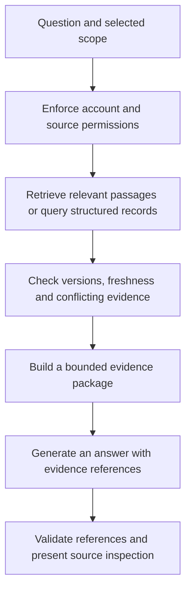

# UIT Assistant: shared-context chat proposal

Design date: 2026-11-04. This document preserves the broader phased proposal.
The public-announcement workspace phase is implemented separately; see the
[delivered architecture and runtime decision](../UIT-ASSISTANT.md). Personal
academic, course-document and Forum scopes below remain planned.

Related issues: [#46 — ingestion, retrieval and verifiable citations](https://github.com/trungdangtapcode/UIT-Mobile-kt/issues/46),
[#55 — announcement assistance](https://github.com/trungdangtapcode/UIT-Mobile-kt/issues/55),
[#52 — semantic course search](https://github.com/trungdangtapcode/UIT-Mobile-kt/issues/52).
Build on [official announcements](../OFFICIAL-ANNOUNCEMENTS.md),
[Study AI](../STUDY-AI.md) and [semantic retrieval research](SEMANTIC-COURSE-SEARCH.md).

## Recommendation

Build a native **UIT Assistant** that answers questions using the app's existing
repositories. Start with official announcements, then add explicitly enabled
personal schedules and deadlines, followed by selected course materials and Forum
posts. Share evidence infrastructure across these workflows rather than building
a separate data pipeline for each chat screen.

The first release should help students understand what a notice says, compare
related notices and prepare an editable local checklist. It must communicate
which sources were searched, how fresh they are and what information is missing.

Example questions, expressed here in English for repository documentation:

- Which important university notices should I review this week?
- What does this scholarship notice require, who is its stated audience and when
  does registration close?
- Which assignments still need action before Friday?
- Where could I fit two revision sessions around my existing commitments?

These are intended capabilities across the delivery phases, not claims that all
are available in the first release.

## Current foundations and required work

The app already supports direct AI and gateway connections, selected course text,
structured AI results and source-quote validation. Official announcement records
preserve source URLs, publication dates, cached bodies and local reading state.
Academic repositories expose structured schedules, deadlines and student records.

A general assistant still needs a conversation model, shared evidence adapters,
permission-aware retrieval, source freshness/conflict handling, cross-source
citation navigation and dedicated evaluation. Existing quote validation can be
reused, but cannot by itself establish that a generated claim follows from a quote.

## Context scopes

| Scope | Included evidence | Activation |
| --- | --- | --- |
| University information | Public official notices from enabled sources | Default scope |
| My studies | Selected account's timetable, exams, deadlines and submission state | Explicitly enabled for that account and conversation |
| Course | Selected course activities, documents and notes | Explicit course/document selection |
| Forum | Selected topics or posts the user can currently access | Explicit addition to the context |

Family records, health information, profile scans and private messages are outside
the initial scope. University cookies, passwords, API keys and authenticated
download URLs must never become model context.

Before enabling personal context, show the account and the types of data that may
be sent. Let the student inspect the selected excerpts before sending. Remember
the chosen scope within that conversation; expanding it requires an explicit
choice. Source selection and query execution remain controlled by application
code, even when the model proposes a retrieval request.

Public-only conversations use a separate device-local namespace. Conversations
with personal context belong to one account. Switching or removing accounts must
cancel pending work, clear active private context and prevent access to another
account's conversation, index or cached answer.

## Retrieval and answer pipeline

1. Resolve the conversation's account, allowed sources and time range before any
   retrieval or cache access. Resolve relative dates in Vietnam time and make the
   interpreted range visible when it matters.
2. Use local lexical search, course codes, date filters and document structure
   first. Add semantic retrieval only after evaluating its benefit on Vietnamese,
   English and mixed technical queries. Model context contains selected relevant
   passages, not an entire academic snapshot.
3. Use deterministic queries and calculations for schedule times, balances,
   assignment counts and available study intervals. The model explains the result;
   it does not invent a balance or calculate availability from prose alone.
4. Preserve a stable source ID, ownership, canonical location, content hash,
   publication date when supplied, retrieval time and paragraph/page/post locator.
   Version the extractor and any search index independently of source versions.
5. Compare amendments and conflicting evidence. Link a correction to an older
   notice only when evidence supports that relationship. A newer publication date
   alone does not prove that a notice supersedes another or applies to the student.
6. Generate structured answer sections that distinguish source-backed facts,
   suggested preparation and unknowns. References must resolve to the exact
   evidence version supplied to that request.
7. Validate source membership, quoted spans and locators. Reject or repair invalid
   references within a bounded retry policy. Evaluate whether the evidence actually
   supports each substantive claim; quote existence is not semantic verification.

Retrieval limits, context budget, timeout and retained conversation length should
be configurable policies with tested bounds. Select their initial values through
evaluation rather than silently inheriting limits from unrelated course actions.

## Freshness, completeness and uncertainty

- Show the sources searched, the latest successful checks and any source failures.
- Distinguish publication dates from retrieval times and user-created reminder times.
- If only a bounded set of articles is cached, disclose that coverage. An empty
  result means no match in that set, not that the university published nothing.
- If an attachment, image, scanned PDF or notebook section was not extracted,
  explicitly identify the missing evidence. Do not answer as though it was read.
- If a notice states cohort/program restrictions, cite them. AI does not establish
  scholarship eligibility or academic status from incomplete personal records.
- Separate student discussion from statements published by university offices.
  Preserve Forum author/post provenance; a Forum post is not automatically policy.
- A follow-up question must retrieve current evidence again where needed. Previous
  assistant prose and conversation summaries are not authoritative source records.
- Preserve historical answer provenance. When underlying evidence changes, label
  the answer as based on an earlier version and offer a fresh answer.

## Phone interface

Follow the existing UIT mobile system: one portrait content column, dark UIT
surfaces, IBM Plex typography and asymmetric cut-corner frames. Review 360dp,
390dp and 412dp widths, larger text and keyboard-visible states.

Entry points:

- **Ask UIT Assistant** on Today.
- **Ask about this article** in an announcement detail, preselecting that source.
- Later, course and Forum actions that explicitly attach the selected material.

Keep the five existing bottom destinations. Do not add a floating assistant over
reading controls or a desktop sidebar.

The conversation screen contains:

1. A compact header with Back, conversation history and a new-conversation action.
2. A visible context strip: University notices, My studies, and Choose sources.
   The personal account and any unavailable scope must remain identifiable.
3. A readable answer stream with restrained speaker labels. Source references sit
   next to the claims they support, rather than in an unrelated citation dump.
4. A source-inspection sheet showing the original excerpt, title, date, freshness,
   location and an action to open the native source. Preserve a snapshot excerpt
   when the live document has changed; do not silently highlight a different version.
5. A bottom composer with source attachment, Send and Stop. Keyboard insets are
   consumed by the existing shell. Keep native touch targets and accessible labels.

Use explicit states for retrieval, generation, cancellation, missing evidence,
offline access, invalid citations and provider failure. Existing saved conversations
can reopen offline; fresh AI generation requires the configured connection.
Show retrieved sources during generation, but publish factual answer sections only
after their evidence references pass validation.

## Local actions and university account safety

Answers may offer **Save checklist**, **Set reminder** or **Inspect study plan**.
Each opens an editable preview and saves only after an explicit user action. Do
not silently turn a suggested time into a verified university deadline.

The assistant's retrieval layer has no university mutation capabilities. It cannot
register courses, submit scholarship applications, pay tuition, post to Forum,
send messages or change university account settings. Source content is untrusted
data: instructions embedded in a document or post must not become application or
model instructions. Enforce these boundaries in the available APIs, not only in
the prompt.

## Connection, storage and cost

Reuse the app's Direct and Gateway modes. A hosted backend is not a prerequisite
for this design: retrieval can run locally and selected evidence can use the
existing direct connection with the student's runtime-configured API key. A
gateway remains an alternative deployment mode. Never bundle a shared secret in
the APK or forward a direct-mode credential to a gateway.

Store conversations and evidence references locally with the existing encrypted
storage approach. Expose deletion of a conversation and all assistant history.
Define retention and deletion for source snapshots, indexes, embeddings, summaries
and generated results before implementation. Removing an account must remove its
derived private data. Clearing a chat should not delete the original course file.

Limit retrieved passages and history sent per request. Display usage information
when available and preserve the selected provider/model explicitly. Do not invent
an exact price estimate without current pricing and measured token usage.

## Delivery sequence

### PR 1: official announcement assistant

Build the conversation shell and reusable evidence contract around #55 and #46.
Support multi-turn questions over selected official notices, inspectable citations,
source coverage/freshness, conflicting amendments and editable local checklist or
reminder drafts. Keep all university access read-only.

### PR 2: personal schedules and deadlines

Add explicit account-scoped context and bounded structured queries for timetable,
exams, assignment status and local planning. Handle missing end times, unknown
submission states, account switching and stale snapshots. Reuse existing scheduling
algorithms for availability rather than asking the model to reconstruct them.

### PR 3: course materials and selected Forum content

Add course/document/post evidence adapters, locators and version invalidation.
Use #52 for evaluated semantic retrieval. Retain permission and attribution
boundaries for Forum material and clearly expose unsupported document extraction.

## Acceptance and evaluation

Before calling a phase complete:

- Exercise real public notices, including amended deadlines, restrictions,
  conflicting posts, cross-posts and notices with attachments.
- Test Vietnamese, English, mixed-language course codes and ambiguous follow-ups.
- Test stale and partial caches, absent answers, source failures and source removal.
- Check citation resolution and semantic support separately. Record retrieval
  recall, unsupported claims, incorrect deadline/audience extraction, abstention,
  latency and token usage; define measurable release thresholds before rollout.
- Test injected document instructions, cross-account cache access, cancellation,
  deletion during a request and source changes during generation.
- Verify every proposed action requires an explicit local save and cannot invoke
  a university mutation endpoint.
- Render actual Compose phone screens with real source data and capture provenance.
  Fixtures are useful for edge cases but must not masquerade as live UIT evidence.

## References

- [OpenAI: prompt engineering and retrieval context](https://developers.openai.com/api/docs/guides/prompt-engineering)
- [OpenAI: safety in building agents](https://developers.openai.com/api/docs/guides/agent-builder-safety)

These references support retrieval and trust-boundary principles. The architecture,
phone interaction and delivery sequence above are proposals tailored to this repo;
they are not evidence of implemented behavior or measured model quality.
