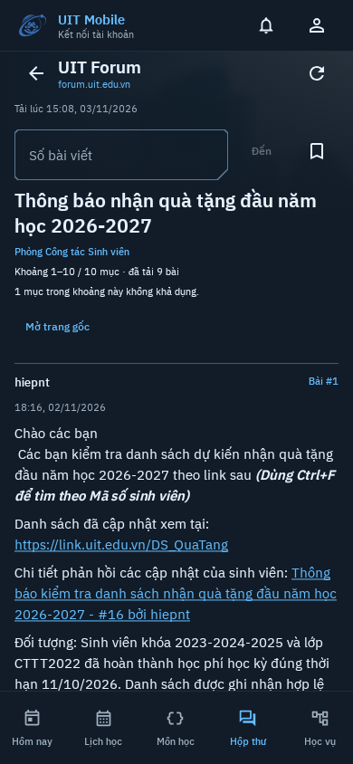
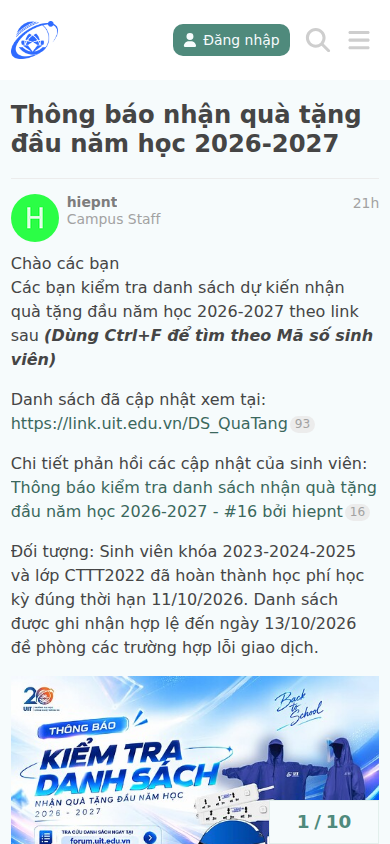

# UIT Forum / Discourse parity audit — 2026-11-03

**Verdict: not equivalent to the student-facing Discourse experience.** The app
has a working native reader and a partial participation client. It is not yet a
replacement for UIT's mobile Forum website. Keep PR #79 draft under its full-parity
scope. A feature name such as “chat”, “polls” or “account synchronization” must not
be interpreted as completion of the corresponding Discourse workflow.

Audited application commit: `5c907fdb4a91f421516046d4fc56018c7780a129`.
Live UIT still advertises Discourse `2026.10.0-latest`, upstream revision
`b81bee142d364526b432788251986871952b5ddb`. This is a self-audit with executable
counterexamples, not an independent third-party review or a security certification.

## Method and evidence

- Read the production domain, parser, transport, repository, ViewModel and Compose
  implementation; compared contracts with the locally pinned upstream checkout.
- Reopened the actual UIT announcement at a 390 × 844 mobile browser viewport in
  a new anonymous context. Blocked all non-read browser requests; two requests
  were blocked. No owner-account login or account action was performed this audit.
- Reran the opt-in production anonymous Compose/live-network scenario successfully.
  Compared the same public announcement with the website. These are separate
  captures about two minutes apart, not an atomic snapshot.
- Ran **five diagnostic probes**: three Compose/ViewModel and two network/parser
  probes. All reproduced the asserted deficient behavior. They are NOT five
  successful parity acceptance tests. No probe exports screenshots or uses UIT.
- Checked baseline PR CI: `verify` and `sign-in-smoke` passed. The latter runs
  Android instrumentation, including guest Forum fixture/cache/Keystore behavior
  and public SSO-page checks; it does not establish native Forum account parity.

[Diagnostic source and results](evidence/forum-parity-audit-2026-11-03/README.md)
and [visual provenance](evidence/forum-parity-audit-2026-11-03/visual-provenance.json)
make the observations reproducible. Existing owner-account login/read evidence
and local mutation acceptance are useful, but were not repeated as production
writes. No claim below relies on synthetic screenshot content.

## Concrete defects in implemented flows

P1 means a high-impact task/data-loss defect that blocks acceptance of the
corresponding flow. P2 means a material correctness or usability defect. These
priorities are review judgments, not CVSS/security scores.

| ID | Priority / confidence | Finding and user consequence | Evidence and required acceptance |
| --- | --- | --- | --- |
| A01 | P1, reproduced | **Unsaved post text is lost.** The composer keeps raw/title/category/reason only in `remember`; saved-state restoration resets the editor. Cancel dismisses and loses text without draft recovery or discard confirmation. | Two Compose probes reproduce restoration and dismissal loss. [Composer state](https://github.com/trungdangtapcode/UIT-Mobile-kt/blob/5c907fdb4a91f421516046d4fc56018c7780a129/feature/forum/src/main/kotlin/vn/edu/uit/mobile/forum/ForumAccountUi.kt#L82), [dismissal](https://github.com/trungdangtapcode/UIT-Mobile-kt/blob/5c907fdb4a91f421516046d4fc56018c7780a129/feature/forum/src/main/kotlin/vn/edu/uit/mobile/forum/ForumViewModel.kt#L543). Require account-bound draft recovery, discard handling and actual Activity/process lifecycle tests. The probe simulates saved-state restoration, not physical-device rotation. |
| A02 | P1, reproduced | **Older chat history becomes unreachable at 500 loaded messages.** The next older page is fetched but removed by `takeLast(500)`; unchanged list size then sets `more=false` despite the server reporting more history. | A 600-message fixture ends with IDs 101–600; the returned page 51–100 disappears and Older messages vanishes. [Merge/continuation logic](https://github.com/trungdangtapcode/UIT-Mobile-kt/blob/5c907fdb4a91f421516046d4fc56018c7780a129/feature/forum/src/main/kotlin/vn/edu/uit/mobile/forum/ForumViewModel.kt#L501). Require directional window eviction, independent cursors and navigation back to newer messages. |
| A03 | P2, reproduced | **A valid multiple-choice poll can behave like single-choice.** Missing `max` becomes 1; the vote button is disabled for two selected choices even when the web allows all three. Explicit minimum 0 is also coerced to 1. | Parser probe supplies three options without `max` and observes `max=1`. [Native bounds](https://github.com/trungdangtapcode/UIT-Mobile-kt/blob/5c907fdb4a91f421516046d4fc56018c7780a129/core/network/forum/src/main/kotlin/vn/edu/uit/mobile/forum/network/ForumParser.kt#L112) differ from upstream [poll-bounds.js](https://github.com/discourse/discourse/blob/b81bee142d364526b432788251986871952b5ddb/plugins/poll/assets/javascripts/lib/poll-bounds.js), which defaults the maximum to option count. Require absent/null/zero/string-bound tests and local-server validation. This is a supported upstream case, not a claim that a particular UIT poll was voted on. |
| A04 | P2, reproduced | **Saved chat messages disappear from Forum bookmarks.** Every bookmark without positive `topic_id` is filtered out, so a legitimate chat-only bookmark list appears empty. | Probe uses a `Chat::Message` bookmark with `bookmarkable_url` and no topic ID. [Filter](https://github.com/trungdangtapcode/UIT-Mobile-kt/blob/5c907fdb4a91f421516046d4fc56018c7780a129/core/network/forum/src/main/kotlin/vn/edu/uit/mobile/forum/network/ForumMemberApi.kt#L31); upstream [chat bookmark serializer](https://github.com/discourse/discourse/blob/b81bee142d364526b432788251986871952b5ddb/plugins/chat/app/serializers/chat/user_message_bookmark_serializer.rb). Require a typed bookmark target, appropriate native navigation and visible unsupported targets rather than silent removal. This does not assert the owner's account currently contains such bookmarks. |
| A05 | P2, source-confirmed | **Polls are not integrated at their source position.** The parser retains cooked poll content; the reader renders all body blocks and then appends native poll controls in the post actions. Cooked options can therefore be duplicated and the controls moved away from their question. The heading uses technical `name` rather than the serialized poll title. | [Body then actions](https://github.com/trungdangtapcode/UIT-Mobile-kt/blob/5c907fdb4a91f421516046d4fc56018c7780a129/feature/forum/src/main/kotlin/vn/edu/uit/mobile/forum/ForumScreen.kt#L313), [poll UI](https://github.com/trungdangtapcode/UIT-Mobile-kt/blob/5c907fdb4a91f421516046d4fc56018c7780a129/feature/forum/src/main/kotlin/vn/edu/uit/mobile/forum/ForumAccountUi.kt#L158). Require typed in-place plugin blocks, multiple-poll ordering and guest/member rendering comparisons. Duplication is conditional on cooked markup, not asserted for every poll. |
| A06 | P2, source-confirmed | **Chat history lacks chat-style scroll behavior.** Messages are sorted ascending, but the list has no explicit latest-message or post-send scroll policy. Opening a full latest batch starts at its earliest loaded message; a sent message may be below the viewport. | [Member list](https://github.com/trungdangtapcode/UIT-Mobile-kt/blob/5c907fdb4a91f421516046d4fc56018c7780a129/feature/forum/src/main/kotlin/vn/edu/uit/mobile/forum/ForumMemberUi.kt#L73), [sort](https://github.com/trungdangtapcode/UIT-Mobile-kt/blob/5c907fdb4a91f421516046d4fc56018c7780a129/feature/forum/src/main/kotlin/vn/edu/uit/mobile/forum/ForumViewModel.kt#L501). Require initial positioning, a new-message affordance, send visibility and anchor tests with long batches; no device-level timing claim is made here. |

A01–A04 are four distinct defect groups established by five executable probes.
A05–A06 are implementation-path findings; they are not presented as live UIT
interaction reproductions. The diagnostic sources intentionally assert the bad
baseline outcome and are archived outside normal test source sets.

## Workflow equivalence, beyond those bugs

| Area | What actually works | Why it is still partial |
| --- | --- | --- |
| Login/session | Same university credentials, independent Forum cookies, identity validation, encrypted production credential storage and local disconnect | No remote session revocation; native account Keystore/lifecycle acceptance on Android remains. Shared credentials are not a shared Portal/Moodle session. |
| Topic discovery | Latest/categories, advertised sorts/Top periods, tags, submitted search and numbered jumps | No equivalent timeline/date navigation, full topic metadata/user cards, multi-tag/category combinations or complete deep-link behavior. |
| Post content/history | Semantic text, nested content, image-original viewer and permitted revision reading | Media playback, gallery/secure/CDN delivery, advanced tables, legacy content and full plugin semantics remain incomplete. Browser handoff is not native coverage. |
| Writing/editing | Basic raw Markdown creation/reply and original-text edit conflict | A01; no preview, attachments/upload progress, durable/server drafts, mention/quote assistance or full category/tag rules. Categories requiring tags cannot be satisfied by the current composer. Actual UIT applicability of every category rule is unverified. |
| Account state | Server bookmark/notification reads, basic bookmark actions and server last-read resume | **Not bidirectional synchronization:** normal app browsing sends no reading timings, notification-read actions or tracking changes. Reading here does not update other devices' unread state. Reminders/preferences and many notification targets are absent. |
| Reactions/polls | Basic explicit like/reaction requests and regular/multiple voting | A03–A05; no full voter/result/group/automatic-close behavior, advanced poll types or poll builder. Per-resource/plugin eligibility needs broader coverage. |
| Chat | Existing joined channels/DMs and existing threads, history reads and explicit sends | A02/A06; no realtime updates, unread/typing indicators, new DM/thread creation, thread directory, chat search, edits/deletes, channel management or full notification integration. It is a manually refreshed history/send interface. |
| Other student features | Some private-topic content can be read when returned and permitted | No native PM creation/invitations, complete profiles/groups/badges, preferences, flags, topic tracking, Solved or topic-voting workflows. |

The read-only university-account research constraint is correct. It should be
implemented as a test transport/account policy, not mistaken for completion of
normal cross-device synchronization. Tracking/write behavior must be developed
and tested in the isolated environment without changing the owner's UIT account.

## Actual mobile comparison

| Current native app | Actual UIT mobile website |
| --- | --- |
|  |  |

Both display the same actual announcement. Native title, core paragraph text,
inline emphasis and links are recognizable; this is not a fake content issue.
The requested UIT dark theme and cut corners are intentional and are **not**
penalized for differing from the website's light theme.

The interaction hierarchy is materially different: the native initial viewport
spends substantial space on retrieval time, a permanent number-jump field,
window/body counts, missing-entry diagnostics and a browser action. The first
paragraph starts roughly 220 pixels lower in these captures. The website leads
with the conversation, avatar/staff identity and an unobtrusive bottom progress
control; native author identity is plain text and its image requires a separate
load action. Move reading/navigation diagnostics into secondary controls and
verify continuous reading before calling the experience equivalent. A custom
mobile layout is acceptable; losing conversation context and common actions is not.

This pair does not prove visual parity for authenticated chat, polls, composing,
large text, 360/412dp or TalkBack. Empty login/composer screenshots from the previous
increment cannot establish those interactions either.

## What the passing checks establish

The existing 37 network, 15 ViewModel, 4 account-isolation and 4 account Compose
tests provide useful coverage of their selected cases. The local production-client
suite establishes basic upstream mutation round trips. Prior real-account checks
establish native login and read-only lists. The current audit also reran real
anonymous reading successfully. None of these covers the counterexamples above.

The CI emulator test for Forum uses guest fixtures and encrypted guest storage.
The real Forum account test uses Robolectric and memory storage. These are
complementary, but must not be combined into a claim of verified real-account
Android Keystore/session behavior or full web fidelity.

## Acceptance order

1. Fix A01–A04 with desired-behavior regression tests: draft recovery, directional
   chat paging, upstream poll bounds, typed bookmark targets.
2. Fix source-position poll rendering and chat navigation; compare realistic
   content and long-history states, not empty forms or one-message fixtures.
3. Complete composing/media and account-state workflows, with separate read-only
   research guards and isolated mutation tests. Add category/tag and permission
   variation, expiry, conflicts and uncertain outcomes.
4. Complete chat and enabled UIT plugins against the parity matrix; add live-event
   reconnect/deduplication, lifecycle and accessibility acceptance.
5. Verify actual native account storage/session recovery on Android and compare
   the same authorized mobile-web states. Keep private captures private.

Do not assign a percentage from endpoint counts or screenshot counts. The
[46-row matrix](UIT-FORUM-PARITY.md) remains the coverage inventory, not 46 equally
weighted tasks or a denominator for an invented completion score.

Reference behavior: [Discourse user guide](https://meta.discourse.org/t/understanding-discourse-for-new-users/96331),
[chat guide](https://meta.discourse.org/t/exploring-features-in-discourse-chat/239695),
[poll guide](https://meta.discourse.org/t/creating-and-managing-polls/77548).
Upstream capability is not proof that every feature is enabled for every UIT user;
UIT-specific unknowns remain explicitly unverified.
