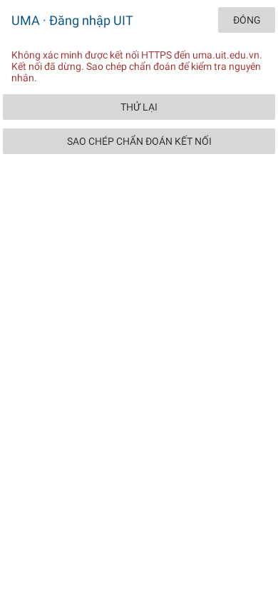

# UMA Android TLS investigation — 2026-11-15

## Observations before changing the trust policy

The owner reported that UMA sign-in stops at HTTPS certificate verification on an
Itel S23, while Chrome on that same phone/network opens UMA successfully. The app
had already bundled the verified public Sectigo E46 root for five exact UIT
hosts, but **UMA was missing from that domain configuration**. Its login WebView
and native HTTP client consequently used system trust alone for UMA.

This is a confirmed configuration omission. The screenshot alone does not reveal
whether the phone reported UNTRUSTED, a date error or another SSL condition. It is
not sufficient evidence to blame the phone clock, tell the owner to reinstall
WebView, or promise a physical-device fix without retesting.

Primary-source research explains why Chrome is not a substitute for app testing:
[Chromium's build configuration](https://chromium.googlesource.com/chromium/src/+/main/net/features.gni)
selects the Android certificate verifier for WebView, while
[Chrome's verifier/root-store documentation](https://chromium.googlesource.com/chromium/src/+/main/net/data/ssl/chrome_root_store/faq.md)
describes its separate trust mechanism. AOSP's
[Android 13 certificate directory](https://android.googlesource.com/platform/system/ca-certificates/+/refs/tags/android-13.0.0_r1/files/)
contains USERTrust ECC, but not the E46 subject-hash file `3afde786.0`.

## Current server chain: do not confuse it with a missing-chain replay

Both observed IPv4 addresses (`118.69.123.140`, `45.122.249.78`) presented the same
wildcard leaf and **three** certificates during this investigation:

1. `*.uit.edu.vn`, issued by Sectigo DV E36. Valid 2026-07-07 to 2027-01-21.
2. Sectigo Public Server Authentication CA DV E36, issued by E46.
3. E46 cross-signed by USERTrust ECC, valid through 2038.

Leaf SHA-256:
`467a65d5fde980a8e879bffed11d89275cfc88df0ef4799548deef2d338fe711`.
The same leaf was observed on UMA, SSO, Portal and Moodle. Both IPs validated on
the Linux host with a USERTrust-only trust anchor; TLS 1.2 also sent the cross-sign.
Therefore, **the current server observations do not show an omitted cross-sign**.
The older October observation in AUTHENTICATION.md is historical, not a claim
about the chain served on November 15 or the owner's particular handshake.

The existing bundled E46 root matches
[Sectigo's published certificate directory](https://www.sectigo.com/knowledge-base/detail/Sectigo-Public-Intermediates-and-Roots),
with SHA-256:
`c90f26f0fb1b4018b22227519b5ca2b53e2ca5b3be5cf18efe1bef47380c5383`.
It is a public root, not the university leaf and not a private signing key.

Using the actual captured leaf/intermediate, OpenSSL produced this matrix:

| Trust anchor | Current complete chain | Deliberately omit cross-sign |
| --- | --- | --- |
| USERTrust ECC only | Accepted | Rejected |
| Bundled E46 | Accepted | Accepted |

The missing-chain column is a controlled compatibility case, **not an assertion
that the current endpoint sent an incomplete chain**. A wrong-hostname verification
with the same captured certificates was rejected. Neither Linux validation nor
this matrix establishes that a particular Android WebView completed sign-in.

## Fix and boundaries

Add `uma.uit.edu.vn` to the existing exact-host Android Network Security
Configuration. Keep system roots, the independently verified E46 root, explicit
`includeSubdomains=false`, and the unchanged system-only base configuration.
No new trust material is downloaded at runtime, no wildcard UIT trust domain is
introduced, and user-installed roots/cleartext are not enabled. Android still
checks certificate signatures, validity and hostname. Both SSL handlers cancel
invalid connections; no `proceed()` bypass or permissive TrustManager is added.
See [Android's configuration contract](https://developer.android.com/privacy-and-security/security-config)
and [WebView's SSL callback contract](https://developer.android.com/reference/android/webkit/WebViewClient#onReceivedSslError(android.webkit.WebView,%20android.webkit.SslErrorHandler,%20android.net.http.SslError)).

UMA's error dialog also gains an explicit Copy connection diagnostics action.
The report contains only the allowlisted host, SSL error categories, Android API,
WebView/app version, device UTC, certificate validity and public certificate
fingerprint. URL paths/query strings, callback codes, sessions, cookies, passwords
and student identity are excluded. Retry hides and clears the old copy action.
The Vietnamese error message stops implying that updating WebView or changing the
phone clock is a proven solution. The native layout remains the existing sign-in
error panel with Retry, Copy and Close.

## Verification and limits

- Before the XML change, the updated exact-host regression test failed because
  UMA was absent. The existing published-root fingerprint test passed.
- After the change: both TLS configuration tests, five UMA login tests and nine
  existing SSO tests passed. SSL cancellation and privacy of copied diagnostics
  are covered, including a callback URL containing private-looking parameters.
- A separate host render used the actual public leaf certificate and a controlled
  UNTRUSTED error. The copied fingerprint matched its DER SHA-256. This checks
  error rendering/reporting, not live Android WebView certificate verification.
- Preview APK and instrumentation APK builds passed locally. No GitHub Actions
  were requested, and no university credentials or account mutations were used.
- A fresh Android 11 software emulator was attempted because this rootless server
  cannot access `/dev/kvm`. Framework startup/watchdog instability prevented a
  completed native WebView acceptance result at the time of this record. The
  opt-in `UmaTlsDeviceTest` is compiled; it must not be described as passed until
  actual instrumentation output exists. It separately checks an intentionally
  truncated chain through the Android trust manager and the production UMA login
  controller against the current public website, without entering credentials.
- The owner's Itel handshake still needs confirmation using the updated preview.
  If it fails, copy the new diagnostics: they distinguish actual trust, validity,
  hostname and certificate differences without requesting university secrets.

### Opt-in native probe on a working Android test device

Use an unconfigured test install on API 29+, with the E46 root absent from its
system store. Capture the current public leaf and DV intermediate into
`leaf.crt` / `intermediate.crt`; do not substitute credentials or modify the device
CA store. Install the matching preview and its instrumentation APK, then:

```sh
adb shell run-as vn.edu.uit.mobile.preview mkdir -p files/uma-tls
adb shell 'run-as vn.edu.uit.mobile.preview sh -c "cat > files/uma-tls/leaf.crt"' < leaf.crt
adb shell 'run-as vn.edu.uit.mobile.preview sh -c "cat > files/uma-tls/intermediate.crt"' < intermediate.crt
adb shell am instrument -w -r \
  -e class vn.edu.uit.mobile.UmaTlsDeviceTest \
  -e umaTlsProbe true -e umaTlsExpected compatible \
  vn.edu.uit.mobile.preview.test/androidx.test.runner.AndroidJUnitRunner
```

`umaTlsExpected=baseline` is for the preserved preview .1 APK, not a way to skip
verification of the fixed app. The report and screenshot are written beneath the
test app's `files/uma-tls`. No form is submitted and no university account is used.
Check both the JSON and instrumentation result before publishing an acceptance
claim. If the test device's system store already contains E46, this particular
legacy-store experiment is inapplicable.

### Reviewed error-state UI

The image below is a synchronous draw of the production native dialog under
Robolectric at 390dp, Vietnamese. The UNTRUSTED condition is deliberately supplied
by the test, using the captured public UMA certificate. It is **not** a live
Android handshake screenshot. The test also verifies that the visible Copy action
copies that certificate's exact fingerprint and excludes callback parameters.


